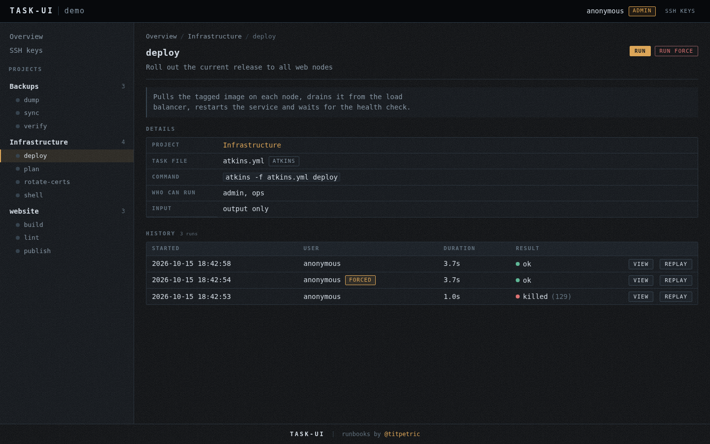
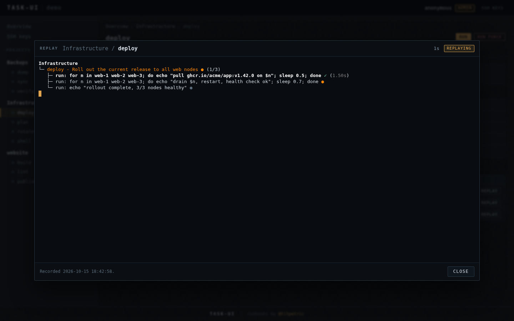
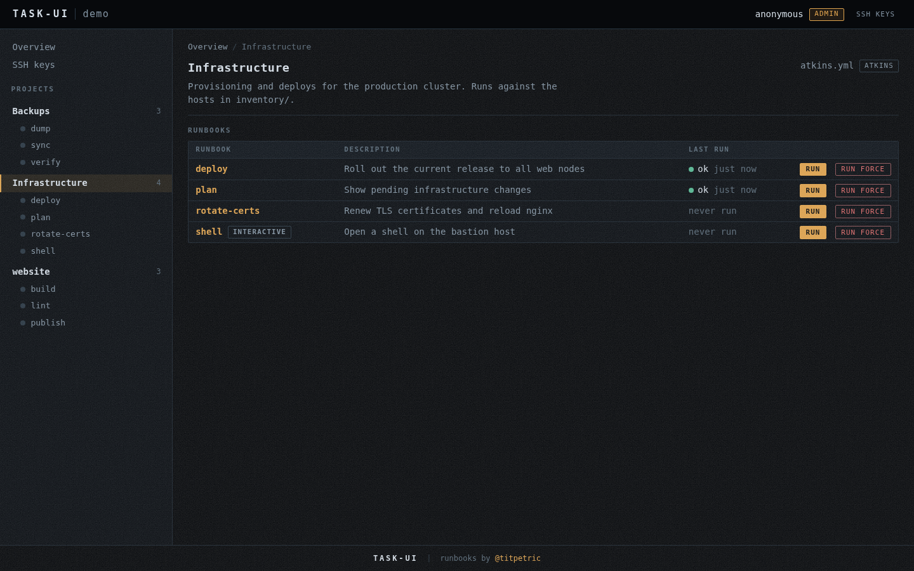
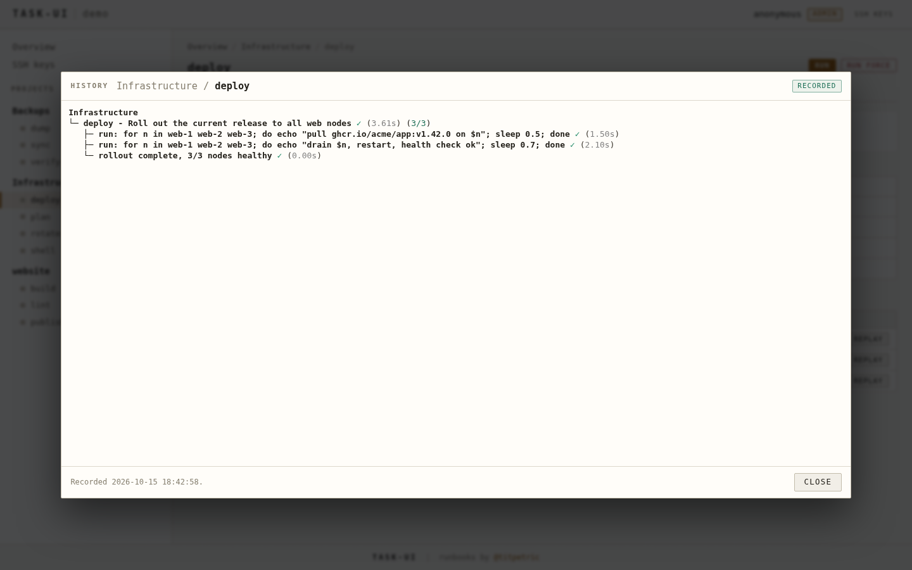
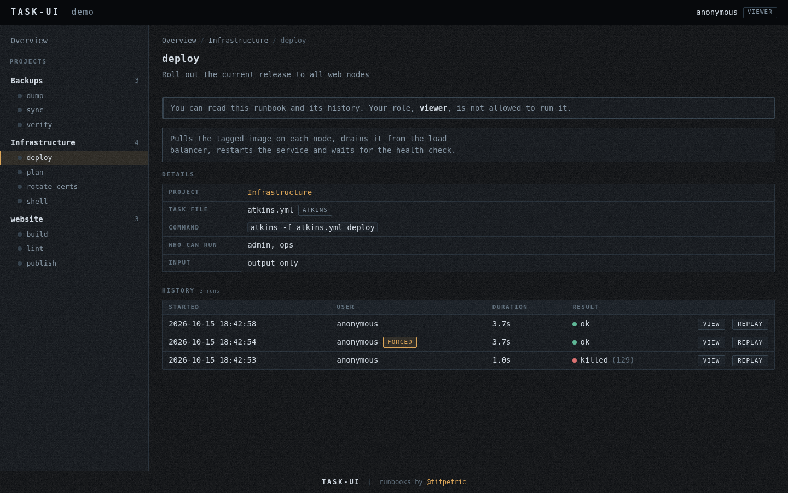
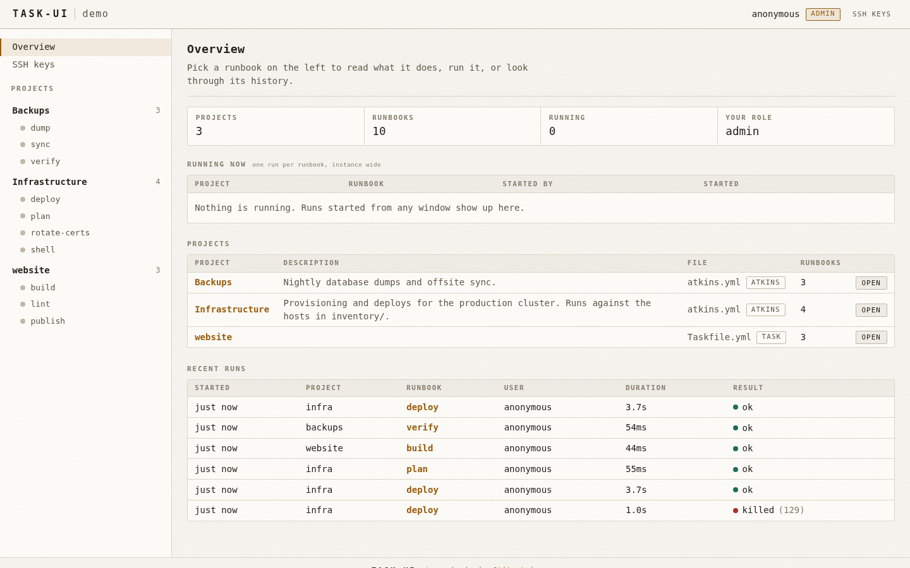

# Task UI

Run your runbooks from the browser. Task UI reads `atkins.yml` and
`Taskfile.yml` files, lists every project and its runbooks, and runs them
in a terminal window over a websocket.


- **Projects and runbooks.** Each folder under the root with a task file is
  a project, each described task is a runbook.
- **Run in a window.** Run opens a modal terminal. Closing the window stops
  the run.
- **One run per runbook.** A runbook runs once at a time across the instance,
  different runbooks run side by side. Run force stops the active run and
  starts again.
- **Users and roles.** A login screen, and three roles: `admin`, `runner` and
  `viewer`. Viewers read runbooks and history and run nothing.
- **History.** Every run is recorded with who ran it, how it ended and the
  full terminal output, with view and replay.
- **SSH keys.** Admins generate, rotate or upload the instance key pair the
  runbooks use to reach other hosts.

The look follows [oida](https://github.com/titpetric/oida): monospace,
hairlines, one amber accent, dark and light from `prefers-color-scheme`. All
assets are embedded, the front end makes no external requests.

# Running

Start the Docker image with `task docker:run`, or use the compose setup:

```yaml
services:
  runner:
    image: titpetric/task-ui
    restart: always
    environment:
      TASK_UI_SECRET: change-me
    ports:
    - 3000:3000
    volumes:
    - $PWD/app:/app
    - $PWD/root/.ssh:/root/.ssh
    - /var/run/docker.sock:/var/run/docker.sock:ro
```

Mount your projects at `/app`. Each subfolder with an `atkins.yml` or
`Taskfile.yml` becomes a project, and a task file in `/app` itself is a
project too. The image bundles `task`, `atkins`, `docker` and
`docker compose`.

- If you don't want to use Docker, remove the volume for `docker.sock`.
- Mount `/root/.ssh` to keep the SSH keys managed from the UI.

## Configuration

Everything is configured from the environment:

| Variable               | Default            | Meaning                                                            |
|------------------------|--------------------|--------------------------------------------------------------------|
| `TASK_UI_LISTEN`       | `:3000`            | Listen address                                                     |
| `TASK_UI_ROOT`         | `.`                | Folder holding the projects                                        |
| `TASK_UI_FILE`         |                    | Serve one task file as the only project                            |
| `TASK_UI_DISCOVER`     | `true`             | List every folder under the root with a task file                  |
| `TASK_UI_CONFIG`       | `task-ui.yml`      | Users and project overrides, looked up in the root                 |
| `TASK_UI_TITLE`        |                    | Instance name in the header                                        |
| `TASK_UI_HISTORY`      | `true`             | Record runs                                                        |
| `TASK_UI_HISTORY_PATH` | `history`          | Recordings folder                                                  |
| `TASK_UI_SSH_DIR`      | `$HOME/.ssh`       | Folder the SSH key admin manages                                   |
| `TASK_UI_SECRET`       | random per process | Signs the session cookie, set it to keep sessions over restarts    |
| `TASK_UI_SESSION_TTL`  | `12h`              | Session lifetime                                                   |
| `TASK_UI_ANONYMOUS`    | `admin`            | Role of visitors when no users exist: admin, runner, viewer, none  |
| `TASK_UI_ASSETS`       |                    | Serve templates and static files from this folder, for development |

The flags `-l`, `-f`, `--root`, `--config`, `--history-enable` and
`--history-output` override the matching variables.

## Users and roles

Users live in `task-ui.yml` next to the projects. The file is re-read when
it changes, so adding or removing a user needs no restart. With no users,
every visitor gets the `TASK_UI_ANONYMOUS` role and there is no login.

```yaml
title: production
users:
  - name: admin
    password: $2a$10$...   # task-ui hash <password>
    role: admin
  - name: ops
    password: $2a$10$...
    role: runner
    projects: [infra]      # optional, limits the visible projects
  - name: support
    password: $2a$10$...
    role: viewer
```

| Role     | Read runbooks and history | Run, Run force, Kill        | SSH keys |
|----------|---------------------------|-----------------------------|----------|
| `admin`  | yes                       | everything                  | yes      |
| `runner` | yes                       | what the allow lists permit | no       |
| `viewer` | yes                       | no                          | no       |

Generate a password hash with `task-ui hash <password>`, or
`echo secret | task-ui hash`.

## Task files

Task UI reads atkins pipelines and Taskfiles alike: `tasks:` or `jobs:`,
`desc`, `summary`, `aliases`, `interactive` and `internal`, plus the atkins
`name:` and `help:` for the project title and description, and the short
forms `job: command` and `job: [commands]`. Runbooks are tasks with a
description; `internal: true` or `show: false` hides one.

An optional `ui:` section and per task `allow:` lists control who may run
what. Atkins and Task ignore both:

```yaml
name: Infrastructure
help: Provisioning and deploys for the production cluster.

ui:
  allow: [ops]          # users or roles that may run this project's runbooks

jobs:
  deploy:
    desc: "Roll out the current release"
    steps:
      - run: ./deploy.sh
  rotate-certs:
    desc: "Renew TLS certificates"
    allow: [admin]      # narrows the project list for this runbook
    steps:
      - run: ./certs.sh
```

Atkins files run with `atkins -f <file> <runbook>`, Taskfiles with
`task -t <file> <runbook>`. Set `ui.command`, or `command` on a project in
`task-ui.yml`, to run something else. Runbooks get `TASK_UI_USER`,
`TASK_UI_PROJECT`, `TASK_UI_RUNBOOK` and `TASK_UI_RUN_ID` in the environment.

## Screenshots

| | |
|-|-|
|  |  |
|  |  |
|  |  |
|  |  |

`scripts/demo.sh` regenerates them: it serves `testdata/demo`, records real
runs over the websocket with `scripts/run.sh`, and captures each view with
headless chromium through `scripts/chromium.sh`. A recorded run opens in the
dialog from a link: `/p/<project>/<runbook>#history=<id>`, or `#replay=<id>`.

# Development

task: Available tasks for this project:

* default:            Run everything
* fix:                Fix code
* install:            Install task-ui
* run:                Run task-ui over the demo projects
* test:               Test task-ui
* docker:build:       Build task-ui docker image
* docker:gen:         Generate ssh key for docker image
* docker:run:         Run task-ui in docker env
* docs:shots:         Regenerate the README screenshots

## task: default

Run everything

commands:
- `Task: fix`
- `Task: install`
- `Task: test`

## task: test

Test task-ui

commands:
- `CGO_ENABLED=1 go test -race -count=1 -cover ./...`
- `CGO_ENABLED=0 go test -count=1 -cover ./...`

## task: run

Run task-ui over the demo projects

commands:
- `go run .`

## task: docs:shots

Regenerate the README screenshots

commands:
- `scripts/demo.sh`

## task: install

Install task-ui

commands:
- `CGO_ENABLED=0 go install .`

## task: fix

Fix code

dependencies:
- `deps:goimports`

commands:
- `goimports -w .`
- `go fmt ./...`
- `go vet .`
- `go mod tidy`
- `./README.md.sh > README.md`

