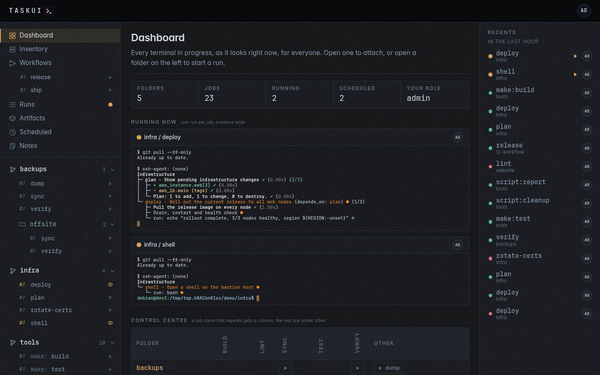

# Using task-ui

task-ui runs what your source trees declare, and lets everyone watch it
run. This guide walks through the screen the way the sidebar lists it:
the whole first, then one chapter per section, top to bottom.

## The screen

The page has three parts.

- **The header.** The name goes home to the dashboard. With Allow Edits
  on Prompts, `prompt/edit`, a prompt field follows it: Enter asks Claude
  about the page you are on, and the logo opens and closes the panel with
  Claude's reply (see [the prompt](guide/projects.md#prompt)); without it,
  the logo goes home too. Your initials, on the right, open the user
  menu: who you are, your role, **Profile**, with your activity,
  folders, permissions and MCP access, **SSH keys**, **Settings** with
  the view permission of any of its sections, and **Logout**. On a phone
  a menu button on the left opens the sidebar as a drawer.
- **The sidebar.** Everything you can open, in a fixed order:
  1. the views across all folders: **Dashboard**, **Inventory**,
     **Workflows** (with the workflows listed under it), **Runs**,
     **Artifacts**, **Scheduled** and **Notes**;
  2. the **projects**, each with its jobs and the folders inside it, as
     a tree: first those at the top of the root, in the default
     workspace `_`, then each named **workspace**, in its order, with
     the projects cloned inside it folded under its own row.
- **Recents**, on a wide screen, a rail on the right: the latest runs and
  workflow runs by anyone. A narrower screen leaves it out; **Runs** lists
  the same runs.
- **The page.** What you opened in the sidebar. A run you start or attach
  to opens in a **window** over the page: a terminal on the run, which
  you close without ending the run.

Three ideas carry the rest of the guide.

- **A job** is a target a folder declares: an atkins or Taskfile job, a
  Makefile target, a package script, a file under `scripts/`. task-ui
  reads the files and lists what they declare; task-ui itself never
  edits them, though a job or a Claude run may change files when asked.
- **A run** is a job running on the server, on a terminal of its own. It
  belongs to no window: anyone allowed attaches to it, and it goes on when
  you close every window. One job runs once at a time across the
  instance; different jobs run side by side, and so do the prompts to
  Claude, as many at once as the machine has CPUs, the rest waiting
  queued in order. A terminal takes no turn.
- **A role** decides what you can do, with each user's own policy on
  top. Viewers watch and read history, runners start the jobs the allow
  lists let them, and admins may do everything; what each role may do is
  in [Settings, Permissions](guide/settings.md#permissions).

Every list marks a job, a workflow or a run with `#!`: faint
until it has run, then in the colour of how it last ended, green for ok
and red for failed or killed, and pulsing amber while it runs.

## Chapters

| Chapter                              | The sidebar section                    | What it covers                                              |
|--------------------------------------|----------------------------------------|-------------------------------------------------------------|
| [Dashboard](guide/dashboard.md)      | Dashboard                              | The terminals running now, and the control centre           |
| [Inventory](guide/inventory.md)      | Inventory                              | The hosts Beszel monitors, and commands run on them at once |
| [Workflows](guide/workflows.md)      | Workflows, and the list under it       | Chains of jobs, run with one button                         |
| [Runs](guide/runs.md)                | Runs                                   | The run window, the history, a run's page and its output    |
| [Artifacts](guide/artifacts.md)      | Artifacts                              | Files the runs leave behind                                 |
| [Scheduled](guide/scheduled.md)      | Scheduled                              | Jobs on a cron expression                                   |
| [Notes](guide/notes.md)              | Notes                                  | Messages, replies, and instructions to the agent            |
| [Projects and jobs](guide/projects.md) | The tree of projects, folders, jobs  | Folders, the conventions, files, the actions bar, Enter Shell, the prompt, a job's page, moving a project, pulls, keys, hours |
| [Workspaces](guide/workspaces.md)    | A workspace's row, its projects under it | Shared tooling, skills, cloning into one, keys, secrets, export and import, what it keeps apart, the prompt |
| [Recents](guide/recents.md)          | Recents                                | The latest runs, by anyone                                  |
| [Settings](guide/settings.md)        | The user menu, Settings                | Projects, workspaces, users, secrets, SSH keys, integrations, env files |
| [MCP](guide/mcp.md)                  |                                        | Tokens, and the tools an agent runs jobs with               |
| [Screenshots](screenshots.md)        |                                        | Every view, in both themes and on a phone                   |

Beside the guide:

- [Running the server](running.md): the Docker image, the environment
  variables, the password file and the server commands;
- [API](api.md): the JSON endpoints and the MCP server;
- [Development](development.md): the packages, the lint and test bar, and
  the screenshots;
- [Testing](testing.md): the unit tests of the default run and the
  integration tests behind a build tag.
