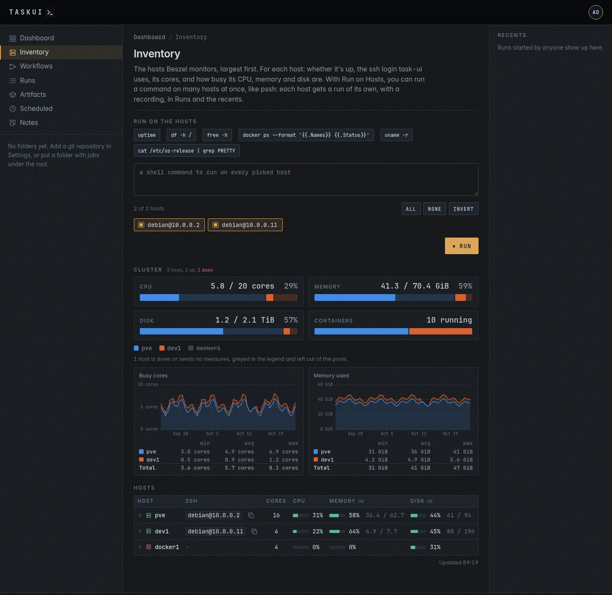
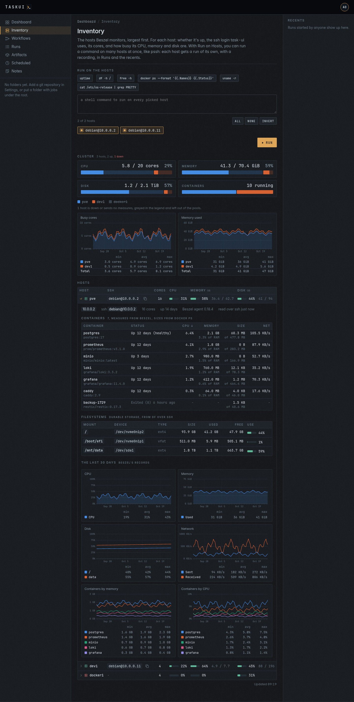

# Inventory

The hosts Beszel monitors, inline in task-ui, the largest first by cores, then RAM: whether each is up, its icon green when up and red otherwise, who task-ui signs in to it as over ssh, its cores, how busy its CPU is, and how full its memory and disk are, with what it uses of each and the size, in GB. A share turns amber past 75% and red past 90%. A host whose agent sends no core count shows its threads.

## The cluster

Over the hosts table, the cluster sums the hosts into pools, one a resource: **CPU**, the cores and how many of them are busy, **Memory**, **Disk** and the running **Containers**, each with its sum, used of total, and its share used. A pool is a bar of a segment a host, as wide as the host's share of the whole, the used part in the host's colour and the free part a wash of it; a hover names the host and its part. A host keeps its colour in every pool and in the legend under them.

The pools count the hosts that are up and report their measures; a host that is down, or sends none, counts in the hosts over the pools and shows struck through in the legend. The disk of a host is its durable filesystems (see [The expanded row](#the-expanded-row)) once task-ui read them over ssh, Beszel's root disk and the extra filesystems its agent watches before that. For a user with `hosts`, a view reads again, over ssh, the filesystems of a host whose filesystems task-ui read more than five minutes ago, in the background, for the next view.

The SSH column is the first of `debian@` and `root@` that signs in to the host with the instance keys, without a password; **Copy ssh**, in the row's **⋯** menu, copies the `ssh` command, and **Open the host's page** opens `/inventory/hosts/<name>`. task-ui tries every ten minutes, and a host it reaches slowly fills in on the next view.

## The expanded row

With `hosts`, a click on a host's line, or Enter or Space on it, opens its expanded row under it, and the next click folds it; the **⋯** menu and the other controls on the line do what they do and open nothing. The row is the host's page, `/inventory/hosts/<name>`, fetched when it opens and kept half a minute. The hosts you open stay open through the page's refresh and a reload, and `/inventory#host=<name>` opens one. Over the tables, the host's address, its ssh login, cores, uptime, Beszel agent and when task-ui last read it over ssh.

**Containers** lists the host's containers, the busiest first, by CPU then memory; a click on a header sorts by it, the next the other way. A row puts two sources together by the container's name:

- Beszel's measures: CPU in percent of the host, memory, with its share of the host's RAM, and the traffic in and out per second, from the hub's `containers` collection, the newest `container_stats` on a hub without one.
- docker's sizes: what the container wrote, its writable layer, of the whole with its image, from `docker ps --size` over the host's ssh login, through `sudo -n` when the login may not run docker, with the image and the status.

A cell one source leaves empty shows `-`, its hover saying why: no ssh login, docker that did not answer, or a container Beszel has no measures of, such as one that exited.

**Filesystems** lists the host's durable storage: mount point, device, type, size, used, free and how full. From `df` over the host's ssh login, it leaves out what holds nothing past a reboot or shows another filesystem again: tmpfs, devtmpfs, overlay, squashfs, efivarfs, proc, sysfs, cgroup, nsfs, autofs, fuse.lxcfs and the like, the mounts docker makes for containers, and of the mounts of one device, bind mounts among them, all but the shortest mount point. A host without an ssh login shows what Beszel watches: the root, `/`, and the extra filesystems of its agent, by the name the agent sets.

**The last 30 days** closes the row with charts of the host's month: CPU, memory used against its RAM, how full each disk Beszel watches is, the root and the extra ones, the traffic sent and received, and the five containers of the most memory on average and the five of the most CPU. Under the pools, the cluster's month: the busy cores and the memory used, a host on another in its colour of the pools, the top the sum.

The charts draw the way rrdtool draws: a line a series over a day axis with a dashed gridline each Monday, three or four gridlines in the chart's unit, an area under a lone line, and a gap where the records stop, such as the days a host is down, the line not drawn across it. Under each chart, a row a series of its least, mean and most, and the total of a stack. They read Beszel's records of eight hours, which the hub keeps 30 days, or of two hours on a hub younger than a record of eight; task-ui reads them at most every ten minutes.

task-ui reads a host over ssh at most every five minutes, in the background, and when a row opens waits for the host a short while; `docker ps --size` is slow on a host of many containers. A host with neither source says so.

## Running a command on the hosts

A user with the `hosts` permission, Run on Hosts, runs a shell command on the hosts at once, like pssh: pick the hosts, by default every one with an ssh login (**All**, **None** and **Invert** set them at once), write the command or take a quick one (`uptime`, `df -h /`, `free -h`, the containers, the kernel, the OS), and **Run**, or Ctrl+Enter.

Each host gets a run of its own, a run of `@host:<host>`, a built-in job of the root beside `@shell`, `@host:dev1` for the host `dev1`: it runs the command over the host's login, on a terminal, for at most two minutes; task-ui kills it past that. Pagers are off (`PAGER=cat`), so `systemctl status` and the like end on their own. A run of `@host:<host>` is a run like any other: it has a row, a recording, live output, a place in the recents and on [Runs](runs.md), where `job=@host:dev1` keeps the runs on `dev1` and `job=@host:*` those on every host, and its page, which names it by its job. Its target is the host, its args the command, so **Run again** runs the same command on the same host. A host without an ssh login gets a run that fails saying so. Who ran what on which host is the run history.

### Queued commands

A host runs one command at a time. A command for a host that still runs one waits, a **queued** run, in the batch and on [Runs](runs.md), and starts once the runs before it ended, in the order they came. At most ten wait for a host; past that, task-ui refuses the command and says so. **Stop** on a queued run takes it out of the queue. A queued run the instance restarted before it ran ends failed, saying so.

The colon keeps a job apart from a mention: `@host:dev1` in a [note](notes.md) names no user `host`. `POST /api/runs` starts `@host:<name>` with the command as its args, and `@host:*` on every host with an ssh login, a batch; the bare `@host` names no host, and the API refuses it.

The runs started together are a batch. The panel shows your last batch under the form, a row a host: the host, linked to its run's page, how the run ended and how long it took, **View** or **Attach**, and what it printed, both streams, in the colours a program prints on a terminal, scrolling inside the row. While a run of the batch runs, the panel follows it on its own; after a reload it shows the batch again. **In Runs** lists the batch at `/runs?batch=<id>`.

**Run and summarize** runs the command the same way, and after the last host finishes asks Claude about the batch, as you: a prompt thread about the batch's first run, "Summarize the runs on these hosts.", which Claude answers with every host's run and output in one or two short paragraphs, leading with what needs attention, and a table with a row a host. The thread shows under the panel and on the page of every run of the batch, where you can ask about the batch again. The button shows when the Claude Code integration has a token for you (see [Settings](settings.md#integrations)).

A [schedule](scheduled.md) or a [workflow](workflows.md) step runs `@host:<name>` or `@host:*` too, with the command as its args; `@host:*` starts a batch. Their job pickers list the host jobs under **Hosts** for a user with `hosts`, and nothing new for anyone else. A workflow step of `@host:*` ends ok when every host's run did. Both take the `hosts` permission of the user they run as. An agent on a [prompt](#prompts-on-the-hosts) reaches the hosts through the inventory in its context; the `@host:` jobs are for the commands to record and to schedule.

The logins sign in as `debian` or `root`, so the panel shows only with `hosts`, which no role but admin holds until [Settings, Permissions](settings.md#permissions) grants it. The page itself takes Allow View on Inventory, `inventory/view`, which the runner and viewer roles hold.

## Prompts on the hosts

A [prompt](projects.md#prompt) on a folder page sees the inventory. Its run gets the hosts in `TASK_UI_HOSTS`, a line a host in the order of the table: the name, the host, the user of its SSH column (empty for a host task-ui does not reach) and `up` or `down`, separated by tabs. Claude reads them with how to sign in, `ssh -o BatchMode=yes -o ConnectTimeout=10 -o StrictHostKeyChecking=accept-new user@host 'command'`, and the commands above as examples. It runs a question about every host on each in parallel, prefers read-only commands, changes nothing on a host unless the question calls for a change, and names the hosts it could not reach. A question for instance:

> list running containers on all hosts, check for any usage of php or frankenphp images

The ssh agent of the run holds the keys that sign in: the instance keys [Settings, Keys](settings.md#keys) links to your role or your name, and the SSH keys of the workspace its links let through. The SSH column comes from every instance SSH key, as a host command does, so a host there may still refuse a prompt whose run lacks the key that reaches it; link that key to the admin role, or to you, in Settings, Keys. When Beszel does not answer, the prompt runs all the same, and Claude reads that task-ui got no inventory. The notes agent, `@claude` on the Notes board, gets no inventory.

task-ui reads the hub at most once a minute, and the page fetches the hosts again each minute on its own, with the time of the fetch under the table as **Updated**. The page needs the Beszel integration: its URL and a token (see [Settings](settings.md#integrations)). Without one, the page says so.

---

Previous: [Dashboard](dashboard.md) · Next: [Workflows](workflows.md) · [Contents](../README.md)
