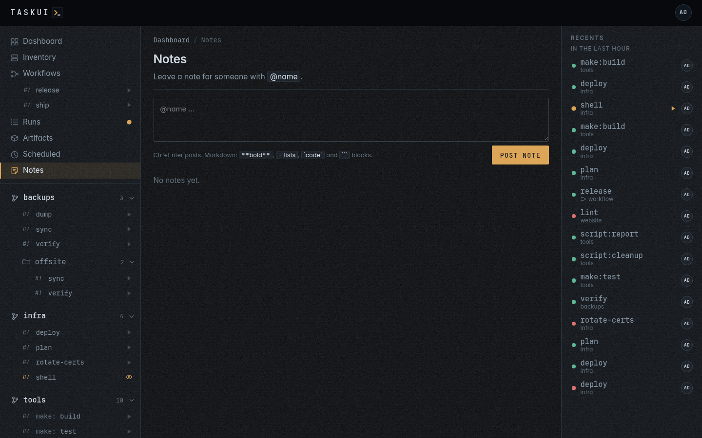

# Notes

A board of notes with replies, for the people on the instance and for the
agent. Name someone with `@name`: the note shows the name marked, and
`list_notes` over [MCP](mcp.md) finds it for that user.

Typing `@` in a note, a reply or an edit lists the users whose name
matches what follows, each with avatar and role: the arrow keys move,
Enter or Tab puts the name in, Esc closes the list. In the field and in
the posted note, the name of a user wears the colour of a link, and the
posted note links to their profile for whoever may open it.

A colon right after the name, with no space after it, makes a job ID
and no mention: `@host:dev1` and `@git:status` name no user `host` or
`git`, while `@ops: look at this` names `ops`.



## Instructions

A note naming another user of the instance, from someone who may run
jobs, is an instruction to whoever it names, and so is a reply that names
one: the reply opens its note again. A name of no user stays a plain
mention, and a note from a viewer stays a message. The note carries the
state on its left edge: **open**, **working**, then **done** or
**failed**.

The user a note names sets that state, and so do the note's author and an
admin; anyone who may post replies. A note may name any user. One with
**MCP agent user** on, such as `@consuela`, an agent on another machine,
picks the note up over [MCP](mcp.md#an-agent-elsewhere): an agent learns
of work from the notes that name it, and nowhere else. task-ui runs the
Notes agent itself only for a user with **Run instance Claude when
mentioned** on; a note naming anyone else waits for them, their agent or
the person.

## Instructions to the agent

A note naming a user with **Run instance Claude when mentioned**,
`@claude` on most instances, starts the Notes agent on it.

- task-ui starts `@claude-note`, the Notes agent in the root, as that
  user the moment the note or the reply appears, with the whole thread in
  its environment: `TASK_UI_NOTE`, every message of the thread under its
  author, `TASK_UI_NOTE_ID` and `TASK_UI_NOTE_AUTHOR`. The note links the
  run for the users who see it. The job writes its answer to the file `TASK_UI_NOTE_REPLY` names,
  and when the run ends, the agent replies with that answer alone, with a
  link to the run for the output. A job that writes no answer replies with
  how the run ended and the end of its output. Each instruction gets a
  run of its own, side by side with the runs of others.
- The agent may decline an instruction: its reply says why, and the note
  ends there.
- With the flag off, the note stays open until an agent reads the board
  over MCP, replies and closes it with `note_comment`, as any other user
  does.

To follow up, reply on the note and name the agent again: it works from
the thread, its own replies included.

A restart of task-ui fails a note working on a run of its own, as that run
ends with it. A note an agent elsewhere set working has no such run and
stays working.

To change what you asked, click the text of the note, or of your reply,
and edit it in place: **Save** or Ctrl+Enter puts it, Esc cancels. An
instruction runs again on the edited text, with the thread up to the
agent's answer to it, and that answer changes in place: its old text
stays, dimmed and marked `working`, until the new one lands. The thread
gets no new reply, and the run keeps its ID, so the run link opens the latest
attempt; the attempt before goes with its recording, summary and
artifacts. An edit while the run goes waits for it, then runs again. The
agent's own answers change only that way. A plain message just
changes; an edited note shows `edited` beside its time.

```sh
curl -s -X PUT https://task.example.com/api/notes/$ID \
  -H "Authorization: Bearer $TOKEN" \
  -d '{"body": "@claude update the weather job, and add Lisbon"}'
```

The author of a note, or an admin, edits it and deletes it with its replies, and the author of a reply, or an admin, deletes that reply alone. The form
posts with **Post note** or Ctrl+Enter; a reply opens under **Reply**.
A note and a reply are markdown: `**bold**`, `*italic*`, lists, headings,
links, quotes, tables, `` `code` `` and ```` ``` ```` blocks. A line break
stays a line break, and HTML shows escaped, as text. Messages from others
arrive the moment someone sends them.

## The agent

An admin makes a user an agent on the user's profile, under **Roles**:
**MCP agent user**, then **Run instance Claude when mentioned**, which
needs the first; `task-ui user agent <name> on` sets both (see [Running
the server](../running.md#users-and-roles)). The agent's user has to
exist in the password file, and its role decides what its runs may
reach. The Claude Code integration under [Settings](settings.md#integrations)
holds its token.

### The Claude jobs

The Claude jobs sit beside `@shell`, built into task-ui, as host
commands that run `task-ui agent`: `@claude-prompt` and `@claude` in
every folder, and `@claude-note` in the root, `_`, alone:

| Job              | Runs                         | What it does                                                                                     |
|------------------|------------------------------|--------------------------------------------------------------------------------------------------|
| `@claude-note`   | `task-ui agent note`         | The Notes agent: Claude Code on the thread in `TASK_UI_NOTE`, in the root; its answer goes to `TASK_UI_NOTE_REPLY` |
| `@claude-prompt` | `task-ui agent prompt`       | Claude Code on the thread in `TASK_UI_PROMPT`, in `TASK_UI_PROMPT_DIR`, or else the workspace's home `TASK_UI_HOME`, or else the workspace's directory `TASK_UI_WORKSPACE_DIR`; its answer goes to `TASK_UI_PROMPT_REPLY`. A prompt about a run gets the run and the end of its output in the file `TASK_UI_PROMPT_RUN` names, a workflow's prompt the steps of its run in `TASK_UI_PROMPT_WORKFLOW`, and **|> Summarize** the shape of the summary, or a schedule's triage its instruction, in `TASK_UI_PROMPT_INSTRUCTIONS`, which goes to the system prompt. With an inventory, `TASK_UI_HOSTS` lists its hosts and their logins |
| `@claude`        | `task-ui agent shell [args]` | Claude Code in a terminal in the folder, or a directory inside it, for an admin at the keyboard: **Enter Claude** |

Each signs in with `CLAUDE_CODE_OAUTH_TOKEN` from the Claude Code
integration and stops without it. Each reads, after Claude's own system
prompt, what task-ui is, from `config/context.md`, with the user it
works for, the role and what the user may do, and the run's
`$TASK_UI_ARTIFACTS`, where a file it writes stays as an artifact (see
[MCP](mcp.md#what-task-ui-is)). They run `claude` from the `PATH` with
`IS_SANDBOX=1` and `--dangerously-skip-permissions`, so Claude skips the
permission prompts. Each run gets the secrets of its folder, as any job
there does; the Notes agent's, of the root's, `_`.

The board starts `@claude-note` in the root as the agent's user, whose role does
not need to see a folder; no `POST /api/runs` starts it. Who sees the
root sees its runs with the `note/view` permission, and the agent's user
always sees its own, which it, or an admin, may stop with `note/edit`.
A run of the root names its job alone, as `@claude-note` or `@shell`, in
the recents, the runs list, a run's page and the MCP tools' text, and a
directory of the root by its path, as `deploy / up`; the run's row keeps
the folder `_`.
A prompt on a folder page runs `@claude-prompt` of that folder as the
user who asks, or as the user an admin picks (see
[Prompt](projects.md#prompt)); that prompt and its
answer are a thread of the folder's page, never of the board.

The runs of older versions keep their folder, `internal`, and their
jobs, `claude-note`, `claude-prompt` and `claude`: they list under Runs
and open for the admins and for whoever started them. No folder,
project or workspace takes the name `internal`, so none shares them.

---

Previous: [Scheduled](scheduled.md) · Next: [Projects and jobs](projects.md) · [Contents](../README.md)
