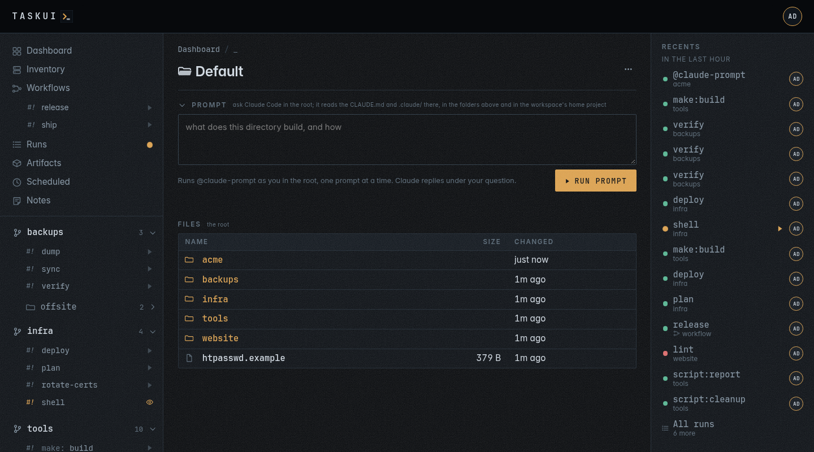

# Projects and jobs

Below the views, the sidebar lists what there is to run, as a tree:

- a **project** (the branch icon) is a folder at the top of the root,
  most often a git checkout;
- under it, its own **jobs**, then the **folders** inside it (the folder
  icon), each with its jobs.

Every job has a play button, so a job is one click from anywhere; a job
that runs has an eye instead, to watch it. A project folds on its
chevron, and this browser remembers the folded ones. The project of the
page you are on stays open.

A [workspace](workspaces.md) adds a level above its projects: a label
row with the workspace's name, and its projects folded under it. Their
links carry the workspace, as `/f/malta/dockerfiles`. The projects at
the top of the root are in the default workspace, `_`, and list first,
without a label row; their links carry `_`, as `/f/_/infra`.


A user with Allow Edits on Projects, `project/edit`, adds a project from a git repository on **Add project** (see
[Settings](settings.md#projects)). Its **Workspace** select clones the
project at the top of the root, `_`, or inside a named workspace (see
[Workspaces](workspaces.md#clone-a-project-into-one)).

## Move a project to another workspace

A project's configure page, **Settings**, **Projects**, then the
project, has the same **Workspace** select, on the workspace the
project is in. Pick another one and **Save** moves it: `web` in `_`
becomes `acme/web` in `acme`, and `acme/web` picked back to `_` becomes
`web`. Before the move a dialog names the new ID and every row that
stays behind.

What moves and what stays:

- the checkout moves, renamed in place, with the folders inside it;
- the project row moves, with its title, allow lists and hours;
- the users whose folder list names the project, or a folder inside it,
  get the new ID in its place, so access follows the project;
- the runs stay under the old ID: their pages, recordings and artifacts
  still open from the Runs page;
- schedules, secrets, env files and workflow steps that name the old ID
  stay behind. The dialog lists them, as does `left` in the API's
  answer; change them to the new ID, or move the project back, to
  bring them along.

A move refuses with `409` while a run of the project, or of a folder
inside it, is going, and while the project is moving already. It also
refuses a workspace itself, a workspace that does not exist, an ID
that a project, a workspace or a directory holds, and a workspace on
another file system, as a move renames and does not copy. Only a
project at the top of a workspace moves; a folder inside a project
stays with it.

To move one through the API, name the workspace on the configure
request:

```sh
curl -X PUT -H "Authorization: Bearer $TOKEN" \
  -d '{"title": "Web", "workspace": "acme"}' \
  https://task.example.com/api/projects/web
```

The request configures as well, so send the fields the project has.
It responds with the project row under its new ID, and `left`: each
row that still names the old ID, as `{kind, id, folder, name}`.

## Where the jobs come from

task-ui reads the files a folder has and lists their targets; task-ui
itself never edits them. A job, or a Claude run, may change files in
the folder when you ask it to.

| Source   | File                                  | A job is                                              |
|----------|---------------------------------------|-------------------------------------------------------|
| atkins   | `atkins.yml`, `.atkins.yml`           | a job with a `desc`; `show: false` hides one          |
| task     | `Taskfile.yml`                        | a task with a `desc`; `internal: true` hides one      |
| make     | `Makefile`, `makefile`, `GNUmakefile` | a target; `target: ## text` or a comment describes it |
| npm      | `package.json`                        | a script, run with npm, pnpm, yarn or bun by the lock file |
| composer | `composer.json`                       | a script, described by `scripts-descriptions`         |
| script   | `scripts/*`                           | a file; its first comment describes it, `# interactive: true` makes it take input |

A pipeline file, `atkins.yml` or a Taskfile, speaks for its folder: the
folder lists that pipeline's jobs, and the files beside it are the
pipeline's business. Without one, the folder lists every source, and a job name
that two of them share gets its kind in front (`make:build`,
`npm:build`). A folder that is itself a `scripts` directory with a
pipeline also lists the scripts beside it that the pipeline does not
run, under their own names, such as a `bash.sh` with `exec bash` and
`# interactive: true`, a terminal to work in.

Every directory under the root that has something to run is a folder, as
deep as they go. Under a folder with a pipeline, the sidebar lists only folders with a
pipeline of their own, so the Makefiles of a Go tree do not
become folders; under a plain folder they do. Hidden directories, `node_modules`, `vendor` and
`testdata` are never looked into.

Discovery skips what a checkout's `.gitignore` ignores: build copies,
caches, dependencies. One kind of ignored directory lists all the same:
a directory right below a workspace or a project that holds a job
source, an `atkins.yml`, a Taskfile, a Makefile, `package.json`
scripts, at its top or in a directory inside it, such as a checkout the
workspace keeps beside its files with its jobs in `scripts/`. The
folders inside it follow the Recursive of the workspace or project above
it. An ignored directory with nothing to run, or one deeper down, stays
out; a project row on the directory configures it, as on any folder.

A project or a workspace with **Recursive** off in its settings lists
itself and its top-level folders alone, `web` and `web/api` but not `web/api/v1`,
counted from its own folder, in a workspace as at the root.
The deeper folders leave the sidebar, the folder pages, the dashboard
and `list_jobs`; their `/f/` path opens as a directory of the folder
above, to browse, and **Files** still holds the whole checkout.

An agent sees the same list over [MCP](mcp.md): `list_jobs` returns the
folders, their jobs, whether its user may run each, and how each last
went.

### A pipeline with errors

atkins lints a pipeline before it lists its jobs, and lists none of a
pipeline that fails: a step that calls a job the file lacks, such as
`task: go:fmt` with no `go:fmt` job. task-ui shows what atkins found
in place of an empty folder:

- The folder's page, and the page of every workspace or project above
  it, opens with an alert, "1 pipeline has errors", and a line for each
  finding: the folder, linked, the pipeline file, the job and atkins'
  words for what is wrong; hover them for the kind of issue. Past five
  lines the rest fold under **Show more**.
- The folder's row in the sidebar carries a red `!` with the count of
  findings in place of its count of jobs; hover it for the first.
- The dashboard has a line that names the workspaces with a broken
  pipeline, each linked to its page.
- `GET /api/folders` and `list_jobs` carry the findings as `errors`,
  each with its `path`, `job`, `issue` and `detail`.

A finding reads as atkins prints it: `job build: step references task
'go:fmt', but job "go:fmt" not found` names the job that holds the
step and the reference that does not resolve. Fix the file, by adding
the job or correcting the reference, and the next look at the folder
lists its jobs again: task-ui asks atkins afresh once the file changes.

## A folder's page

Open a folder from the sidebar:

- **The `[...]` menu** at the top right of a project's or a workspace's
  page, `/f/_` among them, behind the rule of each item:
  - **Project settings**, with `project/view`, or **Workspace
    settings**, with `workspace/view`, opens the configure page, the
    one **Configure** in **Settings**, **Projects** opens;
  - **Pull now**, on a checkout with the `git` skill, for a user who
    may run the folder's jobs, runs `@git:pull` there;
  - **Remove checkout**, last and in red, on a project that is a git
    checkout, with `project/delete`, asks `Remove the folder apps and
    its checkout? You can clone it again from <remote>.`, deletes the
    folder with its files and its configuration, and goes on to
    **Projects** with a notice. The project's configure page has the
    same item in its `[...]` menu.

  A folder inside a project, and a user with none of the rules, gets no
  menu.
- **Actions**: a bar under the title, on a folder's page and on the page
  of a directory inside it (see [Actions](#actions)).
- **Jobs**: a card each, `default` first, with what it does, its first
  steps, how it last went, **Run**, **|>summarize**, which runs the job
  and has Claude summarise the run on its page when it ends (see
  [Runs](runs.md#run-and-summarize)), and, on a job with hours, **Run
  force**; any other job forces from its run's window. A folder with more
  than one source has a section per source.
- **Files**: what the folder holds, dot entries too, the directories
  first, each with its size and when it changed, and `..` up a level:
  the folder's dashboard. A directory opens as a page of its own; a file
  opens in a window, an image shown, markdown rendered, text coloured and
  cut past 1 MiB, with **Download** beside and in the row.
  A directory that is a folder links to the folder's page. A folder the
  listing lacks, such as one a project row places elsewhere, gets a row
  of its own.
  A directory with targets of its own, a pipeline file, Makefile,
  package scripts or scripts folder read as a folder's are, that
  discovery leaves out, such as the Makefile of a directory inside a
  checkout with an `atkins.yml`, lists them as job cards on its page.
  The **Action** column of a directory with jobs, a folder or one with a
  job source at its top, holds **Run**, and its **Summary** column
  **|>summarize**, for those who may ask Claude, and **Summary**, a link
  to Claude's summary of the row's last run on that run's page, its
  start on hover, once the run has one; so does the row of a file that
  is a job source, such as `atkins.yml`, and the file's window holds
  both. **Run** runs `default`, or the only job, and its dot
  shows how that job last went, live as runs start and end, or an eye
  on a run in progress. With more jobs, the chevron beside it opens a
  table of them, `default` first and the rest by name: the play glyph
  in the colour of the job's last run, the name and what it does, or `Run the <name> target` when its file
  says nothing. A row runs its job, or attaches to it while it runs; a
  job your role may not run lists faint. A directory without `default`
  opens the table from **Run** itself. **|>summarize** does the same
  with Claude's summary, the interactive jobs left out, and runs the
  one job left directly. The sidebar and the folder list stay as
  discovery reads them: the jobs of a directory found here run as the
  folder's in that directory.
  They run in that directory under the folder's allow rules and hours,
  and pull the folder's checkout; the API names them with `dir` (see
  [Runs](runs.md#what-a-job-gets)). Each has its page and history under
  the directory, such as `/f/acme/api/tools/build`.
  A file that runs, executable or with a shebang on its first line,
  carries `#!` and **exec**, and **Run** for those the folder lets run,
  in its Action column and in the file's window: it starts the file as the job
  `./<path>`, from the top of the folder, and opens the run's window.
  Its history is at the file's path under the folder.
- **Sealed entries**: `.git` and every dot file, such as `.env`,
  `.gitignore` or `.claude/.secret`, list with a lock and open nothing,
  on the page or over the API, nor does a path through `.git` or a
  symlink to a dot file. A dot file never runs as a job. A dot directory
  other than `.git`, such as `.claude/` or `.atkins/`, opens as any
  directory does, and so do the files in it whose names have no dot in
  front. A symlink that leads out of the checkout opens nothing either.
  Whoever has the server reaches the sealed entries there, and so does
  a job, which runs as the server's user.
- **Folder**: its path, its sources, who can run it, its hours, the
  files it includes, its schedules. **Show** beside a pipeline file opens
  it, coloured, in a window. A folder in a git checkout also shows the
  checkout's size: its files, and the history in `.git`.
- **Environment**: the dotenv files the pipeline reads (see
  [Settings](settings.md#env-files)).





A link to the folder's page with `#file=<name>`, such as
`/f/acme/api#file=README.md`, opens that file of its Files in the window
on load.

## Actions


The bar under a folder's title, and under a directory's inside a folder,
has two parts, and at its top right, with the `shell` permission,
**Enter Shell** and, with a Claude token besides, **Enter Claude**. The
links to a project's or a workspace's settings are in the `[...]` menu
of its page head (see [A folder's page](#a-folders-page)).

- **The git line**: `⎇ main ↑1 ↓3 ●2 · malta/dockerfiles`. It reads the
  checkout the page is in, the nearest one up from it and no higher than
  the root: its branch, or `detached` and the commit of a checkout off any
  branch; `↑` the commits to push and `↓` those to pull from its upstream,
  as last fetched; `●` the files changed or untracked; then where the
  checkout is. A checkout level with its upstream and with nothing changed
  reads `up to date`. Hover it for the upstream. The line reads
  `git status` and stays good for 5 seconds; it changes nothing, and the
  pulls are jobs of the git chip.
- **Chips**: one per [atkins](https://github.com/titpetric/atkins) skill
  that applies there, such as `[git: pull · rebase · status]` or
  `[compose: build · custom... · down · pull · up]`, and an
  `[atkins: default · build]` chip of the place's own pipeline jobs.
  A skill comes from a `.atkins/skills/` folder of the directory or of any
  directory above it, a workspace's among them, and applies where its
  `when:` holds; a job of it with a `when:` of its own that fails, such
  as `compose: build` beside a compose file that builds nothing, has no
  chip ([Workspaces](workspaces.md#skills) shows how to write one).
  Hover a chip for what the skill is and the file its `when:` matched.
  task-ui asks `atkins -l --json --all` in the directory as a page opens,
  and keeps what it lists for 30 seconds, or until the pipeline file or a
  skill file changes; an atkins that is missing, fails or takes longer
  than 3 seconds shows no chips.

Each job of a chip, `default` first, is a **Run**, which opens the run's
window as a job card's does, and **Attach** while it runs; a user who may not run it gets
a link to its page. A job whose name ends in `...`, such as
`compose: custom...`, takes arguments: its Run opens a field for them
first (see [Runs](runs.md#what-a-job-gets)).

A skill job is the job `@<skill>:<job>` of the folder, such as
`@git:status`: it runs `atkins git:status` in the directory of the file
the skill's `when:` matched, the checkout for git, the directory of the
compose file for compose, under the folder's allow rules and hours, and
keeps its history under that directory. A skill that matched above the
folder runs in the directory of the page, where atkins finds it again.

**compose up** and **down** of the compose project task-ui itself runs
in ask first: they stop or recreate the instance and every run in it.
task-ui reads its project from the compose label of its container, or
from `TASK_UI_COMPOSE_PROJECT`, and a compose file's project is its
`name:`, or its directory's name.

The API answers the bar with `GET /api/folders/{id}/actions?dir=`, for
whoever sees the folder.

### Enter Shell

A user with the `shell` permission, Enter Shell in [Settings, Permissions](settings.md#permissions), gets **Enter Shell** at the top right of the bar: `bash -l` in
the folder's directory, or in the directory the page browses, with the
run's window attached and the keyboard yours: the job `@shell` of the
folder, run with the environment, secrets and keys of any job there,
and its history keeps under that directory. Close the window and the
shell keeps running; **Attach** in its place opens it again, `exit` ends
it.

Only a user with `shell` starts a shell: `POST /api/runs` with `@shell`
answers `403` to anyone else, whatever the folder's allow rules say, and
the button shows to those users alone. No schedule or workflow step takes
`@shell`: there is no one at its keyboard.

### Enter Claude

Beside it, a user with `shell` and a token in the
[Claude Code integration](settings.md#integrations) gets **Enter
Claude**: Claude Code in a terminal in the folder's directory, or in the
directory the page browses, the job `@claude` of the folder, which runs
`task-ui agent shell`, a shell as `@shell` is: the **Enter Shell**
permission gates it, `POST /api/runs` with `@claude` answers `403` to
anyone without it, no schedule or workflow step takes it, and it pulls
nothing. Claude reads the `CLAUDE.md` and `.claude/` of that directory
and above, and the run's history keeps under the directory.

### Prompt

A user with Allow Edits on Prompts, `prompt/edit`, and a token in the
[Claude Code integration](settings.md#integrations) gets a **Prompt** box under the bar of every folder page and every
directory inside a folder: open on a workspace's page, on `/f/_`,
which prompts at the root, and wherever its directory holds a prompt, folded
elsewhere until clicked. The prompt runs `@claude-prompt` of that
folder and directory as you, with Claude Code there, so it reads the
`CLAUDE.md` and `.claude/` there and above.

Claude also reads what task-ui is, from `config/context.md`, with your
name, role and permissions, which say what you may do, and the rule that a
file it writes to `$TASK_UI_ARTIFACTS` stays as an artifact (see
[MCP](mcp.md#what-task-ui-is)).

No window opens. The question shows under the box at once, `open`, then
`working` while the run goes, and Claude's answer, in markdown, lands
under it when the run ends, without a reload. Each thread links its
run, which keeps the output. **Reply** under a thread asks again: Claude
reads the whole thread, its earlier answers among them. The box lists
the last 20 threads asked in its directory, by anyone; the Notes board
lists none of them.

Click a question, or a reply of yours, to edit it: add what you need and
**Save**, or Ctrl+Enter; Esc cancels. The question runs again on the
edited text, with the thread up to Claude's answer to it, and that answer
changes in place: its old text stays, dimmed and marked `working`, until
the new one lands. The thread gets no new reply, and the run keeps its ID, so the
run link opens the latest attempt; the attempt before goes with its
recording and artifacts. The question shows `edited` beside its time.

```sh
curl -s -X POST https://task.example.com/api/prompts \
  -H "Authorization: Bearer $TOKEN" \
  -d '{"folder": "malta", "dir": "dockerfiles/blog", "prompt": "what does this image build"}'
curl -s "https://task.example.com/api/prompts?folder=malta&dir=dockerfiles/blog" \
  -H "Authorization: Bearer $TOKEN"
```

The reply is the note, with `dir` `malta/dockerfiles/blog`; `GET
/api/prompts` lists the threads there, each with its `replies`, and
`parent` on the POST replies in a thread. The run is the folder's, as
its `@shell` is: `malta/dockerfiles/blog/@claude-prompt`, folder `malta`,
`dir` `dockerfiles/blog` and job `@claude-prompt`, with the absolute
directory in `TASK_UI_PROMPT_DIR`; the recents and the runs list show it
under the folder. A prompt at the root runs as `@claude-prompt` of the folder `_`, and its
run shows as `@claude-prompt`. The
run gets the secrets of the folder, as its other jobs do, and runs out of
its hours too, as it runs none of the folder's jobs; no `POST /api/runs`
starts it, as a prompt needs its thread. Who sees the folder sees its
prompt runs with the `prompt/view` permission; who asks always sees
theirs, and may stop it. One prompt runs per directory: another there
waits for it, and prompts in two directories run at once. A workspace's prompt route works the same way (see
[Workspaces](workspaces.md#a-prompt-against-a-workspace)).

Enter at the header's prompt, after the logo, asks where the page is:
in the folder or the directory of its page, a project's or workspace's
settings included, about the run on a run's page, and at the root
anywhere else. Claude's answer lands in a panel under the header, in
markdown, with no reload; the panel names the place and links the
thread. A click on the logo opens and closes the panel, which keeps its
thread in the tab from page to page.

With the Beszel integration set up, a prompt also sees the
[Inventory](inventory.md#prompts-on-the-hosts): Claude gets the hosts
with who signs in to each, and inspects them over ssh with the keys of
the run, so a question such as "list running containers on all hosts,
check for any usage of php or frankenphp images" gets an answer per
host.

A run's page has a prompt of its own, about the run and its output,
with its threads kept on that page (see [Runs](runs.md#a-prompt-about-a-run)).

## A job's page


Open a job from the sidebar or a card: the command it runs, its steps
and dependencies, who can run it and when, its **History** of runs, and
its **Scheduled** section (see [Scheduled](scheduled.md)).

The History opens with the job's activity: its runs of the last thirty
days by day and of the last 24 hours by hour, as on the [Runs](runs.md#activity)
page, and a line of how long its latest thirty runs took, a red mark at
each that failed. Hover a point for the run's time, outcome and
duration.

## Pulled before every run

A folder in a git checkout pulls it with `git pull --ff-only` before every
run, in the run's own terminal, so a job always runs the latest version.
A folder inside a checkout pulls the checkout. When the pull fails, the
run fails with it. A project in a workspace pulls the workspace's
checkout first (see [Workspaces](workspaces.md#runs-in-a-workspace)).

## Keys for a run

A run gets SSH keys only through an ssh agent served for that run alone:
the instance keys linked to the role of whoever started it, or to them
by name (see [Settings](settings.md#keys)), and the SSH keys of its
workspace its links let through (see [Workspaces](workspaces.md#keys)).
The agent's socket is in a `0700` directory under `/tmp`, and no key
file lands on disk; a start of task-ui removes the directories a process
before it left. A scheduled run gets
the keys of the schedule's creator. The job gets `SSH_AUTH_SOCK`, and
`ssh`, `git`, `rsync` and terraform's agent authentication use it. The
keys stay in memory and the agent ends with the run; the terminal says
which keys it loaded, or `(none)`. A run with no key has an empty
`SSH_AUTH_SOCK`, never the server's own.

The pull before a run, and a clone, use the git key, the one SSH key
marked for git on its edit form, from an agent of their own; nothing
reads the server's `~/.ssh`. terraform's agent authentication uses only
the agent.

A checkout's `.ssh/` folder is not loaded. The SSH keys page warns about
one with private keys in it: upload a key the project needs as an
instance key and link it.

## Hours

A user with `project/edit` can limit a folder or a job to office hours (see
[Settings](settings.md#projects)). Out of hours **Run** fails.
**Run force** still works, but asks why: it needs a reason, keeps it
with the run, and every list of runs shows it.


## Who may run what

An admin runs everything. A runner runs a folder's jobs unless its allow
list names other users or roles. A viewer runs nothing, but sees the jobs
and watches the runs. Run Jobs, a permission of
[Settings, Permissions](settings.md#permissions), decides who runs at
all, Enter Shell who starts `@shell` and `@claude`; a user with
`user/edit` sets which folders each user sees on the user's profile.

---

Previous: [Notes](notes.md) · Next: [Workspaces](workspaces.md) · [Contents](../README.md)
