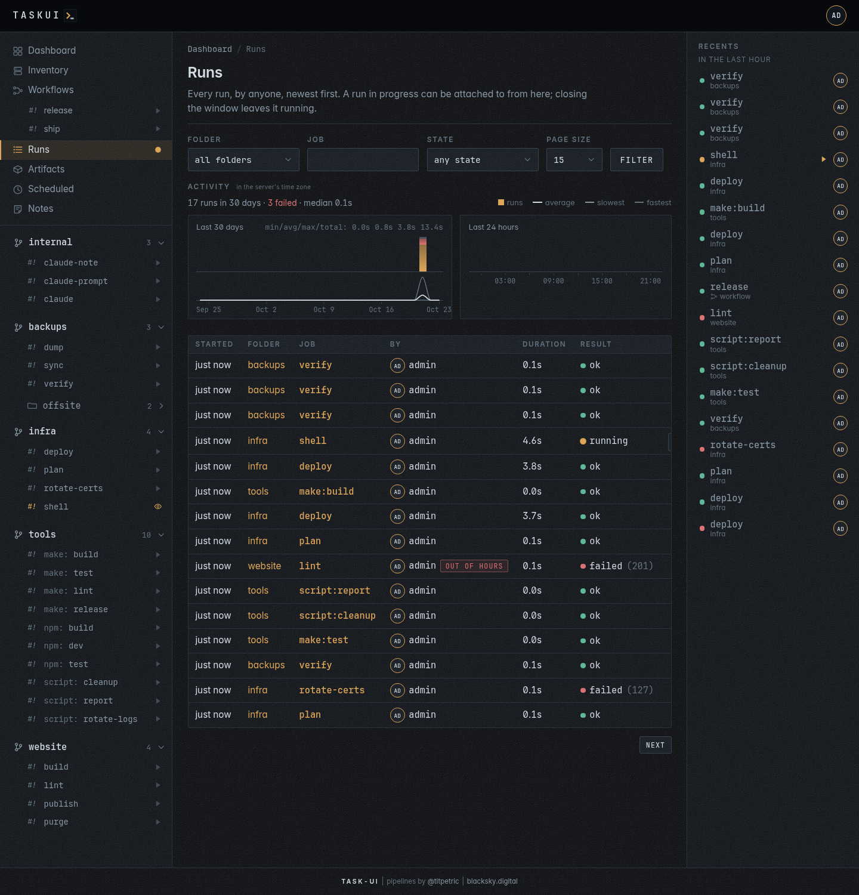
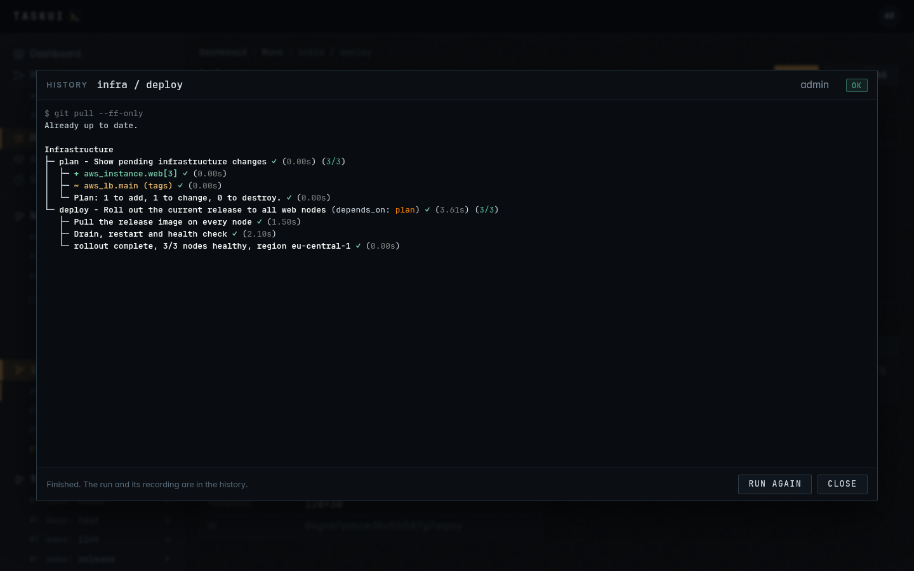
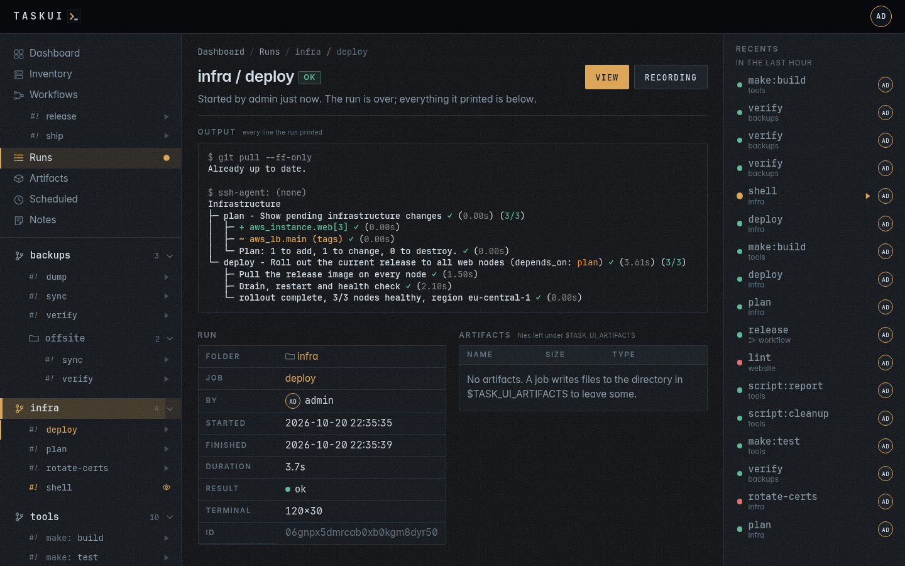
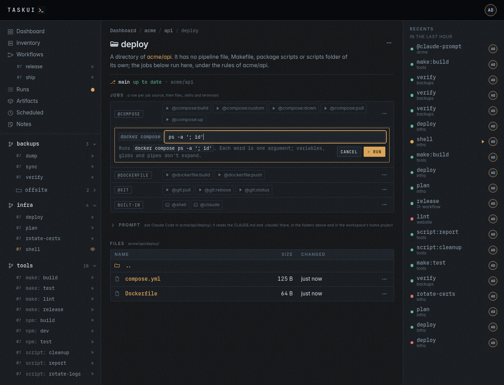

# Runs

Every run, by anyone, newest first. A dot beside **Runs** in the sidebar
pulses while something runs.

A prompt runs as `@claude-prompt` of the folder and directory it asks
in, such as `malta/dockerfiles/@claude-prompt`, and lists under that
folder here and in the recents. Another user's prompt runs list with
the `prompt/view` permission; your own always do (see
[Prompt](projects.md#prompt)). A run of the root names its job alone, as
`@claude-note` or `@shell`, and a directory of the root by its path.

A command on a host of the [inventory](inventory.md) runs as
`@host:<host>`, a built-in job of the root, one run a host, its command
the run's args. `/runs?job=@host:dev1` lists the runs on `dev1`,
`/runs?job=@host:*` those on every host, and `/runs?batch=<id>` the runs
started together on more than one host.



## Activity

Above the list, two charts, in the server's time zone, following the
filter:

- **Last 30 days**, a bar a day, today on the right;
- **Last 24 hours**, a bar an hour, this hour on the right, with a time
  marker every six hours.

Each chart's head reads `min/avg/max/total:`, the fastest, the mean and
the slowest finished run of its window and their time together.

A bar is as tall as its runs against the busiest bar, split into the runs
that ended ok (amber), failed or got killed (red), and the rest, running
or stopped (faint). Hover a bar for its counts. Under each, the same days or
hours as a **line graph of their durations**: the average in the text
colour, the slowest dimmer and the fastest faint, against the slowest run
of the chart, a smooth curve through the middle of each column. A day or
an hour without a finished run sits on the baseline. Hover a column for the average, the
fastest, the slowest and how many runs they cover. A line above shows the
run count, how many failed and the median duration.

## The list

Each row is a run: when it started, the folder and job, who started it,
how long it took and how it ended. **Filter** narrows it by folder, job,
state and who started it, **By**; `?batch=` in the address keeps the
runs of one batch. The **⋯** next to a name opens that
user's menu: their profile, their runs, and their permissions for those
who may change them. A run in progress has **Attach**, a finished one **View**.

A run waits, **queued**, its dot a ring, behind the run of its
job before it: a command on a host that still runs one (see
[Inventory](inventory.md#queued-commands)); or for a free slot, while
as many runs go as the machine has CPUs (see
[Runs at once](#runs-at-once)). It starts once that run
ended or a slot frees, and its page says so; **Stop** takes it out of the queue,
stopped. A queued run the instance restarted before it ran ends failed,
its page saying "the instance restarted before it ran".

The list shows a page of runs at a time. **Page size** picks 15, the
default, 50 or 100 rows. Under the table, **Next** goes to older runs
and **Previous** back to newer ones; both keep the filter and the page
size. A page holds only the runs of the folders you may see, so no
hidden run leaves a gap in it. The list adds a run that starts on top
of the first page only; on a later page, the rows in it still update in
place.

With the Claude Code integration set up for you (see
[Settings](settings.md#integrations)), a finished run also has
**Summary**: Claude reads the end of its output, up to 2000 lines, and
writes one or two short paragraphs on what it did and how it ended, the
cause when it failed, then a markdown table of the values worth a
glance, such as versions, images, counts or durations, when the output
has any, in a window. task-ui keeps the
summary by run, so the next **Summary** of that run, by anyone, shows
the kept one at once, without asking Claude again.

## The run window



Starting a job, or attaching to a run, opens the run window over the
page: the run's terminal, live.

- **The run goes on without the window.** Closing it detaches; the run
  keeps running, and the dashboard, this list or the run's page open a
  window on it again. A window that comes back gets the tail of what it missed.
- **Runners type into an interactive job.** Input goes to the job, and
  the terminal takes the window's size. A viewer can only watch in the
  window.
- **Take input** answers a job that takes no input but waits on a
  prompt, such as the ssh prompt to trust a host. Every run has a
  terminal on its input, so it reaches the process. With **Allow
  interactive mode**, which admins hold, the button sits in the foot of
  a running run's window: your keystrokes go to the process and the
  header says `( > input on )` until **Release input**. The run's
  recording names who took input first, and a window opened later shows
  it in the header.
- **Stop** signals the job to end (SIGHUP and SIGTERM, then SIGKILL after
  `TASK_UI_GRACE`, ten seconds) and records it as `stopped`. **Kill** ends it now, as
  `killed`.
- **Run again** starts the job once more when it has ended.
- **Open run page** in the window's header goes to the run's page.
- **A job can name itself.** A terminal title the job sets, such as
  `printf '\033]0;building images\007'` (OSC 0 or 2), shows beside the
  job's name in the window's header and in the browser tab while the
  window is open, and changes as the job sets another. An empty title
  clears it. The dashboard and this list show it too, and the run keeps
  the last one when it ends.

A finished run stays attachable, its last frame in memory, for
`TASK_UI_KEEP`, fifteen minutes; after that it opens as history: its
whole recording played into the window, with how it ended, and **Run
again** for whoever may run it.

### One run per job

A job runs once at a time across the instance; the same target of two
directories in one folder, such as `build` in `images/` and in
`docs/`, is two jobs. The Claude jobs of a prompt and of the Notes
agent, `@claude-prompt` and `@claude-note`, are each a Claude session of
their own and go side by side: no prompt waits for another. Starting any
other job that runs already attaches to the run in the way. **Run force** kills that run and
starts again; out of a folder's hours it also asks why, and keeps the
reason with the run (see [Projects and jobs](projects.md#hours)).

### Runs at once

Different jobs run side by side, as many at once as the machine that
runs task-ui has CPUs. A run that comes while the runs fill every slot
waits, **queued**, and starts when a run ends, in the order the runs
came; the runs list, the dashboard and the run's page say where it
stands in line, and **Stop** takes it out. A terminal takes no slot:
`@shell`, `@claude` and a job marked `interactive: true` idle on their
input, so an open shell never holds up a run. A prompt's run and the
Notes agent's do work and take one.

### From an agent

An agent starts runs over [MCP](mcp.md) as the user of its token:
`run_job` starts one and can wait for it to end, `list_runs` and
`get_run` read the history and the end of a run's output. Such a run is
like any other: this list shows it under that user, and anyone allowed
attaches to it.

## A run's page



`/runs/<id>` is one run, to link to:

- **Output**: every line the run printed, in its colours, from the first
  to the last, scrolling inside the block. The block replays the recording,
  so what redraws itself, a progress bar or a pipeline tree, shows its
  last frame.
- **Run**: folder, job, who and when, how long, how it ended, and the
  reason for a run forced out of hours. A run of a directory's job names
  the directory, linked to its page, and a run given arguments lists
  them, one each. With `secret/view`, **Secrets** names the secrets the
  run got in its environment, never a value (see
  [Settings](settings.md#secrets)).
- **Artifacts**: the files the run left (see [Artifacts](artifacts.md)).
- **Recording** downloads the run as an asciicast file, for `asciinema
  play`.
- **|>** replays the recording in the run window as the run printed it,
  idle gaps and all, under a blinking `( * recording )` beside the
  title, with **Pause** and **Restart**. It reads the recording and
  nothing more: no run starts, the recents stay as they are, and typing
  goes nowhere. A finished run's row in a list and its window's header
  have the same **|>**.

Once its recording expires under the
[Data retention](settings.md#data-retention) settings, a run keeps its
page, its details and its artifacts: **Output** says the recording
expired, **Recording** and **|>** go, its frame says so, and a prompt
about the run reads that the run has no output any more.

While the run is in progress the page shows its terminal as it looks now,
and **Attach**, **Stop** and **Kill** instead.

### A prompt about a run

With the `prompt/edit` permission and a token in the [Claude Code
integration](settings.md#integrations), a finished run's page has a
**Prompt** box under its output: ask why the run ended the way it did,
or for a fix to its job or pipeline. The prompt runs `@claude-prompt`
as you in the run's folder, or the directory inside it the job ran in,
as a folder's prompt does (see [Projects and
jobs](projects.md#prompt)). Claude gets the run with the question: its
ID, folder, directory and job, who started it, how it ended and its exit
code, when it started and how long it took, the job's command, and the
end of its output as text, marked as cut when longer than either limit:

| Output | Limit |
|--------|-------|
| Lines | the last 2000 |
| Size | 256 KiB |

For a question that names a fix, Claude makes it in the checkout,
commits it to main, pushes, and names the change in its reply.

The run's page lists its threads, newest first, as they get answered:
the run's history of questions and fixes. They stay off the folder's
prompt box. **Reply** asks again about the same run, and a click on a
question edits it and runs it again, as on a folder page. With
`prompt/view` alone you read the threads, without the box. A prompt's
own run has no prompt.

```sh
curl -s -X POST https://task.example.com/api/prompts \
  -H "Authorization: Bearer $TOKEN" \
  -d '{"run": "<run id>", "prompt": "why did this run fail"}'
curl -s "https://task.example.com/api/prompts?run=<run id>" \
  -H "Authorization: Bearer $TOKEN"
```

### Run and summarize

**|>summarize**, beside **Run** on a job's card and page, runs the job
as **Run** does, in its window, and when the run ends, in any state,
task-ui asks Claude about it on the run's page, as you: a thread whose
question reads "Summarize this run.", answered in the shape of a
**Summary**, one or two paragraphs and a table of the values worth a
glance. Claude gets that shape with the question, and changes nothing.
The thread shows under the output as it gets answered, and **Reply**
asks more about the run. The button shows with `prompt/edit` and a
Claude Code token, on jobs that end on their own: not `@shell`,
`@claude` or an interactive job. **Run again** in the window brings
another summary.

task-ui waits for the run in memory: when the server restarts before
the run ends, no summary comes. The API takes `summarize` on a run:

```sh
curl -s -X POST https://task.example.com/api/runs \
  -H "Authorization: Bearer $TOKEN" \
  -d '{"folder": "malta", "dir": "dockerfiles", "job": "@git:status", "summarize": true}'
curl -s "https://task.example.com/api/prompts?run=<run id>" \
  -H "Authorization: Bearer $TOKEN"
```

A workflow summarises itself the same way when its prompt is a
summary: **Summarize** in its editor fills the prompt with this shape
(see [A workflow with a prompt](workflows.md#a-workflow-with-a-prompt)).
Its thread lists by the workflow run:

```sh
curl -s -X POST https://task.example.com/api/workflows/<id>/runs \
  -H "Authorization: Bearer $TOKEN" \
  -d '{"input": "for the 1.2 tag"}'
curl -s "https://task.example.com/api/prompts?workflow_run=<workflow run id>" \
  -H "Authorization: Bearer $TOKEN"
```

## What a job gets

A run starts in its folder, or in the directory inside it whose job it
runs, as a login shell, with:

- `TASK_UI=1`, `TASK_UI_USER`, `TASK_UI_FOLDER`, `TASK_UI_JOB`,
  `TASK_UI_RUN_ID`, and `TASK_UI_ARTIFACTS`, a directory for its files;
- `TASK_UI_ROLE`, the role of whoever started the run, and
  `TASK_UI_PERMISSIONS`, what that user may do in a line, as
  `note/view, note/edit, run; everything else is denied`;
- `TASK_UI_WORKSPACE`, the name of its [workspace](workspaces.md),
  `_` at the top of the workspace folder, and `TASK_UI_WORKSPACE_DIR`,
  its checkout, the workspace folder for `_`; `HOME` stays the
  server's;
- `TASK_UI_HOST_PWD`, its directory as the docker host sees it, and
  `TASK_UI_HOST_DATA`, the data directory there, for a `docker run -v
  "${TASK_UI_HOST_PWD:-$PWD}:/src"` that the host's daemon resolves (see
  [Running the server](../running.md));
- the secrets of its folder and its workspace's shared secrets, never
  another workspace's (see [Settings](settings.md#secrets));
- an ssh agent, through `SSH_AUTH_SOCK`, with the instance keys linked
  to the role or the name of whoever started the run (see
  [Projects and jobs](projects.md#keys-for-a-run)), and the SSH keys of
  its workspace its links let through (see
  [Workspaces](workspaces.md#keys)); a host command gets every instance
  SSH key, as the inventory signs in with them; the terminal says which,
  or `(none)`.

A job that takes arguments, an atkins job with `args: true`, gets them
after `--`, as argv: `POST /api/runs` with `"args": "ps -a"` runs
`atkins -f atkins.yml custom -- ps -a`. The line splits as a shell
splits words, with quotes and backslashes, and nothing in it expands:
`"; id"` reaches the job as one argument, `; id`. Every other job
refuses arguments.

On a page, **Run...** of such a job, on its card, its page or a chip such
as `compose: custom...`, opens a field under it first. The field starts
with the command the arguments follow: the `exec:` step of the job, such
as `docker compose`, or the job's own argv and `--`. Below it, task-ui
shows the whole command as each word reaches it, `docker compose ps -a '; id'`,
or says a quote does not close; **Run** sends the line, Esc or **Cancel**
closes the field. The job's `exec` in `GET /api/folders` is the same
command. A link to the page with `#args=<job>;<line>`, such as
`/f/acme/api/deploy#args=@compose:custom;ps%20-a`, opens the field of
that job on load with the line typed in.



Before the job, a folder in a git checkout pulls it, in the run's own
terminal; when the pull fails, the run fails with it. A folder in a
workspace pulls the workspace's checkout first, then its own. A shell,
`@shell`, pulls nothing: it opens on the checkout as it stands.

---

Previous: [Workflows](workflows.md) · Next: [Artifacts](artifacts.md) · [Contents](../README.md)
