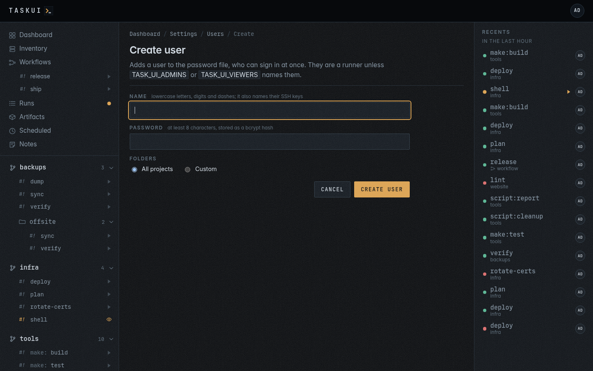
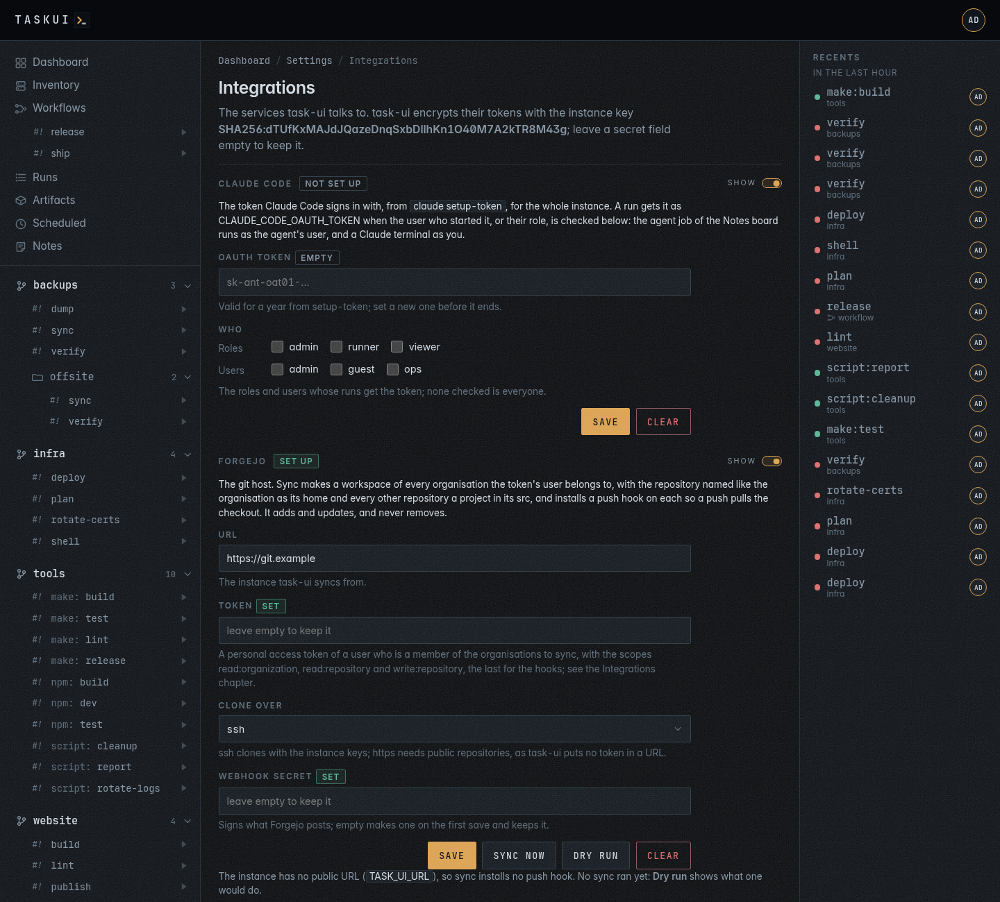

# Settings

Not in the sidebar but in the user menu, behind your initials in the
header, for admins: what the instance brings to every run.


## Projects

The folders under the root, with their sources, where they came from, and
the space each takes: its files, and the git history beside them.


**Add project** clones a git repository into the root. It either works,
and the folder appears in the sidebar, or the page shows git's output and
keeps nothing. git reaches private repositories with the instance SSH
keys.

**Configure** on a folder sets what the instance adds to it; its files
stay as they are:

- a title and a description;
- **who may run it**: a box for each role that runs, admin and runner,
  and each user who is no viewer; none checked is every runner. Each job
  has the same boxes in the per-job table, over the folder's, and none
  checked there inherits;
- which **sources** to read, which is also how a folder with a pipeline
  gets its Makefile or scripts back as jobs;
- **hours**, one rule per line, days then a span. The last rule that
  covers a day decides it:

  ```
  mon-fri 9-17
  fri 9-13
  ```

  runs Monday to Thursday nine to five, Friday mornings, and never on the
  weekend. Days are names or ranges (`mon-fri`, `sat,sun`, `weekdays`,
  `daily`); spans are hours or `hh:mm`;
- the **workspace** a project at the top of one is in: another one moves
  the project there, as
  [Move a project](projects.md#move-a-project-to-another-workspace)
  describes.

The API sets three more on a project: `commands`, the program a kind of
job runs with (`make: gmake`), and `job_allow` and `job_hours`, who may
run and when, per job.


## Workspaces

Checkouts under the root that hold projects: an organisation's tooling,
with the projects cloned inside it. **Add workspace** clones one under
the folder you name, **Move up** and **Move down** order them, and the
remove button deletes one with the projects inside it. **Configure**
changes a workspace's title and description, and holds its **Keys**, the
encryption key of its secrets and the SSH keys of its runs, which the
[Keys](#keys) page also lists, and
**Export**, which **Import** on another instance reads.
[Workspaces](workspaces.md) covers them, their keys and runs, the move
between instances, what they keep apart, and the prompt against a
workspace.

## Users

Who may sign in comes from the password file on the server. **Create
user** adds one to it, with a name and a password of at least 8
characters, and they can sign in at once; `task-ui passwd <user>` on the
server adds or resets one too. Removing the line removes them, and
task-ui reads the file again whenever it changes. The roles
come from the server's `TASK_UI_ADMINS` and `TASK_UI_VIEWERS`; everyone
else is a runner.

What a role may do comes from permission policies over the rules of
`config/permissions.yml`. An admin may do everything. A runner runs
jobs, and reads and writes notes, workflows and schedules; a viewer does
the same without running; both read artifacts and the inventory. A
policy of a user's own adds to the role's, and a deny in either wins.


This page sets which folders a user sees: open a user, then pick **All
projects**, or **Custom** and check the folders. A user's name and role
show as text: the password file and the role lists set them.



A client that is not a browser, such as an agent over [MCP](mcp.md),
signs in with a token instead: `task-ui token <user> <name>` on the
server prints one, once.

## Secrets

Variables added to the environment of the runs in a
[workspace](workspaces.md). The page does one thing, managing them, and
groups them by workspace: first the secrets for every project in it,
then each project's own under the project's name. A row shows the
secret's name, its scope, when it changed, and two buttons, replace the
value and delete. A value is never shown again once saved.

A secret has a scope:

- `workspace:<name>`, a workspace's shared secret, reaches every project
  in that workspace and no project in another one. "every project in
  _", `workspace:_`, reaches the projects at the root; a project in a
  named workspace doesn't get it.
- a folder, `malta/deploy`, reaches that folder's jobs and wins over its
  workspace's shared secret of the same name.

**Add secret** at the top opens the form with a scope picker; each
workspace has an **Add secret** of its own that starts on its shared
scope. In the API, the scope `all`, or none, is `workspace:_`.
`/settings/secrets?workspace=malta` shows one workspace alone; the keys
page links each workspace's count of secrets there.


A workspace stores secrets once it has an encryption key (see
[Keys](#keys)). Without one, its group says **Add an encryption key to
store secrets**, with a link to the keys page, its **Add secret** is
off, the form leaves its scopes out, and `POST /api/secrets` answers
`409`:

```json
{"error": "the workspace acme has no encryption key, so it stores no secrets: generate or upload one in Settings, Keys"}
```

The ⋯ menu of a workspace with a key holds **Rotate encryption key**.
After a confirmation, task-ui generates a new key, keeps the current one
beside it as a backup, `id_ed25519.bak-<time>`, re-encrypts the
workspace's secrets, and the page says how many: **Re-encrypted 3
secrets.** Runs see no change.

The scopes keep a workspace's secrets out of the environment of
another workspace's runs, not out of their reach on disk (see
[What a workspace keeps apart](workspaces.md#what-a-workspace-keeps-apart)).
A folder's workspace is its first segment when that's a named
workspace, else `_`. Removing a workspace removes its secrets with its
keys. The integrations' settings aren't on this page: the
[Integrations](#integrations) page holds them, on the instance's
encryption key.

At start, task-ui moves the secrets of an instance that kept them all on
its SSH key, the `id_ed25519` or `id_rsa` of `TASK_UI_SSH_DIR`: a secret
for all folders, scope `all`, becomes `_`'s shared secret,
`workspace:_`, and task-ui writes every other secret again for its
workspace's key. A workspace that holds secrets and has no encryption
key gets one for them first. Before it writes anything it copies the
database to `task-ui.db.pre-workspace-keys`. Then it writes every
integration setting the instance's encryption key can't open again for
that key, after a copy to `task-ui.db.pre-keysplit`; it reads each one
back before it keeps it. A secret no key opens stays untouched, and the
log names it. The log lines `secrets on their workspace's key` and
`integrations on the instance's encryption key` count what moved. These
moves are the only reads with the SSH keys; after them the SSH keys can
go and every secret still opens.

## Keys

Keys have two purposes, and no key serves both:

- an **encryption key** stores secrets. Each workspace has exactly one,
  for its secrets; the instance has one, for the integrations' settings.
  A workspace without one stores no secrets.
- **SSH keys** connect runs and git to hosts and remotes. A workspace has
  any number, for its own runs; the instance's go to runs by policy.


The page opens on one table, a row for the instance and one per
workspace:

- **Scope**: the instance, or the workspace with its projects under its
  name. The name links to the workspace's configure page.
- **Secrets**: how many the workspace stores, linked to
  `/settings/secrets?workspace=<name>`. For the instance, the
  integrations.
- **Encryption key**: **set**, with **Rotate** and the key's fingerprint
  in small type, or **missing**, in red, with **Generate** and
  **Upload**. Without the key, the workspace stores no secrets. Rotate keeps
  the old key as a backup and re-encrypts what it encrypted: the
  workspace's secrets, or the integrations' settings for the instance's
  key, and the page says how many.
- **SSH keys**: how many, and their names, each linked to its grants or
  policies. A workspace with none reads "task-ui can't SSH to this
  workspace's hosts with a key of its own: its runs get only the instance
  SSH keys their policies grant", with **Generate** and **Upload**.

A workspace starts without an encryption key: an admin adds one on this
page, generated or uploaded, before it stores a secret. The only key
task-ui makes on its own is the instance's, at start when it's missing,
and a workspace's when it holds secrets and has no key, so they open.
The workspace's configure page has the same keys in its
[Keys](workspaces.md#keys) section.

Under the table, **Instance SSH keys** are the key pairs of
`TASK_UI_SSH_DIR`:

- **Generate key** makes a new pair (ed25519, ECDSA or RSA), **Upload key**
  takes a private key you already use, unencrypted.
- The copy button copies a public key, to add on the hosts that
  accept it.
- **Rotate** makes a new pair of the same type and keeps the old one as
  a backup. An SSH key encrypts nothing, so no secret changes.
- **Who gets it** picks whose runs get a key, in a **Roles** row and a **Users** row of boxes. A run
  started by someone with one of the key's roles, or by one of its users,
  has it in the run's ssh agent, and nothing else does: that agent is the
  only way a key reaches a run. Pick them when you generate or upload a key, or later with the
  edit button on its row. A key can have more than one, and a key with none
  stays the instance's: git and the inventory's logins use it, runs do not get it.
- **A key for someone**: pick the user under **For** when you generate or
  upload it, `alice`, and task-ui stores it as `id_ed25519_alice` beside
  the type's own key and grants it to alice. She finds it under **SSH keys** in her user
  menu, the keys her runs get, and copies the public half to her git host
  or servers. A rotation keeps a key's policies. The key files are still
  readable by any job, as jobs run as the server's user; policies decide
  what a run gets, they do not hide a file. Keep `TASK_UI_SSH_DIR`
  out of `~/.ssh`, so `ssh` in a job does not find them by default.
- **Who gets which key** lists each role and each user, and the keys
  their runs get, by comment: a user's own keys, then, dashed, those of
  their role. A key links to its policies.
- A project with private keys in its `.ssh/` folder gets a warning: runs
  do not load them. Keys belong here: upload a key it needs and grant it
  by policy, then delete the folder.
- **Server user's keys** lists the pairs in `~/.ssh` of the user task-ui
  runs as, when that is not `TASK_UI_SSH_DIR`. `ssh` and git take them by
  default, in every run, for git remotes and for the inventory's logins.
  The page shows them read-only, with the copy button: they come with the
  server or its image, and change there.

The instance's encryption key is `TASK_UI_DATA/instance/encrypt/id_ed25519`.
No run, git remote or SSH connection gets it, and with it gone the
workspaces' secrets still open. `POST /api/keys/encrypt/rotate` rotates
it.

### One key, one use

A key either encrypts secrets or authenticates SSH connections, never
both. The encryption keys are the instance's and each workspace's
`encrypt/` key; the SSH keys are those of `TASK_UI_SSH_DIR`, the server
user's `~/.ssh` and each workspace's `ssh/`.

- No encryption key goes into a run's ssh agent, into git's ssh command,
  into a policy or a grant, or onto the SSH key lists, wherever a copy of
  it lies.
- No SSH key is an age recipient or opens a secret.
- An upload of key material, its private or its public half, that
  another store holds for the other use, in the instance or in any
  workspace, answers `409` and writes nothing. So does an encryption
  key another workspace or the instance holds already. A generated key
  is new, so it never collides.
- At start, task-ui looks for a key both an encryption store and an SSH
  store hold, by fingerprint, and logs a warning naming both paths; the
  keys page shows it in red. task-ui deletes no key: remove the SSH
  copy, or generate a new SSH key in its place.

```sh
curl -s https://task.example.com/api/keys -H "Authorization: Bearer $TOKEN"
curl -s -X POST https://task.example.com/api/keys/encrypt/rotate \
  -H "Authorization: Bearer $TOKEN"
```

`GET /api/keys` lists the SSH keys, the instance's encryption key as
`encrypt`, public half and fingerprint, and the keys held for both uses
as `overlaps`. The rotation answers the new key and `rekeyed`, the
count of integration settings task-ui wrote again.

## Integrations



The services task-ui talks to, with their API keys and tokens. task-ui
encrypts them with the instance's encryption key, which the workspaces'
secrets don't use, and never
shows them again: a form marks a secret with a value as **set**, and an empty secret
field keeps it on save. The Secrets page leaves them out, and no run sees
them as secrets. A switch beside each integration's name shows or hides
its form, and the browser keeps the choice. **Clear** deletes every
setting of an integration.

- **Claude Code**: the token Claude Code signs in with, from
  `claude setup-token`, for the whole instance, and **Who**: a box for
  each role and each user, checked for those whose runs get it as
  `CLAUDE_CODE_OAUTH_TOKEN`, such as the admin role and the user
  `claude`. Check the agent's user too: the agent job of the
  [Notes](notes.md) board runs as that user. With no box checked, every
  run gets it. The token alone sets the integration up.
- **Beszel**: the hub's URL, as task-ui reaches it, and a token, for the
  [Inventory](inventory.md) page.

Beszel has no API keys, so task-ui takes a token of a read-only user that
no one signs in as. Make one in Beszel with a password nobody keeps, then
mint a token for it as a superuser, with how long it lasts in seconds:

```bash
super=$(curl -s -X POST http://beszel:8090/api/collections/_superusers/auth-with-password \
  -H 'Content-Type: application/json' -d '{"identity":"<admin email>","password":"<admin password>"}' | jq -r .token)
curl -s -X POST http://beszel:8090/api/collections/users/impersonate/<user id> \
  -H "Authorization: $super" -H 'Content-Type: application/json' -d '{"duration":31536000}' | jq -r .token
```

The token works until it expires, and changing the user's password in
Beszel revokes it.

## Env files

A folder's page lists the dotenv files its pipeline reads. An admin edits
one from there: on saving, and again before every run, task-ui writes the file in the
folder from it with the secrets appended. For a file nobody has
edited, task-ui reads the one in the folder unchanged.


---

Previous: [Recents](recents.md) · Next: [MCP](mcp.md) · [Contents](../README.md)
