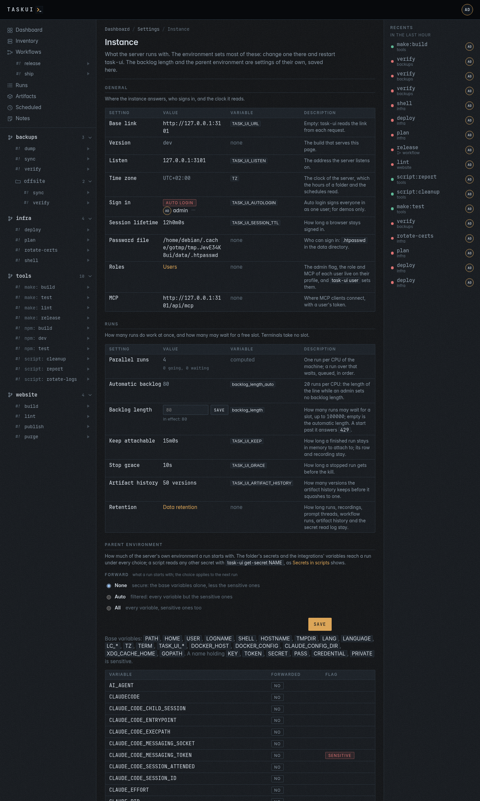
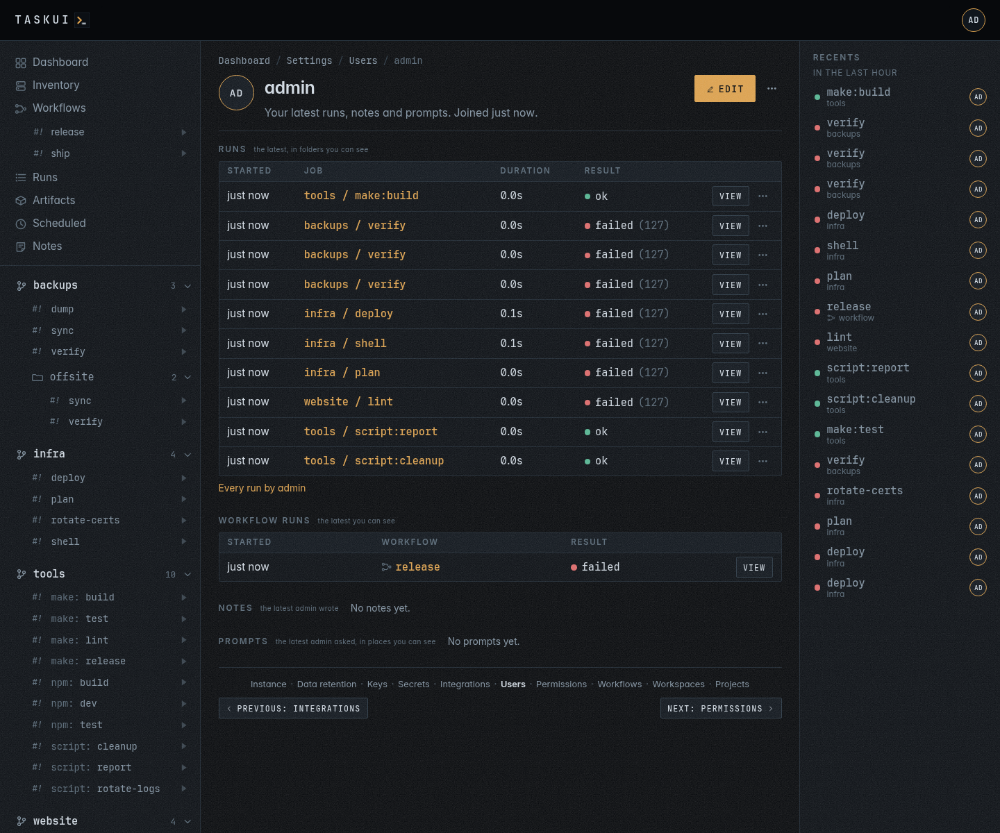
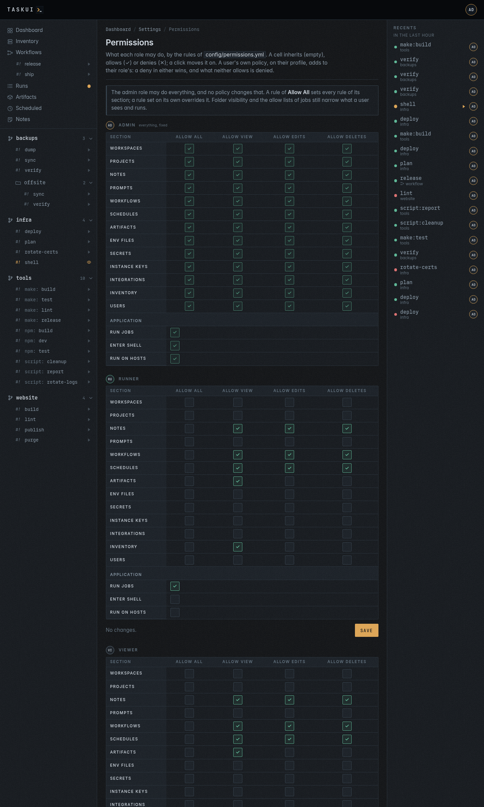
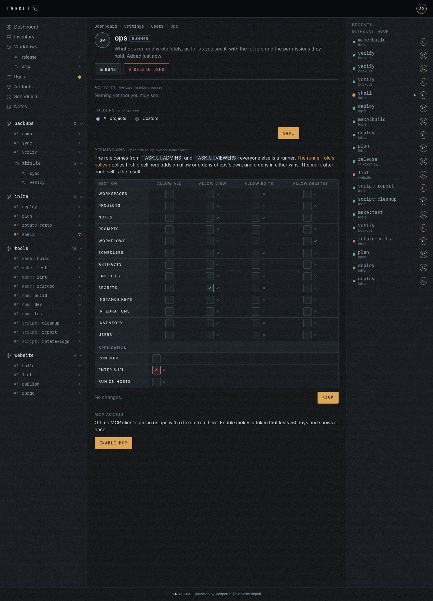

# Settings

Not in the sidebar but in the user menu, behind your initials in the
header, for whoever holds Allow View on any of its sections: Workspaces,
Projects, Instance Keys, Secrets, Integrations or Users. It holds what
the instance brings to every run. The page
lists the steps in the order you set up an instance, numbered, and
each step's page ends with a footer: **Previous** on the left,
**Next** on the right, and the steps between them as links, with the
current one in bold. A step's sub-pages, such as a key's grants, a
user's profile or a project's configure page, end with the footer of
their step. The trail lists only the steps you may open.

1. [Instance](#instance): what the server runs with.
2. [Data retention](#data-retention): how long the instance keeps what it
   records.
3. [Keys](#keys): the encryption keys and the SSH keys.
4. [Secrets](#secrets), which need an encryption key.
5. [Integrations](#integrations): Claude Code and Beszel.
6. [Users](#users): who may sign in.
7. [Permissions](#permissions): what each role may do.
8. [Workflows](workflows.md): chains of jobs.
9. [Workspaces](#workspaces): checkouts that hold projects.
10. [Projects](#projects): the folders under the root.


## Instance

`/settings/instance` shows what the server runs with, in sections, each
a table of the setting, its value, the variable that sets it and what it
does:

- **General**: the base link (`TASK_UI_URL`), the version, the listen
  address, the time zone of the server's clock, how users sign in, the
  session lifetime, the password file, the roles and the MCP endpoint.
- **Runs**: the runs that go at once, the backlog of runs that wait for
  a slot, how long a finished run stays attachable, the stop grace, the
  artifact history and a link to Data retention.
- **Paths**: the workspace folder, discovery, the data folder and how
  the host sees it, the key folder and the compose project.
- **Keys**: the instance's encryption key and the git key, each with
  its algorithm, size, fingerprint and purpose, `encryption` or
  `git + ssh`. The **⋯** menu of a key copies its public key, downloads
  it as `<name>.pub` and rotates the key (see [Keys](#keys)); it never
  shows the private key.
- **Integrations**: whether the Beszel integration lists the
  Inventory's hosts.

The environment sets most of these: change one on the server, then
restart task-ui. The backlog length is the one setting the page saves.
The page shows paths and names, never a password, token or key. Anyone
who may open a step of the settings may open it.



### Runs

**Parallel runs** is how many runs do work at once, the CPUs of the
machine. A run over that waits for a slot, in a line that holds the
**Backlog length**: 20 runs per CPU by default, **Automatic backlog**,
80 on a host with 4 CPUs. An admin sets another length here, a whole
number up to 100000, and **Save** applies it to the next start; empty
goes back to the automatic one. A start while the line is full answers
`429` (see [Runs](runs.md#runs-at-once)).

## Data retention

`/settings/retention` holds how long the instance keeps what it records,
and how much of it, one block per kind of data:

| Block | What goes | What stays | Keep for, at the start |
|-------|-----------|------------|------------------------|
| **Run recordings** | the `.cast` file of a finished run | the run, its details and its artifacts; its page says the recording expired | 31 days |
| **Artifact history** | earlier versions of the artifact tree's files, with their records | the latest version of every file in the tree | Never |
| **Secret read log** | which run got which secret | the last 1000 reads of each secret, which the log keeps whatever the rule | Never |
| **Key read log** | who read which private key, over MCP or the API | the last 1000 reads of each key, which the log keeps whatever the rule | Never |

Each block shows what it holds, the count, the size and the oldest,
and two rules:

- **Keep for**: 24 hours, 7 days, 31 days or Never.
- **Size limit**: none at the start; 100 MB, 1 GB, 10 GB, or any size
  in the field, such as `500MB` or `2GB`. Beside it, the page estimates
  how many runs, versions or reads the size holds, at the average size
  of what there is, as you type.

Past either rule the oldest go first, until both hold. A recording of
a run in progress, or of a step of a workflow run in progress, stays
and counts towards the limit. A run of `internal/*`, from before
prompts had folders of their own, falls under the same rules. A file
deleted from the tree keeps its versions in the history until they
expire.

Anyone who may open a step of the settings reads the page; an admin
saves the rules, with `PUT /api/retention`, and **Clean up now** starts
`@cleanup` at once, as a run whose output shows what went. A save
takes effect at the next run of `@cleanup`: task-ui schedules it
`@daily`, at midnight, as the first admin, once, when it first starts;
the [Schedules](scheduled.md#cleanup) page changes or deletes that
schedule.


## Keys

Keys have two purposes, and no key serves both:

- an **encryption key** stores secrets. Each workspace has exactly one,
  for its secrets; the instance has one, for the integrations' settings.
  A workspace without one stores no secrets.
- **SSH keys** connect runs and git to hosts and remotes. A workspace has
  any number, for its own runs; the instance's go to the runs of the
  roles and users they link.


The page opens on one table, a row for the instance and one per
workspace:

- **Scope**: the instance, or the workspace with its projects under its
  name. The name links to the workspace's configure page.
- **Secrets**: how many the workspace stores, linked to
  `/settings/secrets?workspace=<name>`. For the instance, the
  integrations.
- **Encryption key**: **set**, with **Rotate** and the key's fingerprint
  in small type, or **missing**, in red, with **Generate** and
  **Upload**. Without the key, the workspace stores no secrets. Rotate keeps
  the old key as a backup and re-encrypts what it encrypted: the
  workspace's secrets, or the integrations' settings for the instance's
  key, and the page says how many.
- **SSH keys**: how many, and their names, each linked to its edit
  form. A workspace with none says its runs get only the instance SSH
  keys linked to them, with **Generate** and **Upload**.

A workspace starts without an encryption key: a user with Allow Edits
on Workspaces, `workspace/edit`, adds one on this page, generated or uploaded, before it stores a secret. The only key
task-ui makes on its own is the instance's, at start when it's missing,
and a workspace's when it holds secrets and has no key, so they open.
The workspace's configure page has the same keys in its
[Keys](workspaces.md#keys) section.

Every key lives in one folder, the key folder, `TASK_UI_SSH_DIR`,
`/keys` in the image: flat, `<name>.key` and `<name>.pub`, the
folder `0700` and each file `0600`, beside `known_hosts`. The name ends
with the algorithm and the size, `deploy_rsa4096`,
`task_encryption_ed25519`, `workspace_malta_build_ed25519`,
`user_alice_ed25519`, and is unique across the folder. The database
says what each key is: an encryption key or an SSH key, of the instance
or of a workspace, and whose runs get an SSH key. Nothing but the key
folder reads a key file: git, the inventory's logins, the secrets and
the runs all go through it, and none reads `~/.ssh`.

Under the table, **Every key** lists them all: name, purpose, algorithm
and fingerprint, scope, the roles and users it links, and its date.

- **Generate key** makes a key: a name, the algorithm and the size,
  ed25519 by default, ECDSA P-256, P-384 or P-521, RSA 2048, 3072 or
  4096, and the purpose. **Upload key** takes a private key you already
  use, unencrypted, under a name; task-ui reads the algorithm and the
  size from it. A key the folder holds already, under any name or
  purpose, answers `409`: a key has one purpose.
- The copy button copies a public key, to add on the hosts that
  accept it. **Remove** retires an SSH key: its files stay in the folder
  as `<name>.key.bak-<time>`, nothing lists or loads them.
- **Who gets it** picks whose runs get an SSH key, in a **Roles** row and
  a **Users** row of boxes. A run started by someone with one of the
  key's roles, or by one of its users, has it in the run's ssh agent, and
  nothing else does: that agent is the only way a key reaches a run,
  from memory, with no key file on disk. A workspace's SSH key with no
  link goes to every run of the workspace. An instance SSH key with no
  link stays the instance's: the inventory's logins use it, runs don't.
- **git pulls and clones with this key**, on a key's edit form, makes it
  the one key git uses for every checkout; the Instance page shows it.
- **A key for someone**: **Generate a key for alice** on her profile
  starts `user_alice_ed25519`, linked to her. She finds it under **SSH
  keys** in her user menu, and copies the public half to her git host or
  servers. The key files are still readable by any job, as jobs run as
  the server's user; links decide what a run gets, they do not hide a
  file. Keep the key folder out of `~/.ssh`, so `ssh` in a job does not
  find the keys by default.
- **Who gets which key** lists each role and each user, and the instance
  SSH keys their runs get: a user's own keys, then, dashed, those of
  their role.
- A project with private keys in its `.ssh/` folder gets a warning: runs
  do not load them. Keys belong in the key folder: upload a key it needs
  and link it, then delete the folder.

The instance's encryption key, `task_encryption_ed25519`, encrypts the
integrations' settings. No run, git remote or SSH connection gets it,
and with it gone the workspaces' secrets still open.

### Rotate Key

**Rotate Key**, in the **⋯** menu of a key on the Instance page and
beside the instance's encryption key here, makes a new key of the same
algorithm and size under the key's name and moves the previous one to
`backup/<name>.key` and `.pub` in the key folder, `0600` in a `0700`
folder. The key's row records the backup's fingerprint and when it
rotated, and shows `BACKUP ACTIVE: backup/<name>` while the backup is
there. Both keys serve meanwhile:

- the encryption key decrypts with the new key, then the backup, and
  the rotation writes the integrations' settings again for the new key;
  the page says how many it re-encrypted.
- an SSH key goes into the ssh agent of runs, git pulls and host probes
  with its backup after it, so a host or a remote that knows the old
  public key alone still lets them in. Add the new public key there,
  then delete the backup.

A key keeps one backup: while it has one, **Rotate Key** stays off with
"Delete the backup first". **Delete backup** removes the backup's files
and record, after a confirm that names its fingerprint; the key then
rotates again. The routes are `POST /api/keys/{name}/rotate` and
`DELETE /api/keys/{name}/backup`; `POST /api/keys/encrypt/rotate`
rotates the instance's encryption key the same way, and a key with a
backup answers `409`.

### One key, one use

A key either encrypts secrets or authenticates SSH connections, never
both, and the folder holds a key once, by its fingerprint.

- No encryption key goes into a run's ssh agent, into git's ssh command,
  into a link, or to the inventory's logins; no route hands one out.
- No SSH key is an age recipient or opens a secret.
- An upload of key material the folder holds already, under any name or
  purpose, answers `409` and writes nothing. A scope holds one
  encryption key.

```sh
curl -s https://task.example.com/api/keys -H "Authorization: Bearer $TOKEN"
curl -s -X POST https://task.example.com/api/keys/generate -H "Authorization: Bearer $TOKEN" \
  -d '{"name": "deploy", "algo": "rsa", "bits": 4096, "policies": ["admin"], "users": ["claude"]}'
curl -s -X PUT https://task.example.com/api/keys/task_ssh_ed25519 -H "Authorization: Bearer $TOKEN" \
  -d '{"git": true}'
```

`GET /api/keys` lists every key, the instance's encryption key again as
`encrypt` and the git key's name as `git`, public halves and
fingerprints only. The rotation answers the key and `rekeyed`, the
count of integration settings task-ui wrote again.

### Moving the keys into the key folder

An instance from before the key folder kept its keys apart:
`TASK_UI_DATA/instance/encrypt`, `TASK_UI_DATA/workspaces/<id>/encrypt`
and `ssh`, and `id_*` files in `TASK_UI_SSH_DIR`. The first start takes
them in once and logs each by its old file, its name and its
fingerprint:

- the instance's encryption key becomes `task_encryption_<algo>`;
- a workspace's becomes `workspace_<folder>_encryption_<algo>`, the
  default workspace's folder as `default`, and its SSH keys
  `workspace_<folder>_<name>_<algo>`, with their grants;
- `id_ed25519` of the key folder becomes `task_ssh_ed25519`, which git
  pulls with, and `id_<type>_<name>`, as `id_rsa_deploy`, becomes
  `<name>_<algo>`, `deploy_rsa4096`, with the roles and users its
  policy named.

Backups come along, to decrypt what they encrypted, and the secrets and
the integrations open as before. The old files stay in place;
nothing reads them, and the log says so: remove them once the keys work.

## Secrets

Variables added to the environment of the runs in a
[workspace](workspaces.md). The page manages them and groups them by
workspace: first the secrets for every project in it,
then each project's own under the project's name. A row shows the
secret's name, its scope, when it changed, its **Reads** and **Last
read**, and two buttons, replace the value and delete. A value is never
shown again once saved.

Every run records the secrets it gets in its environment, one read per
secret per run. **Reads** counts them, and **Last read** says when the
last run got the secret and names its job as `folder/dir/job`, a link to
that run. The count links to the secret's read log,
`/settings/secrets/<id>/reads`: the runs that got it, newest first, 50 a
page, each with when, the run, the job and who started it. task-ui keeps
the last 1000 reads of each secret and drops older ones. A run's page
lists the names of the secrets the run got, never a value, for users
with `secret/view`.

A secret has a scope:

- `workspace:<name>`, a workspace's shared secret, reaches every project
  in that workspace and no project in another one. "every project in
  _", `workspace:_`, reaches the projects at the root; a project in a
  named workspace doesn't get it.
- a folder, `malta/deploy`, reaches that folder's jobs and wins over its
  workspace's shared secret of the same name.

**Add secret** at the top opens the form with a scope picker; each
workspace has an **Add secret** of its own that starts on its shared
scope. In the API, the scope `all`, or none, is `workspace:_`.
`/settings/secrets?workspace=malta` shows one workspace alone; the keys
page links each workspace's count of secrets there.


A workspace stores secrets once it has an encryption key (see
[Keys](#keys)). Without one, its group says **Add an encryption key to
store secrets**, with a link to the keys page, its **Add secret** is
off, the form leaves its scopes out, and `POST /api/secrets` answers
`409`:

```json
{"error": "the workspace acme has no encryption key, so it stores no secrets: generate or upload one in Settings, Keys"}
```

The ⋯ menu of a workspace with a key holds **Rotate encryption key**.
After a confirmation, task-ui rotates the key to new material, keeps the
current one beside it as a backup, `<name>.key.bak-<time>`, re-encrypts the
workspace's secrets, and the page says how many: **Re-encrypted 3
secrets.** Runs see no change.

The scopes keep a workspace's secrets out of the environment of
another workspace's runs, not out of their reach on disk (see
[What a workspace keeps apart](workspaces.md#what-a-workspace-keeps-apart)).
A folder's workspace is its first segment when that's a named
workspace, else `_`. Removing a workspace removes its secrets with its
keys. The integrations' settings aren't on this page: the
[Integrations](#integrations) page holds them, on the instance's
encryption key.

At start, task-ui moves the secrets of an instance that kept them all on
its SSH key, the `id_ed25519` or `id_rsa` of the key folder: a secret
for all folders, scope `all`, becomes `_`'s shared secret,
`workspace:_`, and task-ui writes every other secret again for its
workspace's key. A workspace that holds secrets and has no encryption
key gets one for them first. Before it writes anything it copies the
database to `task-ui.db.pre-workspace-keys`. Then it writes every
integration setting the instance's encryption key can't open again for
that key, after a copy to `task-ui.db.pre-keysplit`; it reads each one
back before it keeps it. A secret no key opens stays untouched, and the
log names it. The log lines `secrets on their workspace's key` and
`integrations on the instance's encryption key` count what moved. These
moves are the only reads with the SSH keys; after them the SSH keys can
go and every secret still opens.

## Integrations


The services task-ui talks to, with their API keys and tokens. task-ui
encrypts them with the instance's encryption key, which the workspaces'
secrets don't use, and never
shows them again: a form marks a secret with a value as **set**, and an empty secret
field keeps it on save. The Secrets page leaves them out, and no run sees
them as secrets. A switch beside each integration's name shows or hides
its form, and the browser keeps the choice. **Clear** deletes every
setting of an integration.

- **Claude Code**: the token Claude Code signs in with, from
  `claude setup-token`, for the whole instance, and **Who**: a box for
  each role and each user, checked for those whose runs get it as
  `CLAUDE_CODE_OAUTH_TOKEN`, such as the admin role and the user
  `claude`. Check the agent's user too: the agent job of the
  [Notes](notes.md) board runs as that user. With no box checked, every
  run gets it. The token alone sets the integration up.
- **Beszel**: the hub's URL, as task-ui reaches it, and a token, for the
  [Inventory](inventory.md) page. task-ui reads the collections
  `systems`, `system_stats`, the latest minute of each host and its
  records of eight or two hours for the charts, `containers`, the
  containers each host runs, and `container_stats`, their records,
  the newest minute on a hub without `containers`. A read-only user
  reads them all.

Beszel has no API keys, so task-ui takes a token of a read-only user that
no one signs in as. Make one in Beszel with a password nobody keeps, then
mint a token for it as a superuser, with how long it lasts in seconds:

```bash
super=$(curl -s -X POST http://beszel:8090/api/collections/_superusers/auth-with-password \
  -H 'Content-Type: application/json' -d '{"identity":"<admin email>","password":"<admin password>"}' | jq -r .token)
curl -s -X POST http://beszel:8090/api/collections/users/impersonate/<user id> \
  -H "Authorization: $super" -H 'Content-Type: application/json' -d '{"duration":31536000}' | jq -r .token
```

The token works until it expires, and changing the user's password in
Beszel revokes it.

## Users

Who may sign in comes from the password file on the server. **Create
user** adds one to it, with a name and a password of at least 8
characters, and they can sign in at once; `task-ui passwd <user>` on the
server adds or resets one too. **Delete** on a user's row or page
removes one who is no admin and not you: their line leaves the file, and
their sessions, tokens and policy end at once, while runs, notes and
history keep their name. Deleting takes Allow Deletes on Users,
`user/delete`. Removing the line on the server does the same,
and task-ui reads the file again whenever it changes. A new user
comes in as a viewer, the lowest role; the first users of an empty
database come in as admins (see [Running the
server](../running.md#users-and-roles)). The **Flags** column shows
`mcp` for an MCP agent user and `agent` for one whose mentions run
instance Claude.

What a role may do comes from permission policies over the rules of
`config/permissions.yml`, which [Permissions](#permissions) sets. An
admin may do everything. A runner runs jobs, reads and writes notes,
workflows, schedules and the artifact tree, and reads the inventory; a
viewer does the same without running and without writing the artifact
tree. A user's own allow or deny decides first; where the user has
none, the role's rules decide, and a deny there wins over an allow.
[Permissions](#permissions) lists what each role starts with.


A user's name opens their **profile**, at `/users/<name>`: the name and
the role, and what the
user ran and wrote lately, as far as you see it: runs and workflow runs
in folders you see, notes with Allow View on Notes, and prompts with
Allow View on Prompts in places you see. With Allow Edits on Users the
profile sets which folders the user sees: **All projects**, or
**Custom** and the folders checked. The profile also holds the user's
own permissions and their MCP access, and **Delete user**. Under
**Roles** an admin sets what the user is:

- **Administrative privileges (all)**: every permission, whatever the
  role says. The last admin keeps it: unchecking it answers "the last
  admin".
- **Role**: runner or viewer, what the user's permissions start from
  without the flag.
- **MCP agent user**: the user's token reaches the MCP endpoint, and an
  agent learns of work from the notes that name the user. Off, it ends
  the user's MCP token.
- **Run instance Claude when mentioned**: a note naming the user starts
  the Notes agent as them. It needs MCP agent user.

Anyone else reads them there. Anyone with
Allow View on Users opens any profile; everyone opens their own, from
**Profile** in the user menu.



Next to a user's name, on every page that shows one, a **⋯** button
opens a menu: **Profile**, **Runs by this user**, which opens Runs
filtered to them, and **Permissions** with Allow Edits on Users. A name
that no user holds, such as the agent a note names, has no profile.

A profile's **MCP access**: **Enable MCP** makes a token for an MCP
client that lasts 30 days and shows it once, with the `claude mcp add`
command filled in. Once on, the section shows its dates, the expiry in
amber within a week and red once past, with **Rotate** and **Disable**.
Enabling takes Allow Edits on Users; you rotate or disable your own from
your own profile. `/settings/users/<id>` opens the profile too. See
[MCP](mcp.md).


A client that is not a browser, such as an agent over [MCP](mcp.md),
signs in with a token instead: `task-ui token <user> <name>` on the
server prints one, once, without an expiry. Under the table, **Connect an
MCP client** shows the instance's base link and its MCP endpoint, each
with a copy button, the link to your own MCP access, and the command
that connects Claude Code.

## Permissions

What each role may do, rule by rule, over `config/permissions.yml`: each
section, such as Notes, Secrets or Users, has the rules **Allow All**,
**Allow View**, **Allow Edits** and **Allow Deletes**, and the
application has **Run Jobs**, **Enter Shell**, **Run on Hosts** and
**Allow interactive mode**.
Instance Keys adds **Allow Read Private**, `key/read`, an agent's read
of an SSH key's private half (see [MCP](mcp.md#an-ssh-key-for-a-task)):
Allow All leaves it out, so it takes an allow of its own, and only
admins hold it at the start. A matrix per role holds a row per section,
a column per rule, and under them Allow Read Private and the
application's permissions.



A cell inherits, empty, allows, a green ✓, or denies, a red ✕; a click
moves it to the next, and **Save** keeps the cells that changed. **Allow
All** sets every rule of its section; where it and a rule set on its
own disagree, the deny wins. The admin role shows every cell allowed and none changes:
an admin may do everything. The page opens with Allow View on Users and
changes with Allow Edits on Users; your own role's matrix changes only
when your role grants Allow Edits on Users.

A user's profile has the same matrix under **Permissions**, for their own
policy over their role's, with the result after each cell: a muted ✓
where the user may do it, ✕ where not. The user's own allow or deny
decides first, whatever the role says; an empty cell inherits the role's
rules, where a deny wins over an allow; what neither allows, the user may
not do. An admin's matrix shows
everything allowed and does not change, and your own changes only with
Allow Edits on Users through your role, so no one grants themselves
more.



The application's permissions gate what the sections do not:

| Permission   | Rule    | Gates |
|--------------|---------|-------|
| Run Jobs     | `run`   | starting a folder's jobs and ending their runs, from the pages, the API and `run_job`; a workflow takes it for every step, and a schedule for its job |
| Enter Shell  | `shell` | **Enter Shell**, the job `@shell`, an interactive `bash -l`, and **Enter Claude**, the job `@claude`, which also takes a Claude token |
| Run on Hosts | `hosts` | the command form of [Inventory](inventory.md), which runs a command on its hosts over ssh, and its **Run and summarize** |
| Allow interactive mode | `input` | **Take input** in the run window: typing into a running run of a job that takes no input, to answer a prompt it waits on (see [Runs](runs.md#the-run-window)) |

The admin role may do everything and holds no policy. The other roles,
and the `claude` user, start with these policies; everything else they
lack until a policy allows it:

| Subject       | Allowed at the start |
|---------------|----------------------|
| runner role   | Run Jobs; view, edit and delete on Notes, Workflows and Schedules; Allow View and Allow Edits on Artifacts; Allow View on Inventory |
| viewer role   | the runner's, without Run Jobs and Allow Edits on Artifacts |
| `claude` user | Run Jobs; Allow View and Allow Edits on Notes and on Prompts |

So no role but admin starts with Enter Shell, Run on Hosts, Allow
interactive mode, the prompts or any section of the settings.

Folder visibility and the allow lists of jobs still apply over the
permissions: a user runs a job with Run Jobs, in a folder they see, when
its allow lists name them or their role.

## Workflows

The workflows step opens the [Workflows](workflows.md) page, the
chains of jobs that run one after another. Its footer links to
Permissions before it and Workspaces after it.

## Workspaces

Checkouts under the root that hold projects: an organisation's tooling,
with the projects cloned inside it. **Add workspace** clones one under
the folder you name, **Move up** and **Move down** order them, and the
remove button deletes one with the projects inside it. **Configure**
changes a workspace's title, description and **Recursive**, the toggle
a project has, and holds its **Keys**, the
encryption key of its secrets and the SSH keys of its runs, which the
[Keys](#keys) page also lists, and
**Export**, which **Import** on another instance reads.
[Workspaces](workspaces.md) covers them, their keys and runs, the move
between instances, what they keep apart, and the prompt against a
workspace.

## Projects

The folders under the root, with their sources, where they came from, and
the space each takes: its files, and the git history beside them.


**Add project** clones a git repository into the root. It either works,
and the folder appears in the sidebar, or the page shows git's output and
keeps nothing. git reaches private repositories with the instance SSH
keys.

**Configure** on a folder sets what the instance adds to it; its files
stay as they are:

- a title and a description;
- **who can run it**: a box for each role that runs, admin and runner,
  and each user who is no viewer; none checked is every runner. Each job
  has the same boxes in the per-job table, over the folder's, and none
  checked there inherits;
- which **sources** to read, which is also how a folder with a pipeline
  gets its Makefile or scripts back as jobs;
- **hours**, one rule per line, days then a span. The last rule that
  covers a day decides it:

  ```
  mon-fri 9-17
  fri 9-13
  ```

  runs Monday to Thursday nine to five, Friday mornings, and never on the
  weekend. Days are names or ranges (`mon-fri`, `sat,sun`, `weekdays`,
  `daily`); spans are hours or `hh:mm`;
- **Recursive**, on by default, lists the folders inside the project as
  deep as they go; off lists the project and its top-level folders
  alone, to keep a tree's nested folders out of the catalogue (see
  [Projects and jobs](projects.md#where-the-jobs-come-from));
- the **workspace** a project at the top of one is in: another one moves
  the project there, as
  [Move a project](projects.md#move-a-project-to-another-workspace)
  describes.

The API sets three more on a project: `commands`, the program a kind of
job runs with (`make: gmake`), and `job_allow` and `job_hours`, who may
run and when, per job.


## Env files

A folder's page lists the dotenv files its pipeline reads. A user with
Allow View on Env Files, `env/view`, opens one, and with Allow Edits,
`env/edit`, edits it there: on saving, and again before every run, task-ui writes the file in the
folder from it with the secrets appended. For a file nobody has
edited, task-ui reads the one in the folder unchanged.


---

Previous: [Recents](recents.md) · Next: [MCP](mcp.md) · [Contents](../README.md)
