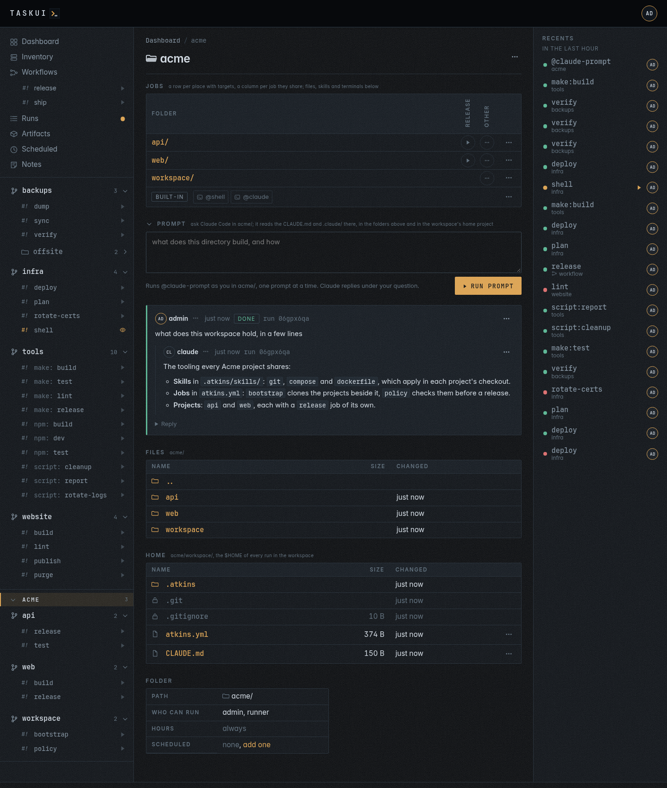
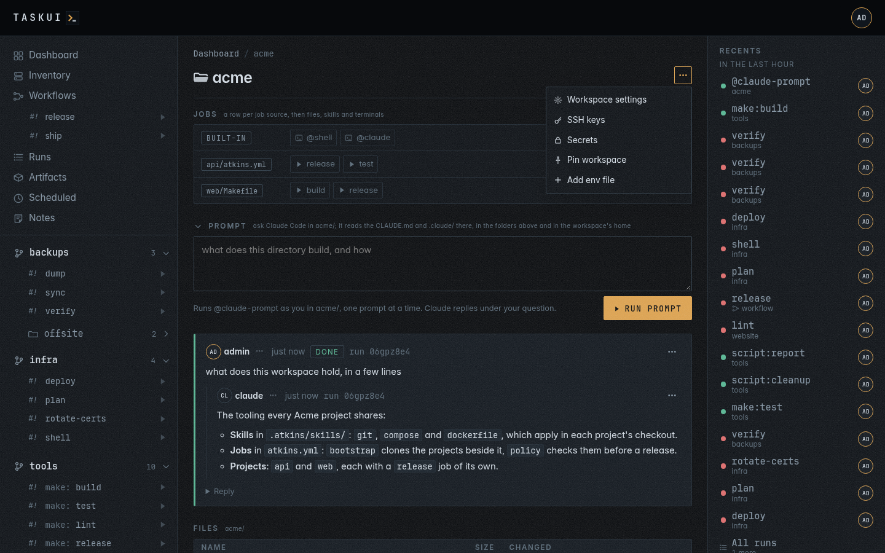
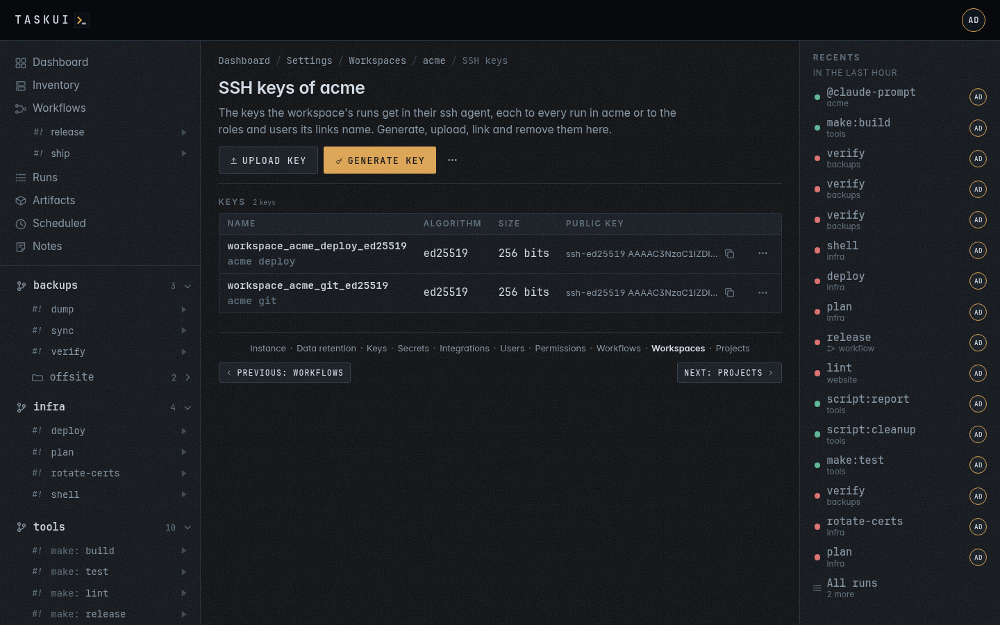
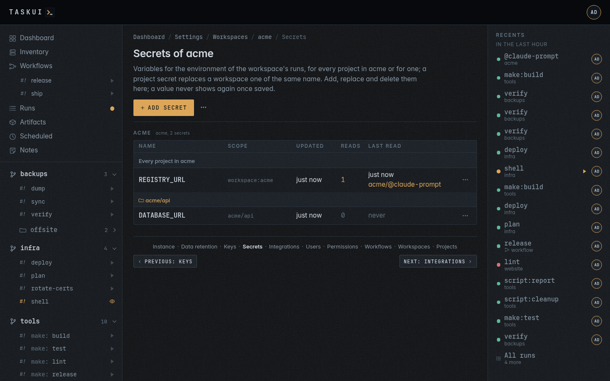

# Workspaces

A workspace is a plain directory under the root that holds projects
side by side, each a checkout of its own, none inside another. One of
them may be the workspace's **home project**: the checkout of what an
organisation's projects share, such as `.atkins/skills`, a `CLAUDE.md`
with `.claude/`, and its policies. You name the workspace's folder, and
the folder is the namespace of its projects: `dockerfiles` cloned into
the workspace `malta` lives at `<root>/malta/dockerfiles`, its folder ID
is `malta/dockerfiles`, and it opens at `/f/malta/dockerfiles`.

```
<root>/malta/            the workspace, a plain directory
<root>/malta/workspace/  the home project, HOME of every run in malta
<root>/malta/dockerfiles/
<root>/malta/apps/
```

Every project is in a workspace. The **default workspace**, `_`, is the
root itself: it holds the projects cloned at the top of the root, and
their pages open under `/f/_/`, so `infra` opens at `/f/_/infra`. A link
without the `_`, such as a bookmarked `/f/infra`, redirects there for
good, its query kept. `/f/_` lists the projects at the root you can see.
task-ui adds the default workspace when it starts, and nobody can
remove it. No workspace, project or directory under the root takes the
name `_`, nor `internal`; discovery skips a directory of the root with
either name.


## The home project

A run in any folder of a workspace with a home project gets the home
project's directory as `HOME`, so the tools a job calls find the
workspace's files there:

- **atkins** reads its skills from the `.atkins/skills` of the working
  directory and of every folder above it, nearest first, then from
  `$HOME/.atkins/skills`: the home project's. A project skill of the same
  name shadows the workspace's. Its pipeline is the project's own.
- **Claude Code** gets the home project as a directory it reads, with
  its `CLAUDE.md` and `.claude/` skills, beside its working directory.

The workspace's page, `/f/malta`, lists the home project's files in
its **Home** section, the `$HOME` of every run in the workspace, in the
table of the Files section: a directory opens its page, a file opens in
the preview window, a dot file and `.git` list sealed and never open.
A workspace without a home project shows no Home section.



A workspace without a home project, and the default workspace without
one, keep the server's `HOME`. The run keeps what the server holds in
its own `HOME` in use, each a variable the server does not set itself,
pointed at the server's `HOME`:

| What | Variable |
|------|----------|
| atkins' stats, which the Tooling charts read | `ATKINS_DB`, `~/.atkins/atkins.db` |
| registry logins of `docker login` | `DOCKER_CONFIG`, `~/.docker` |
| the git identity and settings | `GIT_CONFIG_GLOBAL`, `~/.gitconfig` |
| the caches and configuration of XDG tools, Go's build cache among them | `XDG_CONFIG_HOME`, `XDG_CACHE_HOME`, `XDG_DATA_HOME`, `XDG_STATE_HOME` |
| Go's modules | `GOPATH`, `~/go` |
| a shell's history | `HISTFILE`, `~/.bash_history` |
| Claude Code's settings and sessions | `CLAUDE_CONFIG_DIR`, `~/.claude` |

ssh reads `~/.ssh` from the user's entry in the password database, not
from `HOME`, so its configuration and known hosts stay the server's.
`bash -l` reads the home project's `.profile` or `.bash_profile`, when
it has one. The run also gets `TASK_UI_HOME`, the home project's
directory.

## Skills

The skills of a workspace's home project, its `.atkins/skills/`, add
rows to the [Jobs table](projects.md#skills) of every project and
directory inside it: `@git:pull` and `@git:rebase` on each checkout,
`@compose:down` and `@compose:up` beside a compose file. A skill is an atkins
pipeline file, `<name>.yml`, its jobs named `<name>:<job>`, and its
`when:` decides where it applies:

- `files:` lists the files that turn it on, any one of them, looked for
  in the directory and then in each folder above it. A name with `*`,
  `?` or `[...]` is a glob. A skill without `when:` applies everywhere.
- `here: true` looks in the directory alone, so a compose skill shows on
  the directory holding `compose.yml` and not on the folders under it.
- `contains:` is a regular expression the matched file must match, such
  as a compose file with a `build:` key.
- A job takes a `when:` of its own, with the same keys. Where it fails,
  the job has no row and a run of it fails, and the rest of the skill
  stays.
- `args: true` on a job takes arguments after `--`, which atkins appends
  to the job's `exec:` steps as argv, with no shell between. Its row
  carries `args`, and its **Run...** opens a field for them (see
  [Runs](runs.md#what-a-job-gets)).

A skill job runs in the directory of the file its `when:` matched, so
`git: pull` runs at the top of the checkout and `compose: up` beside the
compose file. One without `when:` runs in the folder that holds its
`.atkins/`.

`<home project>/.atkins/skills/compose.yml`:

```yaml
name: Docker Compose
when:
  files: [compose.yml, compose.yaml]
  here: true

jobs:
  up:
    desc: Start the services
    cmd: docker compose up -d --remove-orphans
  down:
    desc: Stop and remove the services
    cmd: docker compose down
  build:
    desc: Build the service images
    when:
      files: [compose.yml, compose.yaml]
      here: true
      contains: '(?m)^\s+build:'
    cmd: docker compose build
  custom:
    desc: Run docker compose with arguments
    args: true
    steps:
      - exec: [docker, compose]
```

In a directory whose `compose.yml` builds an image, the `@compose`
rows are `build`, `custom`, `down` and `up`; beside one that only pulls
images, they leave `build` out. `atkins -l` in a directory lists what applies
there, as the Jobs table does. The atkins [skills
guide](https://github.com/titpetric/atkins/blob/main/docs/content/usage/skills.md)
covers the rest: aliases, `help:`, the `-l --json` fields task-ui reads,
vendoring.

## Add, edit and delete

Settings, **Workspaces** manages them: Allow View on Workspaces,
`workspace/view`, opens the page, Allow Edits, `workspace/edit`, adds,
configures, orders, exports and imports, and Allow Deletes,
`workspace/delete`, removes one. The page lists
each workspace with its home project and the projects cloned inside it,
in the sidebar's order.


- **Add workspace** makes the directory under the root, the folder you
  name. A **Home project URL** clones that repository into the workspace
  as a project, in a folder you name or one named after the repository,
  and makes it the home project. The clone works, or the page shows
  git's output and keeps nothing. task-ui refuses a folder that a
  workspace, a project or a directory under the root holds already, and
  `internal` and `_`, its own.
- Any number of workspaces may take the same repository as their home
  project, each under its own folder: two teams can start from the same
  tooling and clone different projects beside it.
- **Workspace settings** opens the workspace's configure page. Its
  **Settings** change the title, description and **Recursive**, which,
  as a project's does, lists the folders inside it as deep as they go,
  or, off, the workspace and its top-level folders alone; the folder
  stays. Its **Home project** shows the home project with its
  repository, or "No home project.", and beside it **Change**, which
  picks another project at the top of the workspace, **Add**, or
  **Replace** with one set, which clones a repository into the workspace
  as a project and makes it home, and **Remove**, which unsets it and
  keeps the project. Its **Projects** lists the projects inside it in the
  table of the Projects page, and **Add project**, at the top right,
  clones one into it.
- **Move up** and **Move down**, in a workspace's **⋯** menu, change the order of the workspaces, in
  the sidebar and on the page. An added workspace goes last. The default
  workspace lists first and keeps its place.
- **Delete**, last in the menu, deletes every project inside the
  workspace with its checkout and its row, the env files task-ui keeps
  for them, the workspace's secrets and its keys, and the directory once
  nothing else is in it; its confirm names those projects first.
  Deleting the home project, as any project, unsets it. The default
  workspace has none: `DELETE /api/workspaces/_` answers `409`.
- **Import**, under the list, adds a workspace from a bundle another
  instance exported (see [Move to another
  instance](#move-to-another-instance)).

## Clone a project into one

**Add project** under Settings, Projects has a **Workspace** select.
`_`, the default, clones the project at the top of the root; a named
workspace clones it inside, as `malta/dockerfiles`. The Projects page
lists it under that name. In the API an empty `workspace` means `_`. A
project cloned at the root may not take a workspace's name or a
directory that's there already: that answers `409` before git runs.

A checkout in the workspace without a project row lists too, when it
holds a job source anywhere inside it, such as `malta/deploy` with its
`scripts/atkins.yml`: it opens at `/f/malta/deploy` with its jobs and the
folders inside it, as a project does (see [Where the jobs come from](projects.md#where-the-jobs-come-from)).
A checkout that a project's `.gitignore` ignores right below it lists
the same way.

**Recursive**, on the workspace's add and configure forms as on a
project's, is on by default: discovery lists the folders inside the
workspace as deep as they go. Off, it lists the workspace's top-level
folders alone, and the projects inside it by their own Recursive.

The API does the same, with a token from `task-ui token`:

```sh
curl -s -X POST https://task.example.com/api/workspaces \
  -H "Authorization: Bearer $TOKEN" \
  -d '{"folder": "malta", "title": "Malta", "url": "git@example.com:org/workspace.git"}'
curl -s -X POST https://task.example.com/api/projects \
  -H "Authorization: Bearer $TOKEN" \
  -d '{"url": "git@example.com:org/dockerfiles.git", "workspace": "malta"}'
curl -s -X PUT https://task.example.com/api/workspaces/malta \
  -H "Authorization: Bearer $TOKEN" \
  -d '{"title": "Malta", "home_project": "malta/workspace"}'
```

The create's `url` is optional: with it, `project` names the home
project's folder, the repository's name when left out, and `branch` its
branch; the reply carries the `project` it cloned. A taken folder
answers `409`. `PUT /api/workspaces/malta` with `{title, description}`
changes its text, `recursive` its Recursive, `home_project` the home
project by its folder, `""` to unset it, and `DELETE
/api/workspaces/malta` removes it. A workspace's row names its home
project's ID in `home_project_id`, `""` for none. A `home_project` that
is no project at the top of the workspace answers `400`. `POST
/api/projects` with `"home": true` clones a project into its workspace
and makes it home, the Replace of the page. A `sort` in the `PUT` places the workspace: the lowest comes
first, and workspaces of one sort go by folder. Left out, the sort
stays.

## In the sidebar

The projects at the top of the root come first, by name, and the
workspaces follow them, in their order. A workspace adds a level above
its projects: a label row with the
workspace's name, the count of its projects and a chevron that points
down while it's open. Under it come the workspace's own jobs, then its
projects, each with a fold of its own. This browser remembers each fold
apart, so `malta` and `malta/dockerfiles` open and close on their own.
With no named workspace, the sidebar lists the projects alone (see
[Projects and jobs](projects.md)).

## Runs in a workspace

A run of a job in the workspace or in one of its projects gets two more
variables (see [Runs](runs.md#what-a-job-gets)):

- `TASK_UI_WORKSPACE`, the workspace's folder, such as `malta`, or `_`
  for a project at the root;
- `TASK_UI_WORKSPACE_DIR`, its directory, such as `<root>/malta`, or the
  root for `_`;
- `HOME` and `TASK_UI_HOME`, the home project's directory, when the
  workspace has one (see [The home project](#the-home-project)).

Before the job, the run pulls the home project, then the project's
checkout, so the shared tooling is current when the job starts. When
either pull fails, the run fails with it.

## Keys

Every workspace has SSH keys of its own, in the key folder,
`TASK_UI_SSH_DIR`, out of its directory, where a `git add -A` would
publish them: `workspace_<folder>_<name>_<algorithm>.key` and `.pub`,
the files `0600`. The **Keys** section of a workspace's configure page,
`/settings/workspaces/malta`, lists them in the keys table of the Keys
page, name, algorithm, size, public key with its copy button, purpose
and the **⋯** menu, never a private key. With none, it says "No keys
added." beside **Upload key** and **Generate key**.

**SSH keys**, in the **⋯** menu at the top right of the workspace's
page, `/f/malta`, opens `/settings/workspaces/malta/keys`, the
workspace's keys alone, edited in place: **Generate key** and **Upload
key** at the top right, and **Edit links** in a key's **⋯** menu, open
their forms in a dialog over the list, and **Remove** retires a key.
The page and the menu item take `workspace/view`, the forms
`workspace/edit`, as the key routes do.





- The **SSH keys**, zero or more, are for the workspace's runs. A
  workspace has no encryption key: the instance's encrypts its
  [secrets](settings.md#secrets), as every secret.
  Generate or upload any number, each under a name of its own,
  `workspace_malta_deploy_ed25519`. A key without a link goes to every
  run in the workspace; checking roles or users narrows it to their
  runs. Remove retires the key and its links. With none, task-ui can't
  SSH to the workspace's hosts with a key of its own: its runs get only
  the instance SSH keys linked to them.

A key has one use (see [One key, one use](settings.md#one-key-one-use)):
an upload of key material the key folder holds already, under any name,
answers `409`.


A run gets the instance keys linked to it (see
[Settings](settings.md#keys)), then its workspace's SSH keys, and the
first line of its terminal names each: `$ ssh-agent: deploy_rsa4096,
workspace_malta_deploy_ed25519`. A project at the root gets the keys of
`_`. The links decide what reaches a run's agent, not what a job can
open on disk (see [What a workspace keeps apart](#what-a-workspace-keeps-apart)).

```sh
curl -s -X POST https://task.example.com/api/workspaces/malta/keys/generate \
  -H "Authorization: Bearer $TOKEN" \
  -d '{"algo": "ed25519", "name": "deploy", "policies": ["admin"]}'
curl -s https://task.example.com/api/workspaces/malta/keys \
  -H "Authorization: Bearer $TOKEN"
```

`PUT /api/workspaces/malta/keys/workspace_malta_deploy_ed25519` with
`{policies, users}` sets the links, empty for every run, and `DELETE`
retires the key. `"encrypt": true` on `generate` or `upload` answers
`400`: one encryption key per instance. Listing the keys takes
`workspace/view`; the other key routes take `workspace/edit`.

## Secrets

A workspace's secrets reach its runs as variables (see
[Settings](settings.md#secrets)). Its **shared** secrets, scope
`workspace:malta`, reach every project in it; a project's own, scope
`malta/deploy`, reach that project and win over a shared one of the same
name. The shared secrets of `_` reach the projects at the root and no
named workspace: a project in `malta` gets `malta`'s shared secrets and
its own, never `_`'s. The instance's encryption key encrypts them all.
The Secrets page groups
them by workspace, each project's under its name.

**Secrets**, in the **⋯** menu at the top right of the workspace's
page, opens `/settings/workspaces/malta/secrets`, the workspace's
secrets alone, edited in place: **Add secret** opens a dialog with the
workspace's scopes, the shared one and each project's, **Replace the
value** in a secret's **⋯** menu opens one that takes the new value, and
**Delete** removes it. A value never shows again once saved. The page
and the menu item take `secret/view`, Add and Replace `secret/edit`,
Delete `secret/delete`.



## Move to another instance

A workspace moves to another task-ui as a bundle, `<folder>.tui.age`:
a tar.gz of `manifest.json` and `.ssh/`, encrypted with
[age](https://age-encryption.org) to a passphrase of at least 12
characters. Whoever holds the file and the passphrase holds the
workspace's secrets and SSH keys: nothing else protects them inside it,
and task-ui keeps no copy of the passphrase.

The bundle carries:

- the workspace's row: title, description, sort and Recursive, as
  `shallow`;
- its projects, by folder relative to the workspace, with their
  repository, branch and settings, and the home project's folder in
  `home_project`;
- its env files, by folder and path;
- its secrets in plain text in `manifest.json`, which the importing
  instance encrypts with its own encryption key as they go into its
  vault;
- the SSH keys the workspace's runs get, its own keys, as
  `.ssh/<name>.key` and `.ssh/<name>.pub`, and their links; an import
  names them after its folder, `workspace_<folder>_...`.

It never carries the instance's encryption key, the instance's SSH keys
or another workspace's keys. Schedules, workflows, runs and artifacts
stay on the instance, as do the integrations. The bundle of `_` leaves
out the named workspaces and `internal`.

**Export** at the top right of a workspace's configure page opens a
dialog for the passphrase, typed twice, or made by **Generate**: 24
random characters, shown once with a copy button. Store it before you
export, since nothing recovers it. **Export** in the dialog then
downloads the bundle; the passphrase goes in the request body, never
in the URL or the logs. **Import** at the top right of the Workspaces
page opens a dialog for the file, the passphrase and the folder to
import it as, the bundle's own when left out. The folder must be free,
as for Add workspace: a folder held answers `409`. The import makes the
workspace's directory, writes the keys `0600` into the key folder, adds
the rows under the folder with the home project set, clones each
project, then writes the env files into the folders the clones made. A
bundle of another format answers `400`. A project that does not clone keeps its row,
and the import reports git's output for it. Any failure before the
projects' clones keeps nothing: no directory, no keys, no rows. Env files and
secrets that a removed workspace of the same folder left behind take
the bundle's content.

The import refuses a key it would hold twice, and renames none. A bundle
whose SSH key this instance holds, under any name, or whose key name the
key folder holds answers `409` with the key's name before it clones
anything, so a workspace exported and imported again on the same
instance needs the original removed first, or another instance.

The bundle of the default workspace, `_`, imports as a named workspace,
so it needs a folder, such as `legacy`. Its projects move under that
folder, `web` becomes `legacy/web`, and its shared secrets become
`legacy`'s; the workspace's title is the folder.

```sh
curl -s -X POST https://task.example.com/api/workspaces/malta/export \
  -H "Authorization: Bearer $TOKEN" \
  -d '{"passphrase": "correct horse battery"}' -o malta.tui.age
curl -s -X POST https://other.example.com/api/workspaces/import \
  -H "Authorization: Bearer $OTHER_TOKEN" \
  -F bundle=@malta.tui.age -F passphrase='correct horse battery' -F folder=malta
```

The import answers `{workspace, projects, unknown_users}`: each project
with `cloned` and git's `output`, and the users the grants name that the
instance doesn't have. Their grants stay and reach a run once a user of
that name exists. An export's passphrase under 12 characters, a wrong
passphrase on import, a file that is not a bundle, and an entry other
than `manifest.json` or a `.key` or `.pub` file of `.ssh/` answer `400`;
bundled keys held here answer `409`, and a file over the upload limit
`413`. Both routes take `workspace/edit`.

| Limit | Size |
|-------|------|
| The bundle file | 64 MiB |
| `manifest.json` | 16 MiB |
| Each key file | 1 MiB |
| Entries | 1024 |

## What a workspace keeps apart

A workspace decides what task-ui puts into a run: which secrets go into
its environment and which SSH keys go into its agent. That is no
sandbox. Every run runs as the server's OS user, in every workspace, so
a job can read what that user can:

- every key file of the key folder, `TASK_UI_SSH_DIR`, the encryption
  keys among them; in the image, mount `/keys` and nothing else there;
- the database, with every workspace's secrets as ciphertext, which the
  keys beside it open;
- every checkout under the root, the home projects among them, sealed entries such as `.git` and
  `.env` included: sealing keeps them off the pages and the API, not
  out of a job's reach.

A job that someone in one workspace can change can read another
workspace's secrets. Runner rights, and the right to push to a
workspace's repositories, belong with people you would trust with every
workspace on the instance; where that does not hold, run one instance
per trust boundary.

## A prompt against a workspace

A workspace's folder page, `/f/malta`, carries the **Prompt** box open
for a user with Allow Edits on Prompts, `prompt/edit`, once the
[Claude Code integration](settings.md#integrations) has a token for
them; every other folder page, and every directory inside
a folder, carries it folded until its directory holds a prompt (see
[Prompt](projects.md#prompt)). The prompt runs `@claude-prompt` of the
workspace as you, and Claude's answer shows under the question when the
run ends.


Claude Code works in the workspace's home project, so it reads the
workspace's `CLAUDE.md` and `.claude/`, or in the workspace's directory
without one. The run's environment holds the thread in
`TASK_UI_PROMPT`, the home project in `TASK_UI_HOME`, the workspace's
directory in `TASK_UI_WORKSPACE_DIR`, and the file Claude writes its
answer to in `TASK_UI_PROMPT_REPLY`. `task-ui agent prompt` works in
`TASK_UI_PROMPT_DIR`, which a prompt of a folder or a directory sets, or
else in `TASK_UI_HOME`, or else in `TASK_UI_WORKSPACE_DIR`, and exits
with an error when the prompt or all three are empty. The run
lists under Runs as the workspace's, `malta/@claude-prompt`.

```sh
curl -s -X POST https://task.example.com/api/workspaces/malta/prompt \
  -H "Authorization: Bearer $TOKEN" \
  -d '{"prompt": "list the skills this workspace carries"}'
```

The reply is the note, with its `id`, and its `run_id` once the run
starts; Claude's answer is a reply to it, which `GET
/api/prompts?folder=malta` lists. The run starts in the workspace's
directory and holds it as `POST /api/prompts` holds one: a
second prompt there waits for it, and a prompt in a project of the
workspace runs beside it.

---

Previous: [Projects and jobs](projects.md) · Next: [Recents](recents.md) · [Contents](../README.md)
