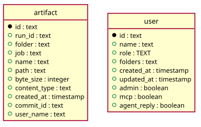

# Artifacts

Generated from the module by `atkins docs`. DO NOT EDIT.

mod_artifacts is the artifact tree: the newest version of every file the runs left, a directory at a time, the space the files and the history behind them take, and the record of every version, newest first.

The page reads and does not write. The buttons that remove something post to /api/artifacts, which the script reads and then reloads the page.

The files themselves are not pages and are not here: a file of the tree, and the .tgz of a directory of it, are byte streams Go serves at the root of the instance, and they stay there. So a link to one is written without the mount and every link to a page of this application carries it, which is why a row arrives holding the whole link and the template adds no {base}.

## Pages

| Method | Path         | Answered by                              |
|--------|--------------|------------------------------------------|
| `GET`  | `/artifacts` | [`mod_artifacts.php`](mod_artifacts.php) |

## The data model

### `artifact`

Artifact

| Column         | Type        | Key     |
|----------------|-------------|---------|
| `id`           | `text`      | primary |
| `run_id`       | `text`      | indexed |
| `folder`       | `text`      | indexed |
| `job`          | `text`      | indexed |
| `name`         | `text`      |         |
| `path`         | `text`      | indexed |
| `byte_size`    | `integer`   |         |
| `content_type` | `text`      |         |
| `created_at`   | `timestamp` |         |
| `commit_id`    | `text`      | indexed |
| `user_name`    | `text`      |         |

### `user`

User

| Column        | Type        | Key     |
|---------------|-------------|---------|
| `id`          | `text`      | primary |
| `name`        | `text`      | indexed |
| `role`        | `TEXT`      |         |
| `folders`     | `text`      |         |
| `created_at`  | `timestamp` |         |
| `updated_at`  | `timestamp` |         |
| `admin`       | `boolean`   |         |
| `mcp`         | `boolean`   |         |
| `agent_reply` | `boolean`   |         |

## Operations

This module owns no data model of its own. It reads the instance's tables through `code/Task`.

---

The tables come from `tables()` on `mod_artifacts`. The operations are the classes of `storage/`, which hold every statement this module runs.
