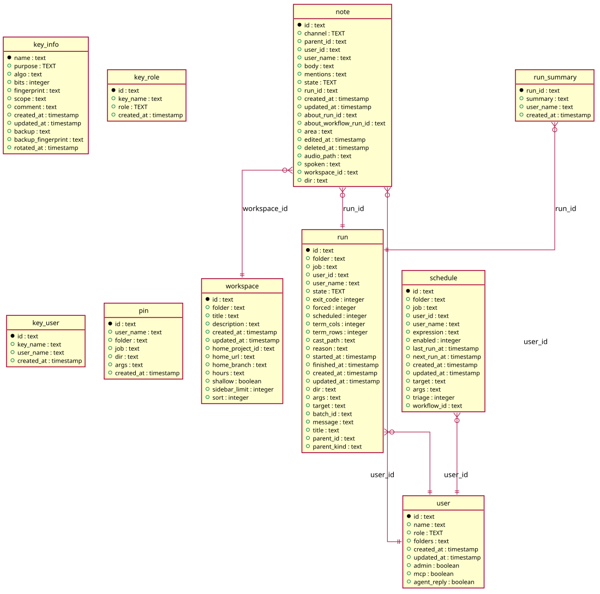

# Folders

Generated from the module by `atkins docs`. DO NOT EDIT.

## Pages

| Method | Path   | Answered by                        |
|--------|--------|------------------------------------|
| `GET`  | `/f/*` | [`mod_folder.php`](mod_folder.php) |

## The data model

### `key_info`

Key Info

| Column               | Type        | Key     |
|----------------------|-------------|---------|
| `name`               | `text`      | primary |
| `purpose`            | `TEXT`      | indexed |
| `algo`               | `text`      |         |
| `bits`               | `integer`   |         |
| `fingerprint`        | `text`      | indexed |
| `scope`              | `text`      | indexed |
| `comment`            | `text`      |         |
| `created_at`         | `timestamp` |         |
| `updated_at`         | `timestamp` |         |
| `backup`             | `text`      |         |
| `backup_fingerprint` | `text`      |         |
| `rotated_at`         | `timestamp` |         |

### `key_role`

Key Role

| Column       | Type        | Key     |
|--------------|-------------|---------|
| `id`         | `text`      | primary |
| `key_name`   | `text`      | indexed |
| `role`       | `TEXT`      | indexed |
| `created_at` | `timestamp` |         |

### `key_user`

Key User

| Column       | Type        | Key     |
|--------------|-------------|---------|
| `id`         | `text`      | primary |
| `key_name`   | `text`      | indexed |
| `user_name`  | `text`      | indexed |
| `created_at` | `timestamp` |         |

### `note`

Note

| Column                  | Type        | Key     |
|-------------------------|-------------|---------|
| `id`                    | `text`      | primary |
| `channel`               | `TEXT`      | indexed |
| `parent_id`             | `text`      | indexed |
| `user_id`               | `text`      | indexed |
| `user_name`             | `text`      |         |
| `body`                  | `text`      |         |
| `mentions`              | `text`      |         |
| `state`                 | `TEXT`      | indexed |
| `run_id`                | `text`      | indexed |
| `created_at`            | `timestamp` |         |
| `updated_at`            | `timestamp` |         |
| `about_run_id`          | `text`      | indexed |
| `about_workflow_run_id` | `text`      | indexed |
| `area`                  | `text`      |         |
| `edited_at`             | `timestamp` |         |
| `deleted_at`            | `timestamp` | indexed |
| `audio_path`            | `text`      |         |
| `spoken`                | `text`      |         |
| `workspace_id`          | `text`      | indexed |
| `dir`                   | `text`      | indexed |

### `pin`

Pin

| Column       | Type        | Key     |
|--------------|-------------|---------|
| `id`         | `text`      | primary |
| `user_name`  | `text`      | indexed |
| `folder`     | `text`      | indexed |
| `job`        | `text`      | indexed |
| `dir`        | `text`      | indexed |
| `args`       | `text`      | indexed |
| `created_at` | `timestamp` |         |

### `run`

Run

| Column        | Type        | Key     |
|---------------|-------------|---------|
| `id`          | `text`      | primary |
| `folder`      | `text`      | indexed |
| `job`         | `text`      | indexed |
| `user_id`     | `text`      | indexed |
| `user_name`   | `text`      |         |
| `state`       | `TEXT`      | indexed |
| `exit_code`   | `integer`   |         |
| `forced`      | `integer`   |         |
| `scheduled`   | `integer`   |         |
| `term_cols`   | `integer`   |         |
| `term_rows`   | `integer`   |         |
| `cast_path`   | `text`      |         |
| `reason`      | `text`      |         |
| `started_at`  | `timestamp` | indexed |
| `finished_at` | `timestamp` |         |
| `created_at`  | `timestamp` |         |
| `updated_at`  | `timestamp` |         |
| `dir`         | `text`      |         |
| `args`        | `text`      |         |
| `target`      | `text`      |         |
| `batch_id`    | `text`      | indexed |
| `message`     | `text`      |         |
| `title`       | `text`      |         |
| `parent_id`   | `text`      | indexed |
| `parent_kind` | `text`      |         |

### `run_summary`

Run Summary

| Column       | Type        | Key     |
|--------------|-------------|---------|
| `run_id`     | `text`      | primary |
| `summary`    | `text`      |         |
| `user_name`  | `text`      |         |
| `created_at` | `timestamp` |         |

### `schedule`

Schedule

| Column        | Type        | Key     |
|---------------|-------------|---------|
| `id`          | `text`      | primary |
| `folder`      | `text`      | indexed |
| `job`         | `text`      | indexed |
| `user_id`     | `text`      | indexed |
| `user_name`   | `text`      |         |
| `expression`  | `text`      |         |
| `enabled`     | `integer`   | indexed |
| `last_run_at` | `timestamp` |         |
| `next_run_at` | `timestamp` | indexed |
| `created_at`  | `timestamp` |         |
| `updated_at`  | `timestamp` |         |
| `target`      | `text`      |         |
| `args`        | `text`      |         |
| `triage`      | `integer`   |         |
| `workflow_id` | `text`      | indexed |

### `user`

User

| Column        | Type        | Key     |
|---------------|-------------|---------|
| `id`          | `text`      | primary |
| `name`        | `text`      | indexed |
| `role`        | `TEXT`      |         |
| `folders`     | `text`      |         |
| `created_at`  | `timestamp` |         |
| `updated_at`  | `timestamp` |         |
| `admin`       | `boolean`   |         |
| `mcp`         | `boolean`   |         |
| `agent_reply` | `boolean`   |         |

### `workspace`

Workspace

| Column            | Type        | Key     |
|-------------------|-------------|---------|
| `id`              | `text`      | primary |
| `folder`          | `text`      | indexed |
| `title`           | `text`      |         |
| `description`     | `text`      |         |
| `created_at`      | `timestamp` |         |
| `updated_at`      | `timestamp` |         |
| `home_project_id` | `text`      | indexed |
| `home_url`        | `text`      |         |
| `home_branch`     | `text`      |         |
| `hours`           | `text`      |         |
| `shallow`         | `boolean`   |         |
| `sidebar_limit`   | `integer`   |         |
| `sort`            | `integer`   |         |

## Operations

This module owns no data model of its own. It reads the instance's tables through `code/Task`.

---

The tables come from `tables()` on `mod_folder`. The operations are the classes of `storage/`, which hold every statement this module runs.
