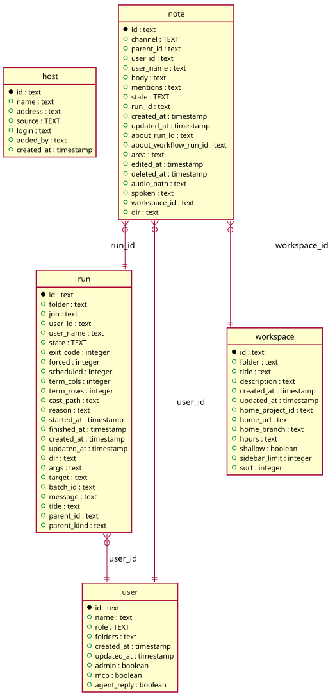

# Inventory

Generated from the module by `atkins docs`. DO NOT EDIT.

mod_inventory is the hosts page: what Beszel monitors largest first, the pools the hosts sum into, and with the hosts permission the form that runs one command on many of them at once.

Every fact of a host is the host's and not a row of this instance, so they come over the binding in one call: Task\Host::inventory() reads the hub, the ssh logins and what each host last told, sums the pools and hands back one answer. The page draws it and computes no fact a host decides.

The reader's hosts permission goes into that call, because it is what makes task-ui read a host now rather than answer out of what the host last told.

## Pages

| Method | Path                           | Answered by                              |
|--------|--------------------------------|------------------------------------------|
| `GET`  | `/inventory/hosts/{name}`      | [`mod_host.php`](mod_host.php)           |
| `POST` | `/inventory/hosts`             | [`mod_host_add.php`](mod_host_add.php)   |
| `POST` | `/inventory/hosts/{id}/delete` | [`mod_host_drop.php`](mod_host_drop.php) |
| `GET`  | `/inventory`                   | [`mod_inventory.php`](mod_inventory.php) |

## The data model

### `host`

Host

| Column       | Type        | Key     |
|--------------|-------------|---------|
| `id`         | `text`      | primary |
| `name`       | `text`      |         |
| `address`    | `text`      | indexed |
| `source`     | `TEXT`      |         |
| `login`      | `text`      |         |
| `added_by`   | `text`      |         |
| `created_at` | `timestamp` |         |

### `note`

Note

| Column                  | Type        | Key     |
|-------------------------|-------------|---------|
| `id`                    | `text`      | primary |
| `channel`               | `TEXT`      | indexed |
| `parent_id`             | `text`      | indexed |
| `user_id`               | `text`      | indexed |
| `user_name`             | `text`      |         |
| `body`                  | `text`      |         |
| `mentions`              | `text`      |         |
| `state`                 | `TEXT`      | indexed |
| `run_id`                | `text`      | indexed |
| `created_at`            | `timestamp` |         |
| `updated_at`            | `timestamp` |         |
| `about_run_id`          | `text`      | indexed |
| `about_workflow_run_id` | `text`      | indexed |
| `area`                  | `text`      |         |
| `edited_at`             | `timestamp` |         |
| `deleted_at`            | `timestamp` | indexed |
| `audio_path`            | `text`      |         |
| `spoken`                | `text`      |         |
| `workspace_id`          | `text`      | indexed |
| `dir`                   | `text`      | indexed |

### `run`

Run

| Column        | Type        | Key     |
|---------------|-------------|---------|
| `id`          | `text`      | primary |
| `folder`      | `text`      | indexed |
| `job`         | `text`      | indexed |
| `user_id`     | `text`      | indexed |
| `user_name`   | `text`      |         |
| `state`       | `TEXT`      | indexed |
| `exit_code`   | `integer`   |         |
| `forced`      | `integer`   |         |
| `scheduled`   | `integer`   |         |
| `term_cols`   | `integer`   |         |
| `term_rows`   | `integer`   |         |
| `cast_path`   | `text`      |         |
| `reason`      | `text`      |         |
| `started_at`  | `timestamp` | indexed |
| `finished_at` | `timestamp` |         |
| `created_at`  | `timestamp` |         |
| `updated_at`  | `timestamp` |         |
| `dir`         | `text`      |         |
| `args`        | `text`      |         |
| `target`      | `text`      |         |
| `batch_id`    | `text`      | indexed |
| `message`     | `text`      |         |
| `title`       | `text`      |         |
| `parent_id`   | `text`      | indexed |
| `parent_kind` | `text`      |         |

### `user`

User

| Column        | Type        | Key     |
|---------------|-------------|---------|
| `id`          | `text`      | primary |
| `name`        | `text`      | indexed |
| `role`        | `TEXT`      |         |
| `folders`     | `text`      |         |
| `created_at`  | `timestamp` |         |
| `updated_at`  | `timestamp` |         |
| `admin`       | `boolean`   |         |
| `mcp`         | `boolean`   |         |
| `agent_reply` | `boolean`   |         |

### `workspace`

Workspace

| Column            | Type        | Key     |
|-------------------|-------------|---------|
| `id`              | `text`      | primary |
| `folder`          | `text`      | indexed |
| `title`           | `text`      |         |
| `description`     | `text`      |         |
| `created_at`      | `timestamp` |         |
| `updated_at`      | `timestamp` |         |
| `home_project_id` | `text`      | indexed |
| `home_url`        | `text`      |         |
| `home_branch`     | `text`      |         |
| `hours`           | `text`      |         |
| `shallow`         | `boolean`   |         |
| `sidebar_limit`   | `integer`   |         |
| `sort`            | `integer`   |         |

## Operations

### `Hosts`

Hosts reads and writes the host table: the machines of the inventory, the ones a person entered and the ones the Beszel hub reported. The table is this module's and no other page reads it, so every statement over it lives here. The address is the key: a machine goes in once, under the address ssh signs in to. Nothing here removes a row on its own. A host the hub stops reporting, one that is down and one somebody rebuilt all stay until a person removes them.

| Method                                       | What it does                                                                                                                           |
|----------------------------------------------|----------------------------------------------------------------------------------------------------------------------------------------|
| `all()`                                      | all is every host, by name.                                                                                                            |
| `find($address)`                             | find is the host of an address, or false where no row holds it.                                                                        |
| `add($name, $address, $source, $login, $by)` | add writes a host and returns its ID, or "" for an address the inventory holds. The name is the address where none is given.           |
| `drop($id)`                                  | drop takes a host out by ID.                                                                                                           |
| `seen($name, $address)`                      | seen writes a host the hub reports under an address no row holds, and returns its ID or "". A row already there keeps the name it has. |

---

The tables come from `tables()` on `mod_host`, `mod_host_add`, `mod_host_drop`, `mod_inventory`. The operations are the classes of `storage/`, which hold every statement this module runs.
