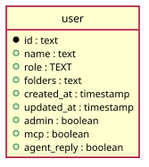

# Sign in

Generated from the module by `atkins docs`. DO NOT EDIT.

mod_login is the sign in page: the form, and the path to open once the credentials are read.

The page is what moves here. Reading the credentials, minting the session and dropping it stay in Go: the Guard sits in front of this application and of /api alike, so POST /login and /logout answer at the root and the form posts there. This route answers GET and writes nothing.

## Pages

| Method | Path     | Answered by                      |
|--------|----------|----------------------------------|
| `GET`  | `/login` | [`mod_login.php`](mod_login.php) |

## The data model

### `user`

User

| Column        | Type        | Key     |
|---------------|-------------|---------|
| `id`          | `text`      | primary |
| `name`        | `text`      | indexed |
| `role`        | `TEXT`      |         |
| `folders`     | `text`      |         |
| `created_at`  | `timestamp` |         |
| `updated_at`  | `timestamp` |         |
| `admin`       | `boolean`   |         |
| `mcp`         | `boolean`   |         |
| `agent_reply` | `boolean`   |         |

## Operations

This module owns no data model of its own. It reads the instance's tables through `code/Task`.

---

The tables come from `tables()` on `mod_login`. The operations are the classes of `storage/`, which hold every statement this module runs.
