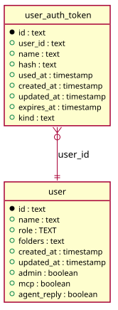

# MCP tokens

Generated from the module by `atkins docs`. DO NOT EDIT.

mod_mcp owns the tokens a client signs in with over MCP: the kind column that tells them from the ones `task-ui token` writes, the uniqueness that lets a user hold several of them, and the reads a page makes of them.

It draws no page of its own and carries no @route. The block a reader sees is MCP access on the user edit page, which is the profile module's, and the writes are the API's: a POST to /api/users/{id}/mcp issues one and a DELETE of /api/users/{id}/mcp/{token} removes one. The module exists because the data model does: a schema folder belongs to the module that owns the table's shape, not to the Go tree beside it.

## Pages

This module draws no page. It owns a data model other modules read, so it carries a schema and the statements over it and no route.

## The data model

### `user`

User

| Column        | Type        | Key     |
|---------------|-------------|---------|
| `id`          | `text`      | primary |
| `name`        | `text`      | indexed |
| `role`        | `TEXT`      |         |
| `folders`     | `text`      |         |
| `created_at`  | `timestamp` |         |
| `updated_at`  | `timestamp` |         |
| `admin`       | `boolean`   |         |
| `mcp`         | `boolean`   |         |
| `agent_reply` | `boolean`   |         |

### `user_auth_token`

User Auth Token

| Column       | Type        | Key     |
|--------------|-------------|---------|
| `id`         | `text`      | primary |
| `user_id`    | `text`      | indexed |
| `name`       | `text`      | indexed |
| `hash`       | `text`      | indexed |
| `used_at`    | `timestamp` |         |
| `created_at` | `timestamp` |         |
| `updated_at` | `timestamp` |         |
| `expires_at` | `timestamp` |         |
| `kind`       | `text`      | indexed |

## Operations

### `Tokens`

Tokens reads the user_auth_token table: the tokens that sign a client in without a session. A row's kind says what issued it, which is this module's column: mcp for the ones a user's MCP access issues, which expire and which their page lists and deletes, and empty for the ones `task-ui token` writes, which never expire and which no page shows. A name is unique per user and kind, so a user holds as many MCP tokens as they care to name. Nothing here answers with the hash and nothing answers with the token. A token is shown once, by whoever made it, and a page that lists one says when it was made, when it runs out and when it was last used.

| Method                 | What it does                                                                                                                                                    |
|------------------------|-----------------------------------------------------------------------------------------------------------------------------------------------------------------|
| `ofKind($user, $kind)` | ofKind is a user's tokens of one kind, newest first: the order their page lists them in, because the one they just issued is the one they came for.             |
| `expired($expires)`    | expired reports whether an expiry has passed. A token from `task-ui token` has none and never expires, which reads as not expired.                              |
| `tone($expires)`       | tone is the colour of the expiry badge: bad once it has passed, signal within a week of it, and the plain badge before that and for a token that never expires. |

### `Connect`

Connect is how a client is told to connect with a token it has just been given: the command for Claude Code, the same connection as a settings file, and the placeholders task-ui.js replaces in either of them. A placeholder is a constant here and not markup of a template, because MiniTPL compiles any {word} into an echo: a template cannot write the literal, so it arrives as a field of the scope. The same strings are read by the user edit page, which reveals them, and by the one-click buttons of the profile and the users list, which copy them.

| Method            | What it does                                                      |
|-------------------|-------------------------------------------------------------------|
| `add($site)`      | add is ADD against a site, which is the instance's own base link. |
| `settings($site)` | settings is SETTINGS against a site.                              |

---

The tables come from `tables()` on `mod_mcp`. The operations are the classes of `storage/`, which hold every statement this module runs.
