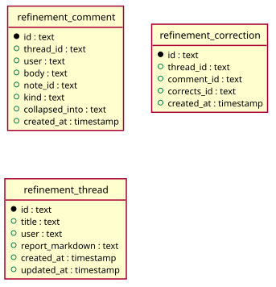

# Refinement

Generated from the module by `atkins docs`. DO NOT EDIT.

mod_refinement is the refinement board: the threads newest first, and the paragraph that starts one.

The page is the front end's own and draws in the theme's head and table, where the plugin it came from drew in a frame that named the module and timed its render.

The gate is the one the plugin page answered behind, which is the capability to open a module at all.

## Pages

| Method | Path                                                 | Answered by                                                |
|--------|------------------------------------------------------|------------------------------------------------------------|
| `GET`  | `/refinement`                                        | [`mod_refinement.php`](mod_refinement.php)                 |
| `POST` | `/refinement/threads/{id}/apply`                     | [`mod_refinement_apply.php`](mod_refinement_apply.php)     |
| `POST` | `/refinement/threads/{id}/comments`                  | [`mod_refinement_comment.php`](mod_refinement_comment.php) |
| `POST` | `/refinement/threads/{id}/comments/{comment}/delete` | [`mod_refinement_delete.php`](mod_refinement_delete.php)   |
| `POST` | `/refinement/threads/{id}/fork`                      | [`mod_refinement_fork.php`](mod_refinement_fork.php)       |
| `POST` | `/refinement/threads`                                | [`mod_refinement_start.php`](mod_refinement_start.php)     |
| `GET`  | `/refinement/threads/{id}`                           | [`mod_refinement_thread.php`](mod_refinement_thread.php)   |

## The data model

### `refinement_comment`

Refinement Comment

| Column           | Type        | Key     |
|------------------|-------------|---------|
| `id`             | `text`      | primary |
| `thread_id`      | `text`      | indexed |
| `user`           | `text`      |         |
| `body`           | `text`      |         |
| `note_id`        | `text`      | indexed |
| `kind`           | `text`      |         |
| `collapsed_into` | `text`      |         |
| `created_at`     | `timestamp` | indexed |

### `refinement_correction`

Refinement Correction

| Column        | Type        | Key     |
|---------------|-------------|---------|
| `id`          | `text`      | primary |
| `thread_id`   | `text`      | indexed |
| `comment_id`  | `text`      | indexed |
| `corrects_id` | `text`      | indexed |
| `created_at`  | `timestamp` | indexed |

### `refinement_thread`

Refinement Thread

| Column            | Type        | Key     |
|-------------------|-------------|---------|
| `id`              | `text`      | primary |
| `title`           | `text`      |         |
| `user`            | `text`      |         |
| `report_markdown` | `text`      |         |
| `created_at`      | `timestamp` | indexed |
| `updated_at`      | `timestamp` |         |

## Operations

### `Threads`

Threads is the refinement module's own data model: the threads of the board, the comments of one, and the corrections that make a comment a rule. The tables are the module's and no other page reads them, so every statement the module runs lives here. A read answers rows; a write is a verb and the thing it writes, taking what the caller already composed, so the text of a title or of a flattened request is decided in code/ and this only stores it. There is no transaction. The instance is one sqlite connection and holding a transaction open holds it with them, so a write that spans two tables is two statements in the order a half-written thread survives: the row a reader needs first, last.

| Method                           | What it does                                                                                                                                                                                                                                                                                                                                                                                                                                                                                                  |
|----------------------------------|---------------------------------------------------------------------------------------------------------------------------------------------------------------------------------------------------------------------------------------------------------------------------------------------------------------------------------------------------------------------------------------------------------------------------------------------------------------------------------------------------------------|
| `all()`                          | all is every thread, newest first, each with how many comments it has.                                                                                                                                                                                                                                                                                                                                                                                                                                        |
| `find($id)`                      | find is one thread, or false where there is none: get() answers a missing row with false, the way PHP does, so a caller tests it with is_array().                                                                                                                                                                                                                                                                                                                                                             |
| `comments($thread)`              | comments is a thread's comments oldest first, each with whether it is a correction, which is what the page marks them with.                                                                                                                                                                                                                                                                                                                                                                                   |
| `latest($thread)`                | latest is the identifier of the comment a thread ends on, which a correction names, or "" for a thread with none.                                                                                                                                                                                                                                                                                                                                                                                             |
| `design($thread)`                | design is the comment a thread opened on, which says what the artifact is, or false for a thread whose design was deleted. It is the oldest comment that corrects nothing and records no Apply all: a correction has a row in refinement_correction and an Apply all carries kind 'apply'.                                                                                                                                                                                                                    |
| `rules($thread)`                 | rules is every correction of a thread, oldest first, folded ones included: a fold is what the page draws and deleting is what retires a rule, so what was asked for is still asked for.                                                                                                                                                                                                                                                                                                                       |
| `start($user, $want)`            | start opens a thread from its first comment, and answers both identifiers: the thread to redirect to and the comment to dispatch. The first comment is no correction: it has nothing to correct. Every comment after it is one, which is what separates "design this" from "use ULID as primary keys".                                                                                                                                                                                                        |
| `correct($thread, $user, $body)` | correct adds a comment that changes what the run before it produced, records the correction against that comment, and answers the comment.                                                                                                                                                                                                                                                                                                                                                                    |
| `apply($thread, $user, $body)`   | apply records the flattened request the caller composed, folds every comment standing on its own into it, and answers the comment. The comment it writes carries kind 'apply' and no correction row, so it is neither the design nor a rule and the next Apply all composes from the same comments this one did. The rules themselves survive, because a fold is not a deletion.                                                                                                                              |
| `carry($from, $into, $after)`    | carry copies the rules of one thread into another as rules of its own, each correcting the comment before it, which is what a fork is. The subject does not travel and the artifacts do not either: a fork starts on an empty folder with how the work is done already in it.                                                                                                                                                                                                                                 |
| `note($comment, $note)`          | note records the run a dispatch opened, beside the comment it answers.                                                                                                                                                                                                                                                                                                                                                                                                                                        |
| `touch($thread, $changed)`       | touch writes a thread back with what reconciling it against the artifact tree changed, and stamps it.                                                                                                                                                                                                                                                                                                                                                                                                         |
| `remove($thread, $comment)`      | remove retires one rule of one thread: the comment and the correction row that made it one. The thread is named as well as the comment, and both statements are scoped to it: the identifier arrives from the path of a form, and a comment of a thread the form was not drawn on is not that form's to delete. The artifacts it produced stay where they are. A rule is a thing the thread asks for, and dropping the ask is what this is; what the next run makes of the folder is the next run's business. |
| `drop($thread)`                  | drop removes a thread: its corrections, its comments and the thread row. Deleting the design is deleting the thread, because the rules are corrections to a design and without it they correct nothing. The folder in the artifact tree stays. This module reads that tree and does not write it, and what a run produced is the instance's to keep or to clear from the artifacts page.                                                                                                                      |

### `Prompt`

Prompt is the flattened request an Apply all sends, and nothing else. A thread runs as a sequence: each correction is a run over what the run before it left, which drifts. By the tenth, the first correction is a thing nobody has read in an hour. Flattening turns the sequence into a statement: here is the design, here is every rule, the artifacts are already in the folder, make them satisfy all of it at once. Composed from the comment rows and never parsed back out of prose. The design is a comment, each rule is a comment, and an Apply all's own record is neither, so the second Apply all composes the way the first did over whatever survives. Static, and over arrays rather than over the store, so a fixture pins the text without a database.

| Method                     | What it does                                                                                                                                                                                                                                                                                                                                                                                                     |
|----------------------------|------------------------------------------------------------------------------------------------------------------------------------------------------------------------------------------------------------------------------------------------------------------------------------------------------------------------------------------------------------------------------------------------------------------|
| `rules($comments)`         | rules is the body of each rule, in the order they were asked for, from the comment rows of a thread's corrections.                                                                                                                                                                                                                                                                                               |
| `flatten($design, $rules)` | flatten is the design and the rules as one request. A rule is numbered because the numbers are how a later rule says it beats an earlier one, and the run is told so: the corrections arrived in order and a person correcting twice meant the second. With no rules there is no rule section. A thread that has had no correction has nothing to flatten, and the request is the design the thread opened with. |

### `Thread`

Thread is what a thread is made of, as text: the lines that name it, the grouping the page draws, and the markdown the page renders. Every method is static and takes rows. The statements are in storage/, the gate and the redirect are in the mod_ files, and this is the part that is neither: what a title is, what counts as a rule, what is a picture and what is prose. A fixture pins all of it without a database.

| Method                       | What it does                                                                                                                                                                                                                                                                                                                                                                                                                                                                                                                                                                                                                                                                                                                  |
|------------------------------|-------------------------------------------------------------------------------------------------------------------------------------------------------------------------------------------------------------------------------------------------------------------------------------------------------------------------------------------------------------------------------------------------------------------------------------------------------------------------------------------------------------------------------------------------------------------------------------------------------------------------------------------------------------------------------------------------------------------------------|
| `cut($line)`                 | cut is one line as the thread list shows it, WIDTH at most.                                                                                                                                                                                                                                                                                                                                                                                                                                                                                                                                                                                                                                                                   |
| `title($body)`               | title is the first line of a comment, for the thread list.                                                                                                                                                                                                                                                                                                                                                                                                                                                                                                                                                                                                                                                                    |
| `reportTitle($markdown)`     | reportTitle is the first heading of the report, which is what the thread is called once a run has written one. A thread opens named after the line the person typed, because that is all there is at the time. The runs then go and find out what the thing actually is, and README.md leads with it: the report's own heading is a better name than the request that started it, and a correction that changes the heading renames the thread with it. ATX and setext both, and the first one anywhere in the document, so a report opening with a badge or a comment still answers. Empty when the report has no heading at all. That is not a title of "", it is the absence of one: the caller keeps what the thread had. |
| `designID($comments)`        | designID is the comment a thread opened on, out of the rows the page already has, or "" for a thread with none left. The same rule the store uses: the oldest comment that corrects nothing and records no Apply all. The page needs it because the delete button on the design has to say that it takes the thread.                                                                                                                                                                                                                                                                                                                                                                                                          |
| `entries($comments)`         | entries groups a thread's comments the way the page draws them: a comment that stands on its own, or an Apply all with the ones it folded under it. Folded comments are not dropped from the page. They are the record of what was asked and of the run that answered each one, and the page keeps them behind a disclosure rather than behind nothing.                                                                                                                                                                                                                                                                                                                                                                       |
| `request($body, $folder)`    | request is what a person wrote, or what an Apply all composed, as the HTML the thread shows. Markdown, because a request is written as markdown: a flattened one is sections and a numbered list, and a typed one is as likely to carry a list or a path in backticks. Printing the source left the reader with the hashes and the asterisks. The renderer is the instance's, which skips raw HTML and keeps a link to a scheme it knows, so a request a reader typed is as safe to draw as a report a run wrote.                                                                                                                                                                                                             |
| `flatHeadings($markdown)`    | flatHeadings takes every heading of a request down to the smallest one, which the page draws as a bold line. A request is a paragraph inside a thread, not a document: a run of `## The design` and `## The rules` set in the page's own h2 reads as though the thread had been cut into chapters, and the thread's own headings lose against them. Inside a fence nothing is a heading. A shell snippet's `# comment` is a comment, and rewriting it would be rewriting the code the request is showing.                                                                                                                                                                                                                     |
| `report($markdown, $folder)` | report renders the README a run wrote as the HTML the page shows. It is markdown the instance's own agent wrote into the artifact tree, not anything a reader typed, and the page draws it rather than printing it. An image in it is embedded, which is how a schema diagram is read on the page instead of downloaded. The folder is the thread's own, and the report names its files from inside it: [schema/user.up.sql](schema/user.up.sql) is the thread's copy and the link has to carry the folder the run left out.                                                                                                                                                                                                  |
| `split($markdown)`           | split separates the report into what is looked at and what is read: the lines that are nothing but an embedded image, and everything else. The point of a refinement is the picture. What the run wrote around it is how it got there, which is worth keeping and not worth putting first: the page draws the images and folds the prose behind "show thinking". A report that embeds nothing is all prose, and then the prose is the output: there is nothing to look at and the page shows it rather than hiding the only thing it has.                                                                                                                                                                                     |

### `Work`

Work is what a thread does through the host: the run a request starts, and the record a page reconciles against the artifact tree. Neither is a statement and neither is text, so neither belongs in storage/ or in Thread. Both take the store and write through it, because a run that started is a note recorded beside its comment and a reconciled thread is a row. Static, and over the store it is handed: the five write endpoints are five files and a mod_ class is outside the classmap, so what they share lives on a class that is inside it.

| Method                                    | What it does                                                                                                                                                                                                                                                                                                                                                                                                                                                                                                                                                                                                             |
|-------------------------------------------|--------------------------------------------------------------------------------------------------------------------------------------------------------------------------------------------------------------------------------------------------------------------------------------------------------------------------------------------------------------------------------------------------------------------------------------------------------------------------------------------------------------------------------------------------------------------------------------------------------------------------|
| `start($store, $thread, $comment, $body)` | start runs the request a comment holds, and records the note that holds the thread beside the comment. The folder is the thread, which is the folder of the artifact tree the run works in: a thread gets its own and nothing else writes there, so a new thread opens on an empty directory rather than on whatever every thread before it left. The run is the reader's. Starting one takes prompt/edit, which the board enforces and every endpoint here checks first, so a viewer is refused the page rather than the run.                                                                                           |
| `sync($store, $thread)`                   | sync brings a thread's record in step with the artifact tree, and answers the thread as it stands after. The tree is the truth: a run writes the files and rewrites the report, and neither goes through this module. The tables are the record the thread keeps, which is what the page reads and what the board lists, so a page load reconciles them. The files are not reconciled. They are a folder of the artifact tree and the instance's own artifacts view browses one; this module links that folder and keeps no second listing of it, which is a listing that goes stale the moment a run renames something. |

---

The tables come from `tables()` on `mod_refinement`, `mod_refinement_apply`, `mod_refinement_comment`, `mod_refinement_delete`, `mod_refinement_fork`, `mod_refinement_start`, `mod_refinement_thread`. The operations are the classes of `storage/`, which hold every statement this module runs.
