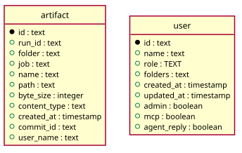

# Artifacts

Generated from the module by `atkins docs`. DO NOT EDIT.

mod_artifacts is the artifact tree: the newest version of every file the runs left, a directory at a time, the space the files and the history behind them take, and the record of every version, newest first.

The page reads and does not write. The buttons that remove something post to /api/artifacts, which the script reads and then reloads the page.

The files themselves are not pages and are not here: a file of the tree, and the .tgz of a directory of it, are byte streams Go serves at the root of the instance, and they stay there. So a link to one is written without the mount and every link to a page of this application carries it, which is why a row arrives holding the whole link and the template adds no {base}.

## Pages

| Method | Path         | Answered by                              |
|--------|--------------|------------------------------------------|
| `GET`  | `/artifacts` | [`mod_artifacts.php`](mod_artifacts.php) |

## The data model

### `artifact`

Artifact

| Column         | Type        | Key     |
|----------------|-------------|---------|
| `id`           | `text`      | primary |
| `run_id`       | `text`      | indexed |
| `folder`       | `text`      | indexed |
| `job`          | `text`      | indexed |
| `name`         | `text`      |         |
| `path`         | `text`      | indexed |
| `byte_size`    | `integer`   |         |
| `content_type` | `text`      |         |
| `created_at`   | `timestamp` |         |
| `commit_id`    | `text`      | indexed |
| `user_name`    | `text`      |         |

### `user`

User

| Column        | Type        | Key     |
|---------------|-------------|---------|
| `id`          | `text`      | primary |
| `name`        | `text`      | indexed |
| `role`        | `TEXT`      |         |
| `folders`     | `text`      |         |
| `created_at`  | `timestamp` |         |
| `updated_at`  | `timestamp` |         |
| `admin`       | `boolean`   |         |
| `mcp`         | `boolean`   |         |
| `agent_reply` | `boolean`   |         |

## Operations

### `Artifacts`

Artifacts reads the artifact table: the files a run left behind, and the files of the artifact tree, which are the ones that hold a commit. The table is this module's. A run page lists the artifacts of one run, newest first. The bytes of a file are not here: they sit outside the directory this may open, and Task\Host::artifact() reads them.

| Method                    | What it does                                                                                                                                                                                                                                                                                                                                                                                                                                                          |
|---------------------------|-----------------------------------------------------------------------------------------------------------------------------------------------------------------------------------------------------------------------------------------------------------------------------------------------------------------------------------------------------------------------------------------------------------------------------------------------------------------------|
| `get($id)`                | get is one artifact by ID, or null.                                                                                                                                                                                                                                                                                                                                                                                                                                   |
| `find($filter = array())` | find is the artifacts a filter lists, newest first. The filter is an array and a field it leaves out narrows nothing: `run`, `folder`, `job` and `path`, where a path is a file of the artifact tree and the rows under it are its versions.                                                                                                                                                                                                                          |
| `latest()`                | latest is the newest version of every file of the artifact tree, by path. A file of the tree is one that holds a commit, and its rows are its versions; the newest is the one the tree holds, which is what says whether a reader may see an entry of it at all. The version is counted by rowid and not by created_at: two versions written in the same millisecond read as the same instant, and the order they were inserted in is the order they were written in. |
| `rows($found)`            | rows turns what the database answered into artifacts.                                                                                                                                                                                                                                                                                                                                                                                                                 |

---

The tables come from `tables()` on `mod_artifacts`. The operations are the classes of `storage/`, which hold every statement this module runs.
