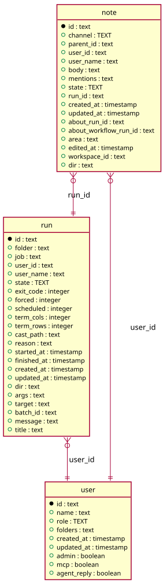

# Notes

Generated from the module by `atkins docs`. DO NOT EDIT.

mod_notes is the notes board: the notes newest first, each with its replies, and the agent a note names to start work.

## Pages

| Method | Path | Answered by |
|--------|------|-------------|
| `GET` | `/notes` | [`mod_notes.php`](mod_notes.php) |
| `POST` | `/notes` | [`mod_notes.php`](mod_notes.php) |
## The data model

### `note`

Note

| Column | Type | Key |
|--------|------|-----|
| `id` | `text` | primary |
| `channel` | `TEXT` | indexed |
| `parent_id` | `text` | indexed |
| `user_id` | `text` | indexed |
| `user_name` | `text` |  |
| `body` | `text` |  |
| `mentions` | `text` |  |
| `state` | `TEXT` | indexed |
| `run_id` | `text` | indexed |
| `created_at` | `timestamp` |  |
| `updated_at` | `timestamp` |  |
| `about_run_id` | `text` | indexed |
| `about_workflow_run_id` | `text` | indexed |
| `area` | `text` |  |
| `edited_at` | `timestamp` |  |
| `workspace_id` | `text` | indexed |
| `dir` | `text` | indexed |
### `user`

User

| Column | Type | Key |
|--------|------|-----|
| `id` | `text` | primary |
| `name` | `text` | indexed |
| `role` | `TEXT` |  |
| `folders` | `text` |  |
| `created_at` | `timestamp` |  |
| `updated_at` | `timestamp` |  |
| `admin` | `boolean` |  |
| `mcp` | `boolean` |  |
| `agent_reply` | `boolean` |  |
## Operations

### `NoteStore`

| Method | What it does |
|--------|--------------|
| `threads($channel, $limit = self::LIMIT)` | threads is the notes that start a thread of a channel, newest first. |
| `get($id)` | get is one note by ID, or null. |
| `replies($channel, $limit = self::LIMIT)` | replies is the replies to the threads of a channel, oldest first, by note. The threads are named by the same subquery threads() runs rather than by the ids it answered: argument unpacking is unavailable, so an IN list of a length only the caller knows cannot be passed. See docs/todo-correction.md. |
| `post($user, $body, $mentions, $parent = "")` | post writes a note, or a reply when the parent is named. |
| `edit($id, $body, $mentions)` | edit rewrites a note's body and the names it mentions. |
| `drop($id)` | drop removes a note and every reply under it. |
---

The tables are what `mod_notes::tables()` names. The operations are the classes
of `storage/`, which hold every statement this module runs.
