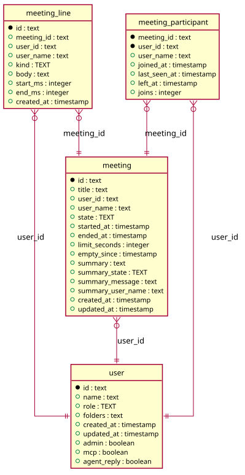

# Meetings

Generated from the module by `atkins docs`. DO NOT EDIT.

mod_orb lists the rooms of the orb: the ones taking participants and the ones that ended with Claude's summary.

The page is read only. New meeting and every room's own actions call /api/meetings from the browser, so the markup sets the data-* attributes assets/orb.js reads and nothing here writes.

## Pages

| Method | Path        | Answered by                    |
|--------|-------------|--------------------------------|
| `GET`  | `/orb`      | [`mod_orb.php`](mod_orb.php)   |
| `GET`  | `/orb/{id}` | [`mod_room.php`](mod_room.php) |

## The data model

### `meeting`

Meeting

| Column              | Type        | Key     |
|---------------------|-------------|---------|
| `id`                | `text`      | primary |
| `title`             | `text`      |         |
| `user_id`           | `text`      | indexed |
| `user_name`         | `text`      |         |
| `state`             | `TEXT`      | indexed |
| `started_at`        | `timestamp` | indexed |
| `ended_at`          | `timestamp` |         |
| `limit_seconds`     | `integer`   |         |
| `empty_since`       | `timestamp` |         |
| `summary`           | `text`      |         |
| `summary_state`     | `TEXT`      |         |
| `summary_message`   | `text`      |         |
| `summary_user_name` | `text`      |         |
| `created_at`        | `timestamp` |         |
| `updated_at`        | `timestamp` |         |

### `meeting_line`

Meeting Line

| Column       | Type        | Key     |
|--------------|-------------|---------|
| `id`         | `text`      | primary |
| `meeting_id` | `text`      | indexed |
| `user_id`    | `text`      | indexed |
| `user_name`  | `text`      |         |
| `kind`       | `TEXT`      |         |
| `body`       | `text`      |         |
| `start_ms`   | `integer`   |         |
| `end_ms`     | `integer`   |         |
| `created_at` | `timestamp` | indexed |

### `meeting_participant`

Meeting Participant

| Column         | Type        | Key     |
|----------------|-------------|---------|
| `meeting_id`   | `text`      | primary |
| `user_id`      | `text`      | primary |
| `user_name`    | `text`      |         |
| `joined_at`    | `timestamp` |         |
| `last_seen_at` | `timestamp` |         |
| `left_at`      | `timestamp` | indexed |
| `joins`        | `integer`   |         |

### `user`

User

| Column        | Type        | Key     |
|---------------|-------------|---------|
| `id`          | `text`      | primary |
| `name`        | `text`      | indexed |
| `role`        | `TEXT`      |         |
| `folders`     | `text`      |         |
| `created_at`  | `timestamp` |         |
| `updated_at`  | `timestamp` |         |
| `admin`       | `boolean`   |         |
| `mcp`         | `boolean`   |         |
| `agent_reply` | `boolean`   |         |

## Operations

### `Meetings`

Meetings reads the orb's three tables: a room, who joined it, and the lines of its log. Nothing here writes. Joining, leaving, speaking and ending a room are /api/meetings, which writes with storage/meeting_storage.go.

| Method              | What it does                                                 |
|---------------------|--------------------------------------------------------------|
| `all($limit = 40)`  | all is every room, open ones above ended ones, newest first. |
| `get($id)`          | get is one room by ID, or null.                              |
| `participants($id)` | participants is everyone who joined a room, oldest first.    |
| `lines($id)`        | lines is a room's log, oldest first.                         |
| `present($id)`      | present is how many participants are in a room now.          |
| `counts()`          | counts is how many are present in each room, by meeting ID.  |

---

The tables come from `tables()` on `mod_orb`, `mod_room`. The operations are the classes of `storage/`, which hold every statement this module runs.
