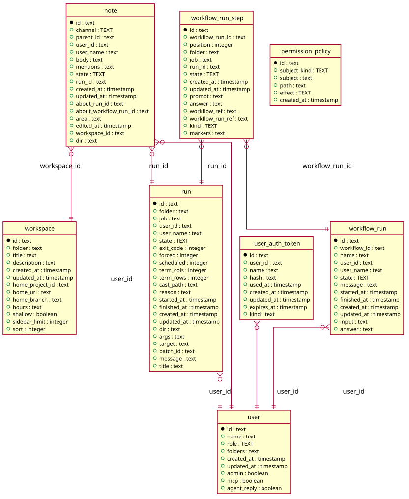

# Profile

Generated from the module by `atkins docs`. DO NOT EDIT.

mod_profile is one user's page: who they are, and the latest runs, workflow runs, notes and prompts of theirs, as far as the reader sees them.

Your own page is yours to read. Anybody else's takes user/view, and a name no row holds answers Not found rather than saying the name is free.

Nothing here is the whole of what a user did: each block is the latest few of a kind the reader may see, and the Runs block links the list that holds the rest.

## Pages

| Method | Path                 | Answered by                              |
|--------|----------------------|------------------------------------------|
| `GET`  | `/keys`              | [`mod_my_keys.php`](mod_my_keys.php)     |
| `GET`  | `/users/{name}`      | [`mod_profile.php`](mod_profile.php)     |
| `GET`  | `/users/{name}/edit` | [`mod_user_edit.php`](mod_user_edit.php) |

## The data model

### `note`

Note

| Column                  | Type        | Key     |
|-------------------------|-------------|---------|
| `id`                    | `text`      | primary |
| `channel`               | `TEXT`      | indexed |
| `parent_id`             | `text`      | indexed |
| `user_id`               | `text`      | indexed |
| `user_name`             | `text`      |         |
| `body`                  | `text`      |         |
| `mentions`              | `text`      |         |
| `state`                 | `TEXT`      | indexed |
| `run_id`                | `text`      | indexed |
| `created_at`            | `timestamp` |         |
| `updated_at`            | `timestamp` |         |
| `about_run_id`          | `text`      | indexed |
| `about_workflow_run_id` | `text`      | indexed |
| `area`                  | `text`      |         |
| `edited_at`             | `timestamp` |         |
| `workspace_id`          | `text`      | indexed |
| `dir`                   | `text`      | indexed |

### `permission_policy`

Permission Policy

| Column         | Type        | Key     |
|----------------|-------------|---------|
| `id`           | `text`      | primary |
| `subject_kind` | `TEXT`      | indexed |
| `subject`      | `text`      | indexed |
| `path`         | `text`      | indexed |
| `effect`       | `TEXT`      |         |
| `created_at`   | `timestamp` |         |

### `run`

Run

| Column        | Type        | Key     |
|---------------|-------------|---------|
| `id`          | `text`      | primary |
| `folder`      | `text`      | indexed |
| `job`         | `text`      | indexed |
| `user_id`     | `text`      | indexed |
| `user_name`   | `text`      |         |
| `state`       | `TEXT`      | indexed |
| `exit_code`   | `integer`   |         |
| `forced`      | `integer`   |         |
| `scheduled`   | `integer`   |         |
| `term_cols`   | `integer`   |         |
| `term_rows`   | `integer`   |         |
| `cast_path`   | `text`      |         |
| `reason`      | `text`      |         |
| `started_at`  | `timestamp` | indexed |
| `finished_at` | `timestamp` |         |
| `created_at`  | `timestamp` |         |
| `updated_at`  | `timestamp` |         |
| `dir`         | `text`      |         |
| `args`        | `text`      |         |
| `target`      | `text`      |         |
| `batch_id`    | `text`      | indexed |
| `message`     | `text`      |         |
| `title`       | `text`      |         |

### `user`

User

| Column        | Type        | Key     |
|---------------|-------------|---------|
| `id`          | `text`      | primary |
| `name`        | `text`      | indexed |
| `role`        | `TEXT`      |         |
| `folders`     | `text`      |         |
| `created_at`  | `timestamp` |         |
| `updated_at`  | `timestamp` |         |
| `admin`       | `boolean`   |         |
| `mcp`         | `boolean`   |         |
| `agent_reply` | `boolean`   |         |

### `user_auth_token`

User Auth Token

| Column       | Type        | Key     |
|--------------|-------------|---------|
| `id`         | `text`      | primary |
| `user_id`    | `text`      | indexed |
| `name`       | `text`      | indexed |
| `hash`       | `text`      | indexed |
| `used_at`    | `timestamp` |         |
| `created_at` | `timestamp` |         |
| `updated_at` | `timestamp` |         |
| `expires_at` | `timestamp` |         |

### `workflow_run`

Workflow Run

| Column        | Type        | Key     |
|---------------|-------------|---------|
| `id`          | `text`      | primary |
| `workflow_id` | `text`      | indexed |
| `name`        | `text`      |         |
| `user_id`     | `text`      | indexed |
| `user_name`   | `text`      |         |
| `state`       | `TEXT`      | indexed |
| `message`     | `text`      |         |
| `started_at`  | `timestamp` | indexed |
| `finished_at` | `timestamp` |         |
| `created_at`  | `timestamp` |         |
| `updated_at`  | `timestamp` |         |
| `input`       | `text`      |         |
| `answer`      | `text`      |         |

### `workflow_run_step`

Workflow Run Step

| Column             | Type        | Key     |
|--------------------|-------------|---------|
| `id`               | `text`      | primary |
| `workflow_run_id`  | `text`      | indexed |
| `position`         | `integer`   | indexed |
| `folder`           | `text`      |         |
| `job`              | `text`      |         |
| `run_id`           | `text`      | indexed |
| `state`            | `TEXT`      |         |
| `created_at`       | `timestamp` |         |
| `updated_at`       | `timestamp` |         |
| `prompt`           | `text`      |         |
| `answer`           | `text`      |         |
| `workflow_ref`     | `text`      |         |
| `workflow_run_ref` | `text`      |         |
| `kind`             | `text`      |         |

### `workspace`

Workspace

| Column            | Type        | Key     |
|-------------------|-------------|---------|
| `id`              | `text`      | primary |
| `folder`          | `text`      | indexed |
| `title`           | `text`      |         |
| `description`     | `text`      |         |
| `created_at`      | `timestamp` |         |
| `updated_at`      | `timestamp` |         |
| `home_project_id` | `text`      | indexed |
| `home_url`        | `text`      |         |
| `home_branch`     | `text`      |         |
| `hours`           | `text`      |         |
| `shallow`         | `boolean`   |         |
| `sidebar_limit`   | `integer`   |         |
| `sort`            | `integer`   |         |

## Operations

This module owns no data model of its own. It reads the instance's tables through `code/Task`.

---

The tables come from `tables()` on `mod_my_keys`, `mod_profile`, `mod_user_edit`. The operations are the classes of `storage/`, which hold every statement this module runs.
