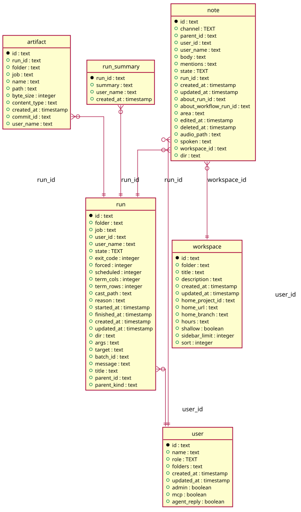

# Runs

Generated from the module by `atkins docs`. DO NOT EDIT.

mod_runs lists every run the reader may see, newest first, a page at a time: the filters narrow it, and the table follows the runs topic so a run that starts goes on top and one that ends changes in place.

## Pages

| Method | Path                | Answered by                        |
|--------|---------------------|------------------------------------|
| `GET`  | `/runs/{id}/report` | [`mod_report.php`](mod_report.php) |
| `GET`  | `/runs/{id}`        | [`mod_run.php`](mod_run.php)       |
| `GET`  | `/runs`             | [`mod_runs.php`](mod_runs.php)     |

## The data model

### `artifact`

Artifact

| Column         | Type        | Key     |
|----------------|-------------|---------|
| `id`           | `text`      | primary |
| `run_id`       | `text`      | indexed |
| `folder`       | `text`      | indexed |
| `job`          | `text`      | indexed |
| `name`         | `text`      |         |
| `path`         | `text`      | indexed |
| `byte_size`    | `integer`   |         |
| `content_type` | `text`      |         |
| `created_at`   | `timestamp` |         |
| `commit_id`    | `text`      | indexed |
| `user_name`    | `text`      |         |

### `note`

Note

| Column                  | Type        | Key     |
|-------------------------|-------------|---------|
| `id`                    | `text`      | primary |
| `channel`               | `TEXT`      | indexed |
| `parent_id`             | `text`      | indexed |
| `user_id`               | `text`      | indexed |
| `user_name`             | `text`      |         |
| `body`                  | `text`      |         |
| `mentions`              | `text`      |         |
| `state`                 | `TEXT`      | indexed |
| `run_id`                | `text`      | indexed |
| `created_at`            | `timestamp` |         |
| `updated_at`            | `timestamp` |         |
| `about_run_id`          | `text`      | indexed |
| `about_workflow_run_id` | `text`      | indexed |
| `area`                  | `text`      |         |
| `edited_at`             | `timestamp` |         |
| `deleted_at`            | `timestamp` | indexed |
| `audio_path`            | `text`      |         |
| `spoken`                | `text`      |         |
| `workspace_id`          | `text`      | indexed |
| `dir`                   | `text`      | indexed |

### `run`

Run

| Column        | Type        | Key     |
|---------------|-------------|---------|
| `id`          | `text`      | primary |
| `folder`      | `text`      | indexed |
| `job`         | `text`      | indexed |
| `user_id`     | `text`      | indexed |
| `user_name`   | `text`      |         |
| `state`       | `TEXT`      | indexed |
| `exit_code`   | `integer`   |         |
| `forced`      | `integer`   |         |
| `scheduled`   | `integer`   |         |
| `term_cols`   | `integer`   |         |
| `term_rows`   | `integer`   |         |
| `cast_path`   | `text`      |         |
| `reason`      | `text`      |         |
| `started_at`  | `timestamp` | indexed |
| `finished_at` | `timestamp` |         |
| `created_at`  | `timestamp` |         |
| `updated_at`  | `timestamp` |         |
| `dir`         | `text`      |         |
| `args`        | `text`      |         |
| `target`      | `text`      |         |
| `batch_id`    | `text`      | indexed |
| `message`     | `text`      |         |
| `title`       | `text`      |         |
| `parent_id`   | `text`      | indexed |
| `parent_kind` | `text`      |         |

### `run_summary`

Run Summary

| Column       | Type        | Key     |
|--------------|-------------|---------|
| `run_id`     | `text`      | primary |
| `summary`    | `text`      |         |
| `user_name`  | `text`      |         |
| `created_at` | `timestamp` |         |

### `user`

User

| Column        | Type        | Key     |
|---------------|-------------|---------|
| `id`          | `text`      | primary |
| `name`        | `text`      | indexed |
| `role`        | `TEXT`      |         |
| `folders`     | `text`      |         |
| `created_at`  | `timestamp` |         |
| `updated_at`  | `timestamp` |         |
| `admin`       | `boolean`   |         |
| `mcp`         | `boolean`   |         |
| `agent_reply` | `boolean`   |         |

### `workspace`

Workspace

| Column            | Type        | Key     |
|-------------------|-------------|---------|
| `id`              | `text`      | primary |
| `folder`          | `text`      | indexed |
| `title`           | `text`      |         |
| `description`     | `text`      |         |
| `created_at`      | `timestamp` |         |
| `updated_at`      | `timestamp` |         |
| `home_project_id` | `text`      | indexed |
| `home_url`        | `text`      |         |
| `home_branch`     | `text`      |         |
| `hours`           | `text`      |         |
| `shallow`         | `boolean`   |         |
| `sidebar_limit`   | `integer`   |         |
| `sort`            | `integer`   |         |

## Operations

### `Runs`

Runs reads the run table: every run of a job, the runs one run dispatched, and the window an activity chart counts. The table is this module's. What a row of it means to a page - its name, the place it ran, the label that follows it over the event stream - is Task\Run, which asks here for the rows.

| Method                                     | What it does                                                                                                                                                                                                                                                                                                                                                                                                                                               |
|--------------------------------------------|------------------------------------------------------------------------------------------------------------------------------------------------------------------------------------------------------------------------------------------------------------------------------------------------------------------------------------------------------------------------------------------------------------------------------------------------------------|
| `get($id)`                                 | get is one run by ID, or null.                                                                                                                                                                                                                                                                                                                                                                                                                             |
| `root($run)`                               | root is the run a batch is named by: the oldest of it, and the run itself where it is in no batch. A batch is one job run over several places at once, and the thing a reader asks about or a summary is written about is the batch and not the page they happen to be on, so every page of a batch answers the same run.                                                                                                                                  |
| `find($filter = array())`                  | find is the runs a filter lists, newest first, or oldest first for a page read after a cursor. The filter is an array and a field it leaves out narrows nothing. Two fields are not that: `dir` is read only alongside `job`, where it tells the folder's own job from the job of a directory inside it with the same name, and `folders` is the list a reader may see, which keeps the page from being filled with rows the reader is about to be denied. |
| `children($id)`                            | children is the runs one run dispatched, oldest first.                                                                                                                                                                                                                                                                                                                                                                                                     |
| `childrenOf($ids)`                         | childrenOf is the children of many runs at once, as rows and not as runs: the rail counts the children of every row it lists. The columns are the ones Task\Seen::rows filters on, so a count costs no hydration: the rail is chrome and is drawn on every page.                                                                                                                                                                                           |
| `latest($folders = array())`               | latest is the last run of each job of the folders, by the key the job is listed under; every folder's for an empty list. A run still queued or going is not the last one: the Jobs table draws the colour of what a job did last beside the run it is doing now. Which runs the reader may see is not asked here, as the Go page does not ask it either: the colour of a dot is not a permission.                                                          |
| `charted($filter)`                         | charted is the rows the activity charts count, newest first, as rows and not as runs: the same filter find reads, with the cursors off, over the columns of CHART_COLUMNS. A chart is the window and not the page, so the list is Activity::LIMIT long where the filter names no limit of its own. Task\Seen::rows filters it and Task\Activity::rows reads it; nothing else may, because the rows carry seven columns and a page reads a run.             |
| `narrowed($filter, &$where, &$args)`       | narrowed is what a filter says about the table, as conditions and the arguments under them, with the cursors left out: find reads a page of the rows and charted reads the window, and the rows either one answers are the same rows.                                                                                                                                                                                                                      |
| `narrow(&$where, &$args, $column, $value)` | narrow adds a condition on a column for a value the filter named.                                                                                                                                                                                                                                                                                                                                                                                          |
| `rows($found)`                             | rows turns what the database answered into runs.                                                                                                                                                                                                                                                                                                                                                                                                           |
| `hydrate($row)`                            | hydrate is one row as a run, its timestamps the text the column holds.                                                                                                                                                                                                                                                                                                                                                                                     |

### `Summaries`

Summaries reads the run_summary table: what Claude wrote about a run, kept beside the run it is about. The table is this module's. What a page makes of a summary is Task\Report, which asks here for the row.

| Method       | What it does                                                 |
|--------------|--------------------------------------------------------------|
| `of($runID)` | of is the summary row of a run, or null for a run with none. |

---

The tables come from `tables()` on `mod_report`, `mod_run`, `mod_runs`. The operations are the classes of `storage/`, which hold every statement this module runs.
