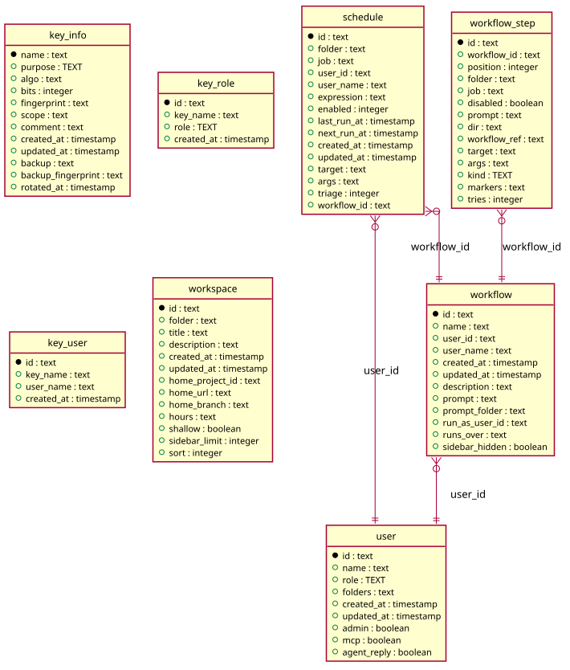

# Scheduled

Generated from the module by `atkins docs`. DO NOT EDIT.

mod_schedules lists what runs on a cron expression, the jobs and the workflows, and takes a new one of a job; a workflow's comes from its edit page.

The page is read only. Every form on it calls /api/schedules from the browser, so the markup carries the data-* attributes task-ui.js drives and nothing here writes.

## Pages

| Method | Path         | Answered by                              |
|--------|--------------|------------------------------------------|
| `GET`  | `/schedules` | [`mod_schedules.php`](mod_schedules.php) |

## The data model

### `key_info`

Key Info

| Column               | Type        | Key     |
|----------------------|-------------|---------|
| `name`               | `text`      | primary |
| `purpose`            | `TEXT`      | indexed |
| `algo`               | `text`      |         |
| `bits`               | `integer`   |         |
| `fingerprint`        | `text`      | indexed |
| `scope`              | `text`      | indexed |
| `comment`            | `text`      |         |
| `created_at`         | `timestamp` |         |
| `updated_at`         | `timestamp` |         |
| `backup`             | `text`      |         |
| `backup_fingerprint` | `text`      |         |
| `rotated_at`         | `timestamp` |         |

### `key_role`

Key Role

| Column       | Type        | Key     |
|--------------|-------------|---------|
| `id`         | `text`      | primary |
| `key_name`   | `text`      | indexed |
| `role`       | `TEXT`      | indexed |
| `created_at` | `timestamp` |         |

### `key_user`

Key User

| Column       | Type        | Key     |
|--------------|-------------|---------|
| `id`         | `text`      | primary |
| `key_name`   | `text`      | indexed |
| `user_name`  | `text`      | indexed |
| `created_at` | `timestamp` |         |

### `schedule`

Schedule

| Column        | Type        | Key     |
|---------------|-------------|---------|
| `id`          | `text`      | primary |
| `folder`      | `text`      | indexed |
| `job`         | `text`      | indexed |
| `user_id`     | `text`      | indexed |
| `user_name`   | `text`      |         |
| `expression`  | `text`      |         |
| `enabled`     | `integer`   | indexed |
| `last_run_at` | `timestamp` |         |
| `next_run_at` | `timestamp` | indexed |
| `created_at`  | `timestamp` |         |
| `updated_at`  | `timestamp` |         |
| `target`      | `text`      |         |
| `args`        | `text`      |         |
| `triage`      | `integer`   |         |
| `workflow_id` | `text`      | indexed |

### `user`

User

| Column        | Type        | Key     |
|---------------|-------------|---------|
| `id`          | `text`      | primary |
| `name`        | `text`      | indexed |
| `role`        | `TEXT`      |         |
| `folders`     | `text`      |         |
| `created_at`  | `timestamp` |         |
| `updated_at`  | `timestamp` |         |
| `admin`       | `boolean`   |         |
| `mcp`         | `boolean`   |         |
| `agent_reply` | `boolean`   |         |

### `workflow`

Workflow

| Column           | Type        | Key     |
|------------------|-------------|---------|
| `id`             | `text`      | primary |
| `name`           | `text`      | indexed |
| `user_id`        | `text`      | indexed |
| `user_name`      | `text`      |         |
| `created_at`     | `timestamp` |         |
| `updated_at`     | `timestamp` |         |
| `description`    | `text`      |         |
| `prompt`         | `text`      |         |
| `prompt_folder`  | `text`      |         |
| `run_as_user_id` | `text`      | indexed |
| `runs_over`      | `text`      |         |
| `sidebar_hidden` | `boolean`   |         |

### `workflow_step`

Workflow Step

| Column         | Type      | Key     |
|----------------|-----------|---------|
| `id`           | `text`    | primary |
| `workflow_id`  | `text`    | indexed |
| `position`     | `integer` | indexed |
| `folder`       | `text`    |         |
| `job`          | `text`    |         |
| `disabled`     | `boolean` |         |
| `prompt`       | `text`    |         |
| `dir`          | `text`    |         |
| `workflow_ref` | `text`    |         |
| `target`       | `text`    |         |
| `args`         | `text`    |         |
| `kind`         | `TEXT`    |         |
| `markers`      | `text`    |         |
| `tries`        | `integer` |         |

### `workspace`

Workspace

| Column            | Type        | Key     |
|-------------------|-------------|---------|
| `id`              | `text`      | primary |
| `folder`          | `text`      | indexed |
| `title`           | `text`      |         |
| `description`     | `text`      |         |
| `created_at`      | `timestamp` |         |
| `updated_at`      | `timestamp` |         |
| `home_project_id` | `text`      | indexed |
| `home_url`        | `text`      |         |
| `home_branch`     | `text`      |         |
| `hours`           | `text`      |         |
| `shallow`         | `boolean`   |         |
| `sidebar_limit`   | `integer`   |         |
| `sort`            | `integer`   |         |

## Operations

### `Lookup`

Lookup is what the schedules page reads of the one table it does not own: the workflows a schedule may start, with the user they run as and the folders their steps name. The rows are the workflows module's and this asks that module for them; which workflow a schedule may start is the schedules page's question.

| Method                 | What it does                                                                                                                                                                                                                                                                                                                                                                                     |
|------------------------|--------------------------------------------------------------------------------------------------------------------------------------------------------------------------------------------------------------------------------------------------------------------------------------------------------------------------------------------------------------------------------------------------|
| `workflows()`          | workflows is every workflow by ID: its name, the user its runs run as, and the folders its steps name. A workflow with no run as user, or one whose user is gone, runs as whoever starts it, which the schedule names itself.                                                                                                                                                                    |
| `steps()`              | steps is every workflow's steps, in position order, by workflow ID.                                                                                                                                                                                                                                                                                                                              |
| `folders($steps, $id)` | folders is the folders the steps of a workflow name, the steps of a workflow a step runs among them, each workflow walked once. The walk is a queue and not a recursion because the workflows already seen have to be shared across every branch, and a parameter written by a call is not visible to its caller. The order differs from the Go side's depth first walk; what reads it is a set. |
| `kind($step)`          | kind is what a step does, from its fields for a row written without one.                                                                                                                                                                                                                                                                                                                         |

### `Schedules`

Schedules reads the schedule table: every schedule, the ones of a folder and the ones of a workflow. The table is this module's. What a row of it means to a page - whether it is on, what it starts, the cells a table draws - is Task\Schedule. Nothing here writes. The schedules page is read only and its forms call /api/schedules from the browser, so Create, Update, Delete and Due stay in storage/schedule_storage.go.

| Method              | What it does                                                                                                                                                                                                                                                                                         |
|---------------------|------------------------------------------------------------------------------------------------------------------------------------------------------------------------------------------------------------------------------------------------------------------------------------------------------|
| `all()`             | all is every schedule, by folder and job.                                                                                                                                                                                                                                                            |
| `byFolder($folder)` | byFolder is the schedules of one folder, by job: the page of a folder counts them and the page of a job lists its own. A schedule of a workflow names no folder, so this is the schedules of jobs and of hosts and nothing else.                                                                     |
| `byWorkflow($id)`   | byWorkflow is the schedules of one workflow, by ID.                                                                                                                                                                                                                                                  |
| `refs($id)`         | refs is the schedules a folder and the folders inside it name, each said as its kind, its folder and its name: what a move of the project leaves where it was. An ID may hold the underscore LIKE matches any character with, so the match is on the ID itself or on the ID and a slash as a prefix. |
| `get($id)`          | get is one schedule by ID, or null.                                                                                                                                                                                                                                                                  |

---

The tables come from `tables()` on `mod_schedules`. The operations are the classes of `storage/`, which hold every statement this module runs.
