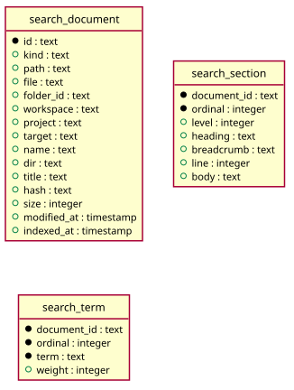

# Search

Generated from the module by `atkins docs`. DO NOT EDIT.

mod_search is the search page: one box over the documentation and job targets of every project the reader may see. The box starts a run at /search/ask, which answers in a thread.

## Pages

| Method | Path          | Answered by                                |
|--------|---------------|--------------------------------------------|
| `GET`  | `/search`     | [`mod_search.php`](mod_search.php)         |
| `POST` | `/search/ask` | [`mod_search_ask.php`](mod_search_ask.php) |

## The data model

### `search_document`

Search Document

| Column        | Type        | Key     |
|---------------|-------------|---------|
| `id`          | `text`      | primary |
| `kind`        | `text`      | indexed |
| `path`        | `text`      | indexed |
| `file`        | `text`      |         |
| `folder_id`   | `text`      | indexed |
| `workspace`   | `text`      |         |
| `project`     | `text`      |         |
| `target`      | `text`      | indexed |
| `name`        | `text`      | indexed |
| `dir`         | `text`      |         |
| `title`       | `text`      |         |
| `hash`        | `text`      |         |
| `size`        | `integer`   |         |
| `modified_at` | `timestamp` |         |
| `indexed_at`  | `timestamp` |         |

### `search_section`

Search Section

| Column        | Type      | Key     |
|---------------|-----------|---------|
| `document_id` | `text`    | primary |
| `ordinal`     | `integer` | primary |
| `level`       | `integer` |         |
| `heading`     | `text`    |         |
| `breadcrumb`  | `text`    |         |
| `line`        | `integer` |         |
| `body`        | `text`    |         |

### `search_term`

Search Term

| Column        | Type      | Key     |
|---------------|-----------|---------|
| `document_id` | `text`    | primary |
| `ordinal`     | `integer` | primary |
| `term`        | `text`    | primary |
| `weight`      | `integer` |         |

## Operations

This module owns no data model of its own. It reads the instance's tables through `code/Task`.

---

The tables come from `tables()` on `mod_search`, `mod_search_ask`. The operations are the classes of `storage/`, which hold every statement this module runs.
