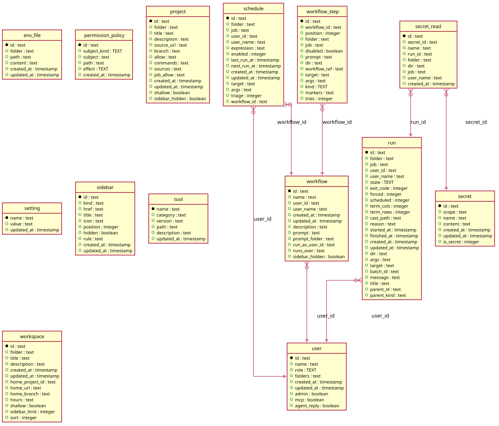

# Settings

Generated from the module by `atkins docs`. DO NOT EDIT.

mod_settings is the index of the settings: the steps in the order an instance is set up in, each with how much it holds.

The page reads and does not write. It is the one step that is not a step itself, so it draws no trail at the foot: a reader is at the start of the walk and every row is a way into it.

## Pages

| Method | Path                                          | Answered by                                                        |
|--------|-----------------------------------------------|--------------------------------------------------------------------|
| `GET`  | `/settings/instance`                          | [`mod_instance.php`](mod_instance.php)                             |
| `GET`  | `/settings/integrations`                      | [`mod_integrations.php`](mod_integrations.php)                     |
| `GET`  | `/settings/keys/{name}`                       | [`mod_key_edit.php`](mod_key_edit.php)                             |
| `GET`  | `/settings/keys/generate`                     | [`mod_key_generate.php`](mod_key_generate.php)                     |
| `GET`  | `/settings/keys/upload`                       | [`mod_key_upload.php`](mod_key_upload.php)                         |
| `GET`  | `/settings/keys`                              | [`mod_keys.php`](mod_keys.php)                                     |
| `GET`  | `/settings/permissions`                       | [`mod_permissions.php`](mod_permissions.php)                       |
| `GET`  | `/settings/projects/{rest...}`                | [`mod_project_edit.php`](mod_project_edit.php)                     |
| `GET`  | `/settings/projects/new`                      | [`mod_project_new.php`](mod_project_new.php)                       |
| `GET`  | `/settings/projects`                          | [`mod_projects.php`](mod_projects.php)                             |
| `GET`  | `/settings/retention`                         | [`mod_retention.php`](mod_retention.php)                           |
| `GET`  | `/settings/secrets/edit`                      | [`mod_secret_edit.php`](mod_secret_edit.php)                       |
| `GET`  | `/settings/secrets/new`                       | [`mod_secret_new.php`](mod_secret_new.php)                         |
| `GET`  | `/settings/secrets/{id}/reads`                | [`mod_secret_reads.php`](mod_secret_reads.php)                     |
| `GET`  | `/settings/secrets`                           | [`mod_secrets.php`](mod_secrets.php)                               |
| `GET`  | `/settings`                                   | [`mod_settings.php`](mod_settings.php)                             |
| `GET`  | `/settings/sidebar`                           | [`mod_sidebar.php`](mod_sidebar.php)                               |
| `GET`  | `/settings/telemetry`                         | [`mod_telemetry.php`](mod_telemetry.php)                           |
| `GET`  | `/settings/users/{id}`                        | [`mod_user_by_id.php`](mod_user_by_id.php)                         |
| `GET`  | `/settings/users/new`                         | [`mod_user_new.php`](mod_user_new.php)                             |
| `GET`  | `/settings/users`                             | [`mod_users.php`](mod_users.php)                                   |
| `GET`  | `/settings/workspaces/{folder}`               | [`mod_workspace_edit.php`](mod_workspace_edit.php)                 |
| `GET`  | `/settings/workspaces/{folder}/keys/generate` | [`mod_workspace_key_generate.php`](mod_workspace_key_generate.php) |
| `GET`  | `/settings/workspaces/{folder}/keys/upload`   | [`mod_workspace_key_upload.php`](mod_workspace_key_upload.php)     |
| `GET`  | `/settings/workspaces/{folder}/keys`          | [`mod_workspace_keys.php`](mod_workspace_keys.php)                 |
| `GET`  | `/settings/workspaces/new`                    | [`mod_workspace_new.php`](mod_workspace_new.php)                   |
| `GET`  | `/settings/workspaces`                        | [`mod_workspaces.php`](mod_workspaces.php)                         |

## The data model

### `env_file`

Env File

| Column       | Type        | Key     |
|--------------|-------------|---------|
| `id`         | `text`      | primary |
| `folder`     | `text`      | indexed |
| `path`       | `text`      | indexed |
| `content`    | `text`      |         |
| `created_at` | `timestamp` |         |
| `updated_at` | `timestamp` |         |

### `permission_policy`

Permission Policy

| Column         | Type        | Key     |
|----------------|-------------|---------|
| `id`           | `text`      | primary |
| `subject_kind` | `TEXT`      | indexed |
| `subject`      | `text`      | indexed |
| `path`         | `text`      | indexed |
| `effect`       | `TEXT`      |         |
| `created_at`   | `timestamp` |         |

### `project`

Project

| Column           | Type        | Key     |
|------------------|-------------|---------|
| `id`             | `text`      | primary |
| `folder`         | `text`      | indexed |
| `title`          | `text`      |         |
| `description`    | `text`      |         |
| `source_url`     | `text`      |         |
| `branch`         | `text`      |         |
| `allow`          | `text`      |         |
| `commands`       | `text`      |         |
| `sources`        | `text`      |         |
| `job_allow`      | `text`      |         |
| `created_at`     | `timestamp` |         |
| `updated_at`     | `timestamp` |         |
| `shallow`        | `boolean`   |         |
| `sidebar_hidden` | `boolean`   |         |

### `run`

Run

| Column        | Type        | Key     |
|---------------|-------------|---------|
| `id`          | `text`      | primary |
| `folder`      | `text`      | indexed |
| `job`         | `text`      | indexed |
| `user_id`     | `text`      | indexed |
| `user_name`   | `text`      |         |
| `state`       | `TEXT`      | indexed |
| `exit_code`   | `integer`   |         |
| `forced`      | `integer`   |         |
| `scheduled`   | `integer`   |         |
| `term_cols`   | `integer`   |         |
| `term_rows`   | `integer`   |         |
| `cast_path`   | `text`      |         |
| `reason`      | `text`      |         |
| `started_at`  | `timestamp` | indexed |
| `finished_at` | `timestamp` |         |
| `created_at`  | `timestamp` |         |
| `updated_at`  | `timestamp` |         |
| `dir`         | `text`      |         |
| `args`        | `text`      |         |
| `target`      | `text`      |         |
| `batch_id`    | `text`      | indexed |
| `message`     | `text`      |         |
| `title`       | `text`      |         |

### `schedule`

Schedule

| Column        | Type        | Key     |
|---------------|-------------|---------|
| `id`          | `text`      | primary |
| `folder`      | `text`      | indexed |
| `job`         | `text`      | indexed |
| `user_id`     | `text`      | indexed |
| `user_name`   | `text`      |         |
| `expression`  | `text`      |         |
| `enabled`     | `integer`   | indexed |
| `last_run_at` | `timestamp` |         |
| `next_run_at` | `timestamp` | indexed |
| `created_at`  | `timestamp` |         |
| `updated_at`  | `timestamp` |         |
| `target`      | `text`      |         |
| `args`        | `text`      |         |
| `triage`      | `integer`   |         |
| `workflow_id` | `text`      | indexed |

### `secret`

Secret

| Column       | Type        | Key     |
|--------------|-------------|---------|
| `id`         | `text`      | primary |
| `scope`      | `text`      | indexed |
| `name`       | `text`      | indexed |
| `content`    | `text`      |         |
| `created_at` | `timestamp` |         |
| `updated_at` | `timestamp` |         |
| `is_secret`  | `integer`   |         |

### `secret_read`

Secret Read

| Column       | Type        | Key     |
|--------------|-------------|---------|
| `id`         | `text`      | primary |
| `secret_id`  | `text`      | indexed |
| `name`       | `text`      |         |
| `run_id`     | `text`      | indexed |
| `folder`     | `text`      |         |
| `dir`        | `text`      |         |
| `job`        | `text`      |         |
| `user_name`  | `text`      |         |
| `created_at` | `timestamp` | indexed |

### `setting`

Setting

| Column       | Type        | Key     |
|--------------|-------------|---------|
| `name`       | `text`      | primary |
| `value`      | `text`      |         |
| `updated_at` | `timestamp` |         |

### `sidebar`

Sidebar

| Column       | Type        | Key     |
|--------------|-------------|---------|
| `id`         | `text`      | primary |
| `kind`       | `text`      |         |
| `href`       | `text`      | indexed |
| `title`      | `text`      |         |
| `icon`       | `text`      |         |
| `position`   | `integer`   | indexed |
| `hidden`     | `boolean`   |         |
| `rule`       | `text`      |         |
| `created_at` | `timestamp` |         |
| `updated_at` | `timestamp` |         |

### `tool`

Tool

| Column        | Type        | Key     |
|---------------|-------------|---------|
| `name`        | `text`      | primary |
| `category`    | `text`      |         |
| `version`     | `text`      |         |
| `path`        | `text`      |         |
| `description` | `text`      |         |
| `updated_at`  | `timestamp` |         |

### `user`

User

| Column        | Type        | Key     |
|---------------|-------------|---------|
| `id`          | `text`      | primary |
| `name`        | `text`      | indexed |
| `role`        | `TEXT`      |         |
| `folders`     | `text`      |         |
| `created_at`  | `timestamp` |         |
| `updated_at`  | `timestamp` |         |
| `admin`       | `boolean`   |         |
| `mcp`         | `boolean`   |         |
| `agent_reply` | `boolean`   |         |

### `workflow`

Workflow

| Column           | Type        | Key     |
|------------------|-------------|---------|
| `id`             | `text`      | primary |
| `name`           | `text`      | indexed |
| `user_id`        | `text`      | indexed |
| `user_name`      | `text`      |         |
| `created_at`     | `timestamp` |         |
| `updated_at`     | `timestamp` |         |
| `description`    | `text`      |         |
| `prompt`         | `text`      |         |
| `prompt_folder`  | `text`      |         |
| `run_as_user_id` | `text`      | indexed |
| `runs_over`      | `text`      |         |
| `sidebar_hidden` | `boolean`   |         |

### `workflow_step`

Workflow Step

| Column         | Type      | Key     |
|----------------|-----------|---------|
| `id`           | `text`    | primary |
| `workflow_id`  | `text`    | indexed |
| `position`     | `integer` | indexed |
| `folder`       | `text`    |         |
| `job`          | `text`    |         |
| `disabled`     | `boolean` |         |
| `prompt`       | `text`    |         |
| `dir`          | `text`    |         |
| `workflow_ref` | `text`    |         |
| `target`       | `text`    |         |
| `args`         | `text`    |         |
| `kind`         | `TEXT`    |         |
| `markers`      | `text`    |         |
| `tries`        | `integer` |         |

### `workspace`

Workspace

| Column            | Type        | Key     |
|-------------------|-------------|---------|
| `id`              | `text`      | primary |
| `folder`          | `text`      | indexed |
| `title`           | `text`      |         |
| `description`     | `text`      |         |
| `created_at`      | `timestamp` |         |
| `updated_at`      | `timestamp` |         |
| `home_project_id` | `text`      | indexed |
| `home_url`        | `text`      |         |
| `home_branch`     | `text`      |         |
| `hours`           | `text`      |         |
| `shallow`         | `boolean`   |         |
| `sidebar_limit`   | `integer`   |         |
| `sort`            | `integer`   |         |

## Operations

This module owns no data model of its own. It reads the instance's tables through `code/Task`.

---

The tables come from `tables()` on `mod_instance`, `mod_integrations`, `mod_key_edit`, `mod_key_generate`, `mod_key_upload`, `mod_keys`, `mod_permissions`, `mod_project_edit`, `mod_project_new`, `mod_projects`, `mod_retention`, `mod_secret_edit`, `mod_secret_new`, `mod_secret_reads`, `mod_secrets`, `mod_settings`, `mod_sidebar`, `mod_telemetry`, `mod_user_by_id`, `mod_user_new`, `mod_users`, `mod_workspace_edit`, `mod_workspace_key_generate`, `mod_workspace_key_upload`, `mod_workspace_keys`, `mod_workspace_new`, `mod_workspaces`. The operations are the classes of `storage/`, which hold every statement this module runs.
