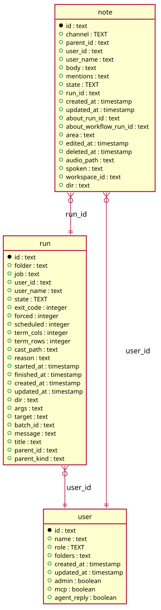

# Threads

Generated from the module by `atkins docs`. DO NOT EDIT.

mod_threads is the timeline: every thread the reader may see, newest first, and the box that starts one.

A thread is a note of the board, a prompt asked from a page, or a question put to the orb: one table, one list, one page per thread. The list is rows and not the threads themselves, because a thread is read on its own page, where the messages take sides and a recording plays.

The page reads and does not write. The box holds data-note-form, which the script posts to /api/notes and then refreshes the list in place.

## Pages

| Method | Path            | Answered by                          |
|--------|-----------------|--------------------------------------|
| `GET`  | `/notes`        | [`mod_notes.php`](mod_notes.php)     |
| `GET`  | `/threads/{id}` | [`mod_thread.php`](mod_thread.php)   |
| `GET`  | `/threads`      | [`mod_threads.php`](mod_threads.php) |

## The data model

### `note`

Note

| Column                  | Type        | Key     |
|-------------------------|-------------|---------|
| `id`                    | `text`      | primary |
| `channel`               | `TEXT`      | indexed |
| `parent_id`             | `text`      | indexed |
| `user_id`               | `text`      | indexed |
| `user_name`             | `text`      |         |
| `body`                  | `text`      |         |
| `mentions`              | `text`      |         |
| `state`                 | `TEXT`      | indexed |
| `run_id`                | `text`      | indexed |
| `created_at`            | `timestamp` |         |
| `updated_at`            | `timestamp` |         |
| `about_run_id`          | `text`      | indexed |
| `about_workflow_run_id` | `text`      | indexed |
| `area`                  | `text`      |         |
| `edited_at`             | `timestamp` |         |
| `deleted_at`            | `timestamp` | indexed |
| `audio_path`            | `text`      |         |
| `spoken`                | `text`      |         |
| `workspace_id`          | `text`      | indexed |
| `dir`                   | `text`      | indexed |

### `run`

Run

| Column        | Type        | Key     |
|---------------|-------------|---------|
| `id`          | `text`      | primary |
| `folder`      | `text`      | indexed |
| `job`         | `text`      | indexed |
| `user_id`     | `text`      | indexed |
| `user_name`   | `text`      |         |
| `state`       | `TEXT`      | indexed |
| `exit_code`   | `integer`   |         |
| `forced`      | `integer`   |         |
| `scheduled`   | `integer`   |         |
| `term_cols`   | `integer`   |         |
| `term_rows`   | `integer`   |         |
| `cast_path`   | `text`      |         |
| `reason`      | `text`      |         |
| `started_at`  | `timestamp` | indexed |
| `finished_at` | `timestamp` |         |
| `created_at`  | `timestamp` |         |
| `updated_at`  | `timestamp` |         |
| `dir`         | `text`      |         |
| `args`        | `text`      |         |
| `target`      | `text`      |         |
| `batch_id`    | `text`      | indexed |
| `message`     | `text`      |         |
| `title`       | `text`      |         |
| `parent_id`   | `text`      | indexed |
| `parent_kind` | `text`      |         |

### `user`

User

| Column        | Type        | Key     |
|---------------|-------------|---------|
| `id`          | `text`      | primary |
| `name`        | `text`      | indexed |
| `role`        | `TEXT`      |         |
| `folders`     | `text`      |         |
| `created_at`  | `timestamp` |         |
| `updated_at`  | `timestamp` |         |
| `admin`       | `boolean`   |         |
| `mcp`         | `boolean`   |         |
| `agent_reply` | `boolean`   |         |

## Operations

### `Notes`

Notes reads and writes the note table: the notes that start a thread, newest first, and the replies under them. The table is this module's. A note of a channel is a board note; a note with a workspace is a prompt, which belongs to the page it was asked from and not to the board. What a page draws of one is Task\Note.

| Method                                            | What it does                                                                                                                                                                                                                                             |
|---------------------------------------------------|----------------------------------------------------------------------------------------------------------------------------------------------------------------------------------------------------------------------------------------------------------|
| `threads($channel, $limit = self::LIMIT)`         | threads is the notes that start a thread of a channel, newest first.                                                                                                                                                                                     |
| `timeline($limit = self::LIMIT)`                  | timeline is every thread of every channel, newest first.                                                                                                                                                                                                 |
| `drop($id)`                                       | drop marks a thread and its replies deleted, which hides them from every listing.                                                                                                                                                                        |
| `byUser($channel, $name, $limit = self::PROFILE)` | byUser is the board notes one user wrote, newest first, which a profile lists under Notes. The replies they wrote under someone else's note are not theirs to list: a profile lists threads, as the board does.                                          |
| `promptsByUser($name, $limit = self::PROFILE)`    | promptsByUser is the prompts one user asked, newest first.                                                                                                                                                                                               |
| `prompts($runID, $limit = self::PROMPTS)`         | prompts is the prompt threads asked about one run, newest first.                                                                                                                                                                                         |
| `inPlace($dir, $limit = self::PROMPTS)`           | inPlace is the prompts asked from one directory, about no run and no area.                                                                                                                                                                               |
| `ofArea($area, $limit = self::PROMPTS)`           | ofArea is the prompts asked from one page of the instance.                                                                                                                                                                                               |
| `ofWorkflowRun($runID, $limit = 5)`               | ofWorkflowRun is the prompts asked about one workflow run.                                                                                                                                                                                               |
| `promptsAbout($runIDs)`                           | promptsAbout is the prompts asked about many runs at once, newest first.                                                                                                                                                                                 |
| `get($id)`                                        | get is one note by ID, or null for one that is gone.                                                                                                                                                                                                     |
| `byRun($runID)`                                   | byRun is the thread a run belongs to, the parent for a reply's run.                                                                                                                                                                                      |
| `replies($ids)`                                   | replies is the replies of many threads at once, oldest first, by thread.                                                                                                                                                                                 |
| `post($user, $body, $parent = "")`                | post writes a note, or a reply when the parent is named. A reply holds the channel of the thread it sits under. The column takes the board's channel or the chat's and nothing else, and the thread list reads the parent to tell a thread from a reply. |
| `purge($id)`                                      | purge removes a note and every reply under it, deleted or not.                                                                                                                                                                                           |

### `Talk`

Talk is one thread as a conversation: the messages in the order they were said, each on the side of whoever said it. The reader's own messages take one side and everyone else's the other, which is the shape a spoken thread wants: a question, an answer, a question. A message that was spoken carries the recording it was spoken into, and an answer that was read out carries what it was read out as, so a thread is read and listened to the same way it happened.

| Method                                             | What it does                                                                                                                                                                                                                                                                                                                                                           |
|----------------------------------------------------|------------------------------------------------------------------------------------------------------------------------------------------------------------------------------------------------------------------------------------------------------------------------------------------------------------------------------------------------------------------------|
| `messages($note, $replies, $chrome, $seen = null)` | messages is the thread and its replies, oldest first, as the template reads them. An answer the session read out is named by the recording the question was spoken into, `<clip>.<n>.reply.wav`, which is what the brief in docs/guide/voice.md tells the session to write. The row does not hold it, so the folder is listed once and the answers take what is there. |
| `spokenFor($note, $replies)`                       | spokenFor is the answers of a voice thread that were read out, by their place in the thread: an empty list for a thread nobody spoke.                                                                                                                                                                                                                                  |
| `message($note, $chrome, $seen = null)`            | message is one thing somebody said, as the thread template reads it.                                                                                                                                                                                                                                                                                                   |
| `said($note)`                                      | said is what a message shows: the transcription where one was spoken, and the body otherwise. A spoken message's body carries what the agent needs beside the words - where the clip is, and the brief the session opens on - and none of that was said by anyone.                                                                                                     |
| `audio($note)`                                     | audio is the URL the message plays from, or the empty string where nothing was recorded.                                                                                                                                                                                                                                                                               |
| `url($path)`                                       | url is a file of the artifact tree as the player reads it, by byte range.                                                                                                                                                                                                                                                                                              |

### `Timeline`

Timeline is the list the Threads page draws: one row per thread, newest first, whatever started it. A row says who said the first thing, when, what it was, how it is going and how many messages came after. What it does not say is the conversation: that is Talk, on the thread's own page.

| Method                                        | What it does                                                                            |
|-----------------------------------------------|-----------------------------------------------------------------------------------------|
| `row($note, $replies, $chrome, $seen = null)` | row is one thread as components/thread-row.tpl reads it.                                |
| `kind($note)`                                 | kind names what started the thread: a recording, a prompt asked from a page, or a note. |
| `heard($note, $replies)`                      | heard reports whether any message of the thread was spoken or read out.                 |
| `lastAt($note, $replies)`                     | lastAt is when the thread last moved: its newest reply, or the thread itself.           |

---

The tables come from `tables()` on `mod_notes`, `mod_thread`, `mod_threads`. The operations are the classes of `storage/`, which hold every statement this module runs.
