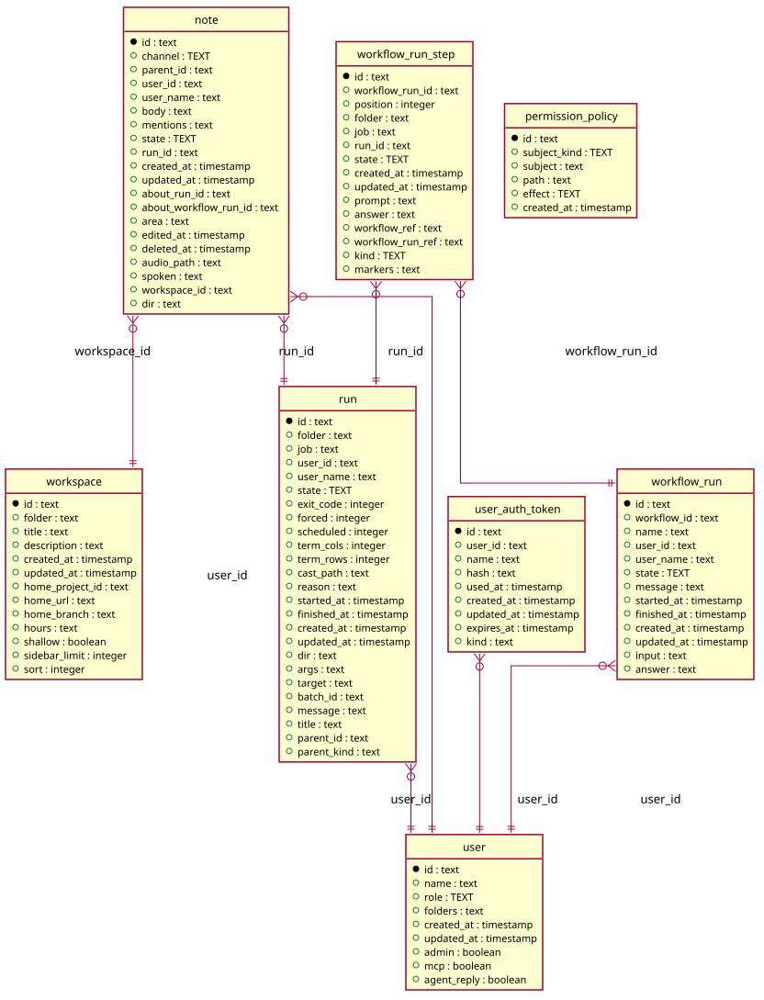

# Sign in

Generated from the module by `atkins docs`. DO NOT EDIT.

## Pages

| Method | Path                 | Answered by                              |
|--------|----------------------|------------------------------------------|
| `GET`  | `/login`             | [`mod_login.php`](mod_login.php)         |
| `GET`  | `/keys`              | [`mod_my_keys.php`](mod_my_keys.php)     |
| `GET`  | `/users/{name}`      | [`mod_profile.php`](mod_profile.php)     |
| `GET`  | `/users/{name}/edit` | [`mod_user_edit.php`](mod_user_edit.php) |

## The data model

### `note`

Note

| Column                  | Type        | Key     |
|-------------------------|-------------|---------|
| `id`                    | `text`      | primary |
| `channel`               | `TEXT`      | indexed |
| `parent_id`             | `text`      | indexed |
| `user_id`               | `text`      | indexed |
| `user_name`             | `text`      |         |
| `body`                  | `text`      |         |
| `mentions`              | `text`      |         |
| `state`                 | `TEXT`      | indexed |
| `run_id`                | `text`      | indexed |
| `created_at`            | `timestamp` |         |
| `updated_at`            | `timestamp` |         |
| `about_run_id`          | `text`      | indexed |
| `about_workflow_run_id` | `text`      | indexed |
| `area`                  | `text`      |         |
| `edited_at`             | `timestamp` |         |
| `deleted_at`            | `timestamp` | indexed |
| `audio_path`            | `text`      |         |
| `spoken`                | `text`      |         |
| `workspace_id`          | `text`      | indexed |
| `dir`                   | `text`      | indexed |

### `permission_policy`

Permission Policy

| Column         | Type        | Key     |
|----------------|-------------|---------|
| `id`           | `text`      | primary |
| `subject_kind` | `TEXT`      | indexed |
| `subject`      | `text`      | indexed |
| `path`         | `text`      | indexed |
| `effect`       | `TEXT`      |         |
| `created_at`   | `timestamp` |         |

### `run`

Run

| Column        | Type        | Key     |
|---------------|-------------|---------|
| `id`          | `text`      | primary |
| `folder`      | `text`      | indexed |
| `job`         | `text`      | indexed |
| `user_id`     | `text`      | indexed |
| `user_name`   | `text`      |         |
| `state`       | `TEXT`      | indexed |
| `exit_code`   | `integer`   |         |
| `forced`      | `integer`   |         |
| `scheduled`   | `integer`   |         |
| `term_cols`   | `integer`   |         |
| `term_rows`   | `integer`   |         |
| `cast_path`   | `text`      |         |
| `reason`      | `text`      |         |
| `started_at`  | `timestamp` | indexed |
| `finished_at` | `timestamp` |         |
| `created_at`  | `timestamp` |         |
| `updated_at`  | `timestamp` |         |
| `dir`         | `text`      |         |
| `args`        | `text`      |         |
| `target`      | `text`      |         |
| `batch_id`    | `text`      | indexed |
| `message`     | `text`      |         |
| `title`       | `text`      |         |
| `parent_id`   | `text`      | indexed |
| `parent_kind` | `text`      |         |

### `user`

User

| Column        | Type        | Key     |
|---------------|-------------|---------|
| `id`          | `text`      | primary |
| `name`        | `text`      | indexed |
| `role`        | `TEXT`      |         |
| `folders`     | `text`      |         |
| `created_at`  | `timestamp` |         |
| `updated_at`  | `timestamp` |         |
| `admin`       | `boolean`   |         |
| `mcp`         | `boolean`   |         |
| `agent_reply` | `boolean`   |         |

### `user_auth_token`

User Auth Token

| Column       | Type        | Key     |
|--------------|-------------|---------|
| `id`         | `text`      | primary |
| `user_id`    | `text`      | indexed |
| `name`       | `text`      | indexed |
| `hash`       | `text`      | indexed |
| `used_at`    | `timestamp` |         |
| `created_at` | `timestamp` |         |
| `updated_at` | `timestamp` |         |
| `expires_at` | `timestamp` |         |
| `kind`       | `text`      | indexed |

### `workflow_run`

Workflow Run

| Column        | Type        | Key     |
|---------------|-------------|---------|
| `id`          | `text`      | primary |
| `workflow_id` | `text`      | indexed |
| `name`        | `text`      |         |
| `user_id`     | `text`      | indexed |
| `user_name`   | `text`      |         |
| `state`       | `TEXT`      | indexed |
| `message`     | `text`      |         |
| `started_at`  | `timestamp` | indexed |
| `finished_at` | `timestamp` |         |
| `created_at`  | `timestamp` |         |
| `updated_at`  | `timestamp` |         |
| `input`       | `text`      |         |
| `answer`      | `text`      |         |

### `workflow_run_step`

Workflow Run Step

| Column             | Type        | Key     |
|--------------------|-------------|---------|
| `id`               | `text`      | primary |
| `workflow_run_id`  | `text`      | indexed |
| `position`         | `integer`   | indexed |
| `folder`           | `text`      |         |
| `job`              | `text`      |         |
| `run_id`           | `text`      | indexed |
| `state`            | `TEXT`      |         |
| `created_at`       | `timestamp` |         |
| `updated_at`       | `timestamp` |         |
| `prompt`           | `text`      |         |
| `answer`           | `text`      |         |
| `workflow_ref`     | `text`      |         |
| `workflow_run_ref` | `text`      |         |
| `kind`             | `TEXT`      |         |
| `markers`          | `text`      |         |

### `workspace`

Workspace

| Column            | Type        | Key     |
|-------------------|-------------|---------|
| `id`              | `text`      | primary |
| `folder`          | `text`      | indexed |
| `title`           | `text`      |         |
| `description`     | `text`      |         |
| `created_at`      | `timestamp` |         |
| `updated_at`      | `timestamp` |         |
| `home_project_id` | `text`      | indexed |
| `home_url`        | `text`      |         |
| `home_branch`     | `text`      |         |
| `hours`           | `text`      |         |
| `shallow`         | `boolean`   |         |
| `sidebar_limit`   | `integer`   |         |
| `sort`            | `integer`   |         |

## Operations

### `Users`

Users reads the user table: one user by ID or by name, every user by name, how many there are, how many are admins, and the agents a reply may be written as. The table is this module's, which draws the sign in page, a user's own page and the form that edits one. What a user may do - the role, the folders, the permissions - is Task\User.

| Method          | What it does                                   |
|-----------------|------------------------------------------------|
| `get($id)`      | get is one user by ID, or null.                |
| `byName($name)` | byName is one user by name, or null.           |
| `all()`         | all is every user, by name.                    |
| `count()`       | count is how many users there are.             |
| `admins()`      | admins is how many users carry the admin flag. |
| `agents()`      | agents is every user an agent may reply as.    |

---

The tables come from `tables()` on `mod_login`, `mod_my_keys`, `mod_profile`, `mod_user_edit`. The operations are the classes of `storage/`, which hold every statement this module runs.
